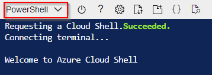
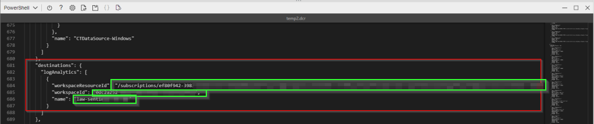
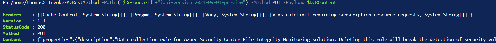
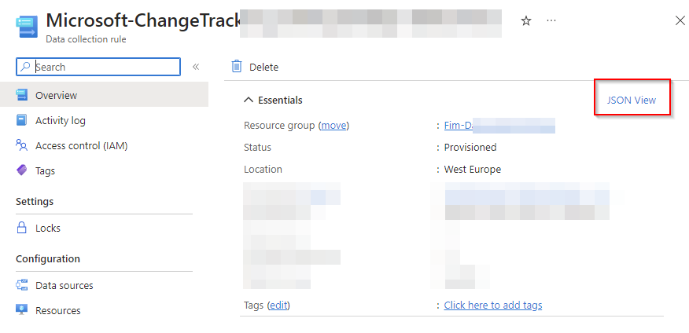

+++
date = '2023-03-27T18:45:40+01:00'
lastmod = '2023-04-13T21:48:32+01:00'
draft = false
title = "Tutorial: Change the workspace destination of your already provisioned Data Collection Rule used by the Azure Monitoring Agent"
slug = 'tutorial-change-the-workspace-destination-of-you-data-collection-rule'
description = "This post is inspired on different setups I saw while working with my clients. More and more clients are leveraging the Azure Monitoring Agent (AMA) and Data Collection Rules (DCR) to collect log…"
author = 'Thomas Verheyden'
tags = ["Azure Monitor Agent", "Data Collection Rule", "Defender for Cloud"]
categories = ["Defender for Cloud"]

[cover]
  image = 'view-data-collection-rules.png'
  hiddenInSingle = false
+++

### Intro

This post is inspired on different setups I saw while working with my clients. More and more clients are leveraging the Azure Monitoring Agent (AMA) and Data Collection Rules (DCR) to collect log data. I’ve noticed that clients sometimes are sending logs data to different Log Analytics Workspace (LAW), without them being aware. Most of the time this is because Azure will create default LAW workspaces without warning about it or they just misconfigured the Data Collection Rule.

I would always advise to centralise your log data to one Log Analytics workspace especially if you are using Microsoft Sentinel. Centralizing log data will reduce the complexity of managing multiple workspaces and in querying data from them where possible. But because of compliance reason like having different region requirements, different tenants, split billing this isn’t always achievable.

To centralise the log data we need to modify the destination of the LAW in the DCR definition file. At the moment changing the destination of the LAW isn’t possible from the Azure portal. That’s why I’m writing this tutorial to describe how to edit the definition of Data Collection Rule that has been already provisioned using command lines tools

### Prerequisites

Before you can start editing the Data Collection rule, there are some prerequisites that needs to be fulfilled:

- Contributor rights on the Log Analytics workspace
- Permissions to create Data Collection Rule objects in the workspace
- Access to Azure Cloud Shell
- DCR resource id
- New LAW destination
  - id
  - Resource id
  - Name

### Retrieve the definition file of DCR

The first step will be retrieving the definition file of the Data Collection Rule you would like to edit. This can be done with Cloud Shell button in the Azure portal.


*Cloud shell*

Make sure you set the Cloud Shell environment to **Powershell**



*Powershell environment*

Execute the following commands to retrieve the definition file and save it to a file. The definition file will be stored as a .JSON file. The command will place a HTTP GET call to retrieve the DCR definition file and format the JSON to a readable text.

```powershell
$ResourceId = "<ResourceId>" # Resource ID of the DCR to edit
$FilePath = "<FilePath>" # Store DCR content in this file
$DCR = Invoke-AzRestMethod -Path ("$ResourceId"+"?api-version=2021-09-01-preview") -Method GET
$DCR.Content | ConvertFrom-Json | ConvertTo-Json -Depth 20 | Out-File -FilePath $FilePath
```

### Edit the definition file

The code editor supplied with the environment is a good tool to use. Alternatively you can download the file from the Cloud shell. You can find a explanation how to do that [here](https://learn.microsoft.com/en-us/azure/cloud-shell/using-the-shell-window#upload-and-download-files).

```
code "Edit.dcr"
```



*Definition file*

Scroll down in the editor and locate the line containing “**Destinations**” attribute. There you will see “**workspaceResourceid**“, “**workspaceid**“,”**name**” under **“logAnalytics**” . You need to modify the value of those lines with your new destination Log Analytics Workspace id, Resourceid and name. After you modified all the three values you can save the file in the editor.

### Update the DCR with the modified definition file

Execute the following commands to load DCR content from the file and place HTTP call to update the DCR in the system. Replace `<ResourceId>` with DCR ResourceID and `<FilePath>` with the name of the file modified in the previous part of the tutorial. You can omit first two lines if you read and write to the DCR within the same PowerShell session.

Upon succesfull , you will get the response with status code “200”, indicating that your DCR is now updated as in the example below:



*PUT request result*

### Validate you modification

As an Extra control check you navigate to your Data Collection Rule in the Azure portal and examine the definition file via the ‘JSON VIEW” function.



*Data Collectio Rule in Azure portal*

### Putting everything together

Now, when we know how to read and update the content of a DCR, let’s put everything together into utility script, which can be used to perform both operations together. Save the the script as DCEEditor.ps1 .

```powershell
param ([Parameter(Mandatory=$true)] $ResourceId)

# get DCR content and put into a file
$FilePath = "temp.dcr"
$DCR = Invoke-AzRestMethod -Path ("$ResourceId"+"?api-version=2021-09-01-preview") -Method GET
$DCR.Content | ConvertFrom-Json | ConvertTo-Json -Depth 20 | Out-File $FilePath

# Open DCR in code editor
code $FilePath | Wait-Process

#Wait for confirmation to apply changes
$Output = Read-Host "Apply changes to DCR (Y/N)? "
if ("Y" -eq $Output.toupper())
{ 
	#write DCR content back from the file
	$DCRContent = Get-Content $FilePath -Raw
	Invoke-AzRestMethod -Path ("$ResourceId"+"?api-version=2021-09-01-preview") -Method PUT -Payload $DCRContent		
}

#Delete temporary file
Remove-Item $FilePath
```

You can use this script for example if you want to modify the Data Collection Rule with Resource ID of /subscriptions/xxxxxxxx-xxxx-xxxx-xxxx-xxxxxxxxxxxx/resourceGroups/foo/providers/Microsoft.Insights/dataCollectionRules/tempDCR , this could be accomplished by running the follow command:

```
.\DCREditor.ps1 "/subscriptions/xxxxxxxx-xxxx-xxxx-xxxx-xxxxxxxxxxxx/resourceGroups/foo/providers/Microsoft.Insights/dataCollectionRules/bar"
```

DCR content will open in embedded code editor. Once editing is complete, entering “Y” on script prompt will apply changes back to the DCR.

Source:

[Microsoft docs](https://learn.microsoft.com/en-us/azure/azure-monitor/essentials/data-collection-rule-edit)
