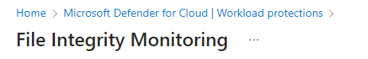
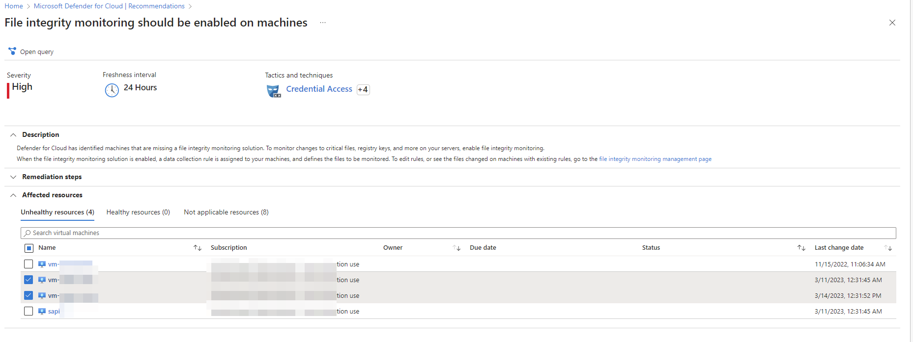
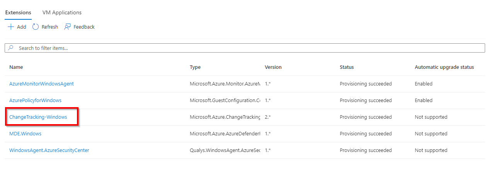
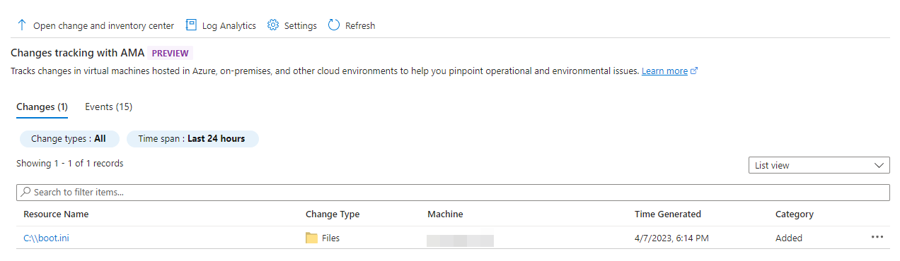
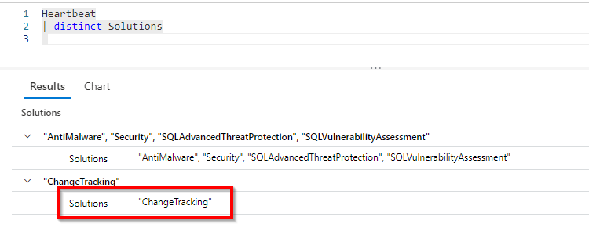
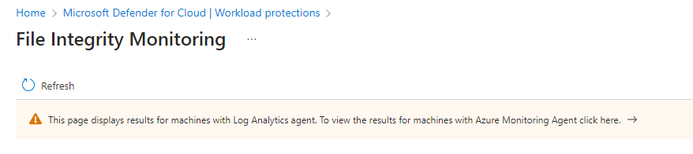
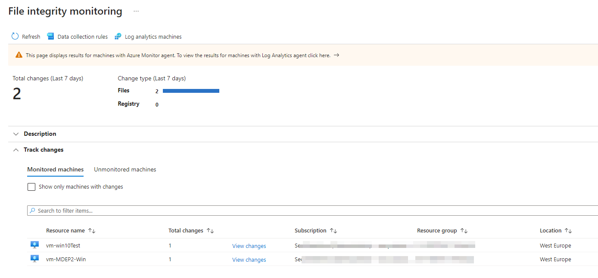
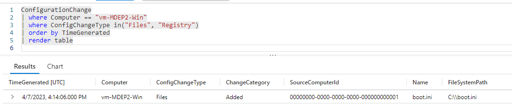

+++
date = '2023-04-19T14:40:38+01:00'
lastmod = '2023-06-19T12:28:20+01:00'
draft = false
title = "Unleash the power of Defender for Servers Plan 2: File integrity monitoring – Part 1"
slug = 'advanced-protection-features-in-defender-for-servers-plan-2-file-integrity-monitoring-part-1'
description = "Welcome to part 1 of the blog series about enhanced protection features available in Defender for Servers Plan 2. Part 1 will be about  the protection feature called File Integrity Monitoring…"
author = 'Thomas Verheyden'
tags = ["Advanced protection features series", "Defender for Cloud", "Defender for Servers"]
categories = ["Defender for Cloud"]
+++

## Intro

Welcome to part 1 of the blog series about enhanced protection features available in Defender for Servers Plan 2. Part 1 will be about  the protection feature called **File Integrity Monitoring (FIM)** in Defender for cloud.

## Intro

Welcome to part 1 of the blog series about enhanced protection features available in Defender for Servers Plan 2. Part 1 will be about  the protection feature called **File Integrity Monitoring (FIM)** in Defender for cloud.

## What is FIM

File Integrity Monitoring (FIM) is an ongoing process which gets you visibility into all of your sensitive files, detecting changes and tampering of critical system files or directories that would indicate an ongoing attack. Knowing if any of these files have been tampered with is critical to keep your infrastructure secure, helping you detect attacks at an early stage and investigate them afterwards. FIM studies your operating systems files, Windows registries, application software and linux system files for changes that might be suspicious such as:

- File and registry key creation or removal
- File modifications (changes in file size, access control lists, and hash of the content)
- Registry modifications (changes in size, access control lists, type, and content)

FIM uses the Azure Change tracking solution in the background to track and identify changes on your operating systems. Change tracking forwards the collected data to a Log Analytics workspace. Devices connected to the Log Analytics workspace can both use the Log Analytics agent or Azure Monitor Agent to collect data about changes.   
  
In this blog I will only explain how to enable File Integrity monitoring when using the Azure Monitor agent, which is currently still in preview, because the Log Analytics Agent will be deprecated soon.  The Azure Monitor Agent (AMA) collects data from devices according to data collection rules to define a list of files and registry to track. You can use the Microsoft default configuration of tracked files and registry keys but you can always edit the DCR to add, remove, or update the list tracked by FIM. Change Tracking is supported on all operating systems that [meet AMA requirements.](https://learn.microsoft.com/en-us/azure/azure-monitor/agents/agents-overview#supported-operating-systems)

For tracking changes in files on both Windows and Linux, Change Tracking uses MD5 hashes of the files. The feature uses the hashes to detect if changes have been made since the last inventory. The next table shows the data collection frequency for the types of changes supported by Change Tracking. For every type, the data snapshot of the current state is also refreshed at least every 24 hours.

| **Change Type** | **Frequency** |
| --- | --- |
| Windows registry | 50 minutes |
| Windows File | 30 minutes |
| Linux file | 15 minutes |
| Windows services | Default: 30 minutes |
| Linux daemons | 5 minutes |
| Windows software | 30 minutes |
| Linux software | 5 minutes |

### Limitations

There are some limitation of Change tracking to keep in mind:

- Recursion for Windows registry tracking
- Network file systems
- Different installation methods
- \*.exe files stored on Windows
- The Max File Size column and values are unused in the current implementation.
- If you are tracking file changes, it is limited to a file size of 5 MB or less.
- If the file size appears >1.25MB, then FileContentChecksum is incorrect due to memory constraints in the checksum calculation.
- If you try to collect more than 2500 files in a 30-minute collection cycle, Change Tracking and Inventory performance might be degraded.
- If network traffic is high, change records can take up to six hours to display.
- If you modify a configuration while a machine or server is shut down, it might post changes belonging to the previous configuration.
- Collecting Hotfix updates on Windows Server 2016 Core RS3 machines.
- Linux daemons might show a changed state even though no change has occurred. This issue arises because of the way the SvcRunLevels data in the Azure Monitor [ConfigurationChange](https://learn.microsoft.com/en-us/azure/azure-monitor/reference/tables/configurationchange) table is written.

## How to get started

Maintaining an asset inventory is the first step in your FIM implementation process. **You cannot secure what you can’t see,** and thus, having a list of files and directories that are important for you is the very first best practice you must implement in your infrastructure.

Create and maintain a comprehensive list of the files and directories that need monitoring. These assets include system and configuration files, as well as files containing sensitive information. While many of these files will depend on the actual business use case, there are a common set of assets that you certainly want to be monitored. When you have your assets and list of files ready you can start with enabling FIM.

> ℹ️ A word of caution here: Too big of a scope will cause too many alerts, and it can lead to too many false positives and alert fatigue, rendering your whole FIM untrustable and worthless.

### Availability

| **Aspect** | **Details** |
| --- | --- |
| Release state | Preview |
| License | Requires Microsoft Defender for Servers Plan 2 |
| Required roles and permissions | Owner Contributor |
| Clouds | screenshot Commercial clouds – Supported only in regions: australiaeast, australiasoutheast, canadacentral, centralindia, centralus, eastasia, eastus2euap, eastus, eastus2, francecentral, japaneast, koreacentral, northcentralus, northeurope, southcentralus, southeastasia, switzerlandnorth, uksouth, westcentralus, westeurope, westus, westus2 screenshot National (Azure Government, Azure China 21Vianet) [screenshotAzure Arc](https://learn.microsoft.com/en-us/azure/azure-arc/servers/overview) enabled devices. screenshot Connected AWS accounts screenshot Connected GCP accounts |

### Prerequisites

To enable FIM on devices with AMA:

- Enable Defender for Servers Plan 2 on subscription and Log Analytics workspace level
- Install AMA on machines that you want to monitor

## Enable FIM with the Azure Monitor Agent

There are different ways to enable FIM, you can enable the different components one by one or you can use the Secure score Recommendation. I would like to suggest to use the Recommendation.

From Defender for Cloud’s sidebar, open the Recommendations page.

1. Select the ‘**All recommendations’** tab and search for **‘File integrity monitoring should be enabled on machines**‘
2. Select the machines on the unhealthy resources tab you would like to enable FIM on.
3. Click on Fix

*Recommendation FIM*

The Fix will do the following steps:

- Installs the ChangeTracking-Windows or ChangeTracking-Linux extensions on the machines
- Generates a Data Collection Rule (DCR) for the subscription, named Microsoft-ChangeTracking-[subscriptionId]-default-dcr, that defines what files and registries should be monitored based on default settings.
- Creates a new Log Analytics workspace with the naming convention defaultWorkspace-[subscriptionId]-fim and with the default workspace settings.

**Note: if you use the default workspace make sure you enable defender for servers plan 2 on the workspace level.**

> ⛔ **Warning: In some cases you would not like to forward the events to a default workspace created by Microsoft, for instance if you want to forward the events to your Sentinel workspace. In one of my previous blogs I explained how you can change the workspace destination of Data Collection Rules. Which you can find [here](/2023/03/27/tutorial-change-the-workspace-destination-of-you-data-collection-rule/).**

## Validate your deployment & troubleshoot tips

Don’t expect to see results directly , give it some time. In this section I will point to some ways to validate you configuration on the device and in the Azure Portal.

In the Azure portal the first thing you could check is if the ‘ChangeTracking-Windows’ extension is provisioned successfully for windows devices. For linux devices the extension name is ‘ChangeTracking-Linux’. You can check this by going to virtual machines resources. Select your virtual machine. In the sidepanel under settings you will see Extensions + applications as you see in the screenshot below:

*Extension: ChangeTracking-Windows*

When you  navigate to the virtual machine, you will have in the sidepanel under Operations ‘Change Tracking’. If Change Tracking is configured correctly you will see the screen with the text ‘Change tracking with AMA’. If Change Tracking already detected some file changes you will see which file has been changed. In this example I created the file ‘boot.ini’ which is being monitored by Change tracking.

*Changes tracking with AMA*

Another way you could check is, if the AMA agent is sending data to the Log Analytics workspace your configured in the previous steps. This can be done with the table ‘Heartbeat’ available in the logs of the log analytic workspace. Here you could see if the AMA agent is sending data correctly to the workspace. The table field ‘Solutions’ most contain ‘ChangeTracking’ as you can see in the screenshot below:

*Solutions: ChangeTracking*

On the Windows devices you can check the following files:

- C:\WindowsAzure\Logs\Plugins\Microsoft.Azure.ChangeTrackingAndInventory.ChangeTracking-Windows\2.8.1.0\CommandExecution.txt
  - *Check if the installation successfully completed*
- C:\WindowsAzure\Logs\Plugins\Microsoft.Azure.ChangeTrackingAndInventory.ChangeTracking-Windows\2.8.1.0\cta\_windows\_agent.txt
  - *Check if there are any Errors.*

- /var/log/azure/Microsoft.Azure.ChangeTrackingAndInventory.ChangeTracking-Linux/CommandExecution.txt
  - *Check if the installation successfully completed*
- /var/log/azure/Microsoft.Azure.ChangeTrackingAndInventory.ChangeTracking-Linux/cta\_linux\_agent.txt
  - *Check if there are any Errors*

The following Windows services needs to be in the ‘running state’ locally on the device:

- Change\_tracking\_agent\_windows\_amd64.exe
- Change\_tracking\_service.exe

The following Linux services needs to be in the ‘running state’ locally on the device::

- Cxp.service – Azure Change tracking Parent Daemon

## Detecting changes

Default no alert will be created in Defender for Cloud when a change is being detected. There are only two ways you could check if a change happened:

- In Defender for Cloud under workload protection and the File integrity Monitoring page
- The logs in the workspace hunting with KQL

### Azure portal

[In the Azure Portal](https://portal.azure.com/#view/Microsoft_Azure_Security/FileIntegrityMonitoringWorkspaceSelectorBlade) you can validate if any changes happened via the File Integrity Monitoring page. Because we are using the Azure Monitor Agent you need to select the banner to see the results:

*Azure Monitoring Agent Banner*

*File Integrity monitoring*

### Log hunting with KQL

Using the logs available in the Log Analytics workspace will be very useful if you would like to detect the changes in like Microsoft Sentinel. Change tacking of important files could be a use case in your detection engineering process. You can use the table ‘ConfigurationChange’ to build you KQL query. This table contains a lot of interesting fields, for instance Acls, PreviousAcls, DateModified, FieldsChanged etc. A reference of this table can you find [here](https://learn.microsoft.com/en-us/azure/azure-monitor/reference/tables/configurationchange).

Below you see an example which could be used:

*KQL query example*

## Edit the list of your tracked files

FIM for machines with Azure Monitor Agent uses [Data Collection Rules (DCRs)](https://learn.microsoft.com/en-us/azure/azure-monitor/essentials/data-collection-rule-overview) to define the list of files and registry keys to track. Each subscription has a DCR for the machines in that subscription.

FIM creates DCRs with a default configuration of tracked files and registry keys. You can edit the DCRs to add, remove, or update the list of files and registries that are tracked by FIM.

To edit the list of tracked files and registries:

1. In File integrity monitoring, select Data collection rules.  
   You can see each of the rules that were created for the subscriptions that you have access to.
2. Select the DCR that you want to update for a subscription.  
   Each file in the list of Windows registry keys, Windows files, and Linux files contains a definition for a file or registry key, including name, path, and other options. You can also set Enabled to False to untrack the file or registry key without removing the definition.  
   Learn more about [system file and registry key definitions](https://learn.microsoft.com/en-us/azure/automation/change-tracking/manage-change-tracking#track-files).
3. Select a file, and then add or edit the file or registry key definition.
4. Select Add to save the changes.

## RECAP

This blog discusses the importance of file integrity monitoring in protecting servers from cyber threats. I begin by explaining what file integrity monitoring is and how it works. Then I describe the benefits of file integrity monitoring, including detecting unauthorized changes to files and identifying potential security breaches.  
  
I provided a step-by-step guide on how to set up file integrity monitoring in Defender for Cloud with some additional troubleshooting tips and tricks. How you can detect changes by using the KQL query language and I ended with a guidance to change the list of your tracked files.   
  
I hope this was instructive. If you have any comments or concerts you can always contact me on my socials (see below) or via [the contact form](/about/#get-in-touch).

*Sources:*

*<https://learn.microsoft.com/en-us/azure/azure-monitor/reference/tables/configurationchange>  
<https://learn.microsoft.com/en-us/azure/automation/change-tracking/enable-vms-monitoring-agent?tabs=singlevm>  
<https://learn.microsoft.com/en-us/azure/automation/change-tracking/overview-monitoring-agent>  
<https://sysdig.com/blog/file-integrity-monitoring/>*
