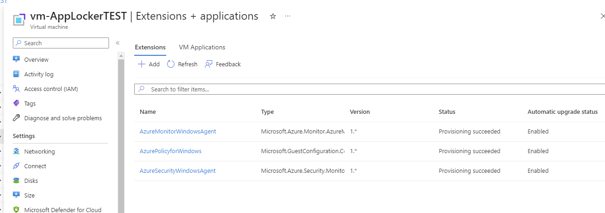
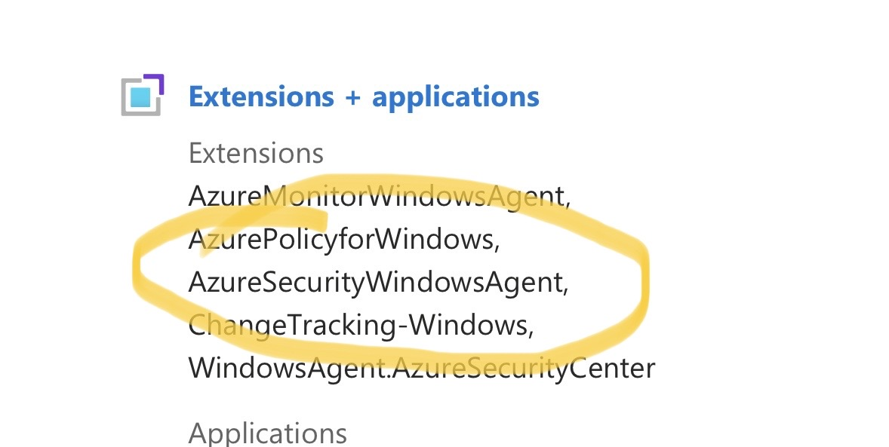
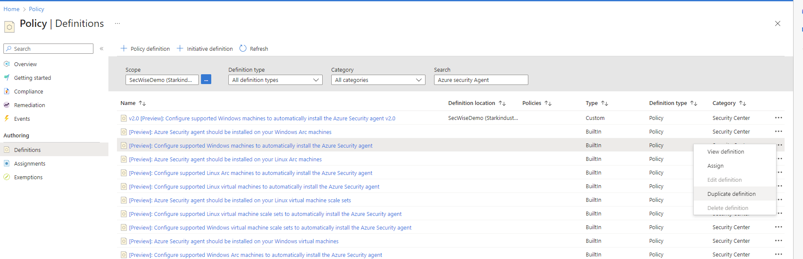

+++
date = '2023-05-04T09:39:19+01:00'
lastmod = '2023-05-05T11:51:44+01:00'
draft = false
title = "How to work around the Azure Security Agent extension not deploying by default on the latest VM windows images, a currently know limitation…"
slug = 'how-to-work-around-the-azure-security-agent-extension-not-deploying-by-default-on-the-latest-vm-windows-images-a-currently-know-limitation'
description = "This blog will be about an issue I bumped into when deploying one of the enhanced protection features in defender for cloud. The enhanced feature, adaptive application control, requires the…"
author = 'Thomas Verheyden'
tags = ["Azure Monitor Agent", "Defender for Cloud", "Defender for Servers"]
categories = ["Defender for Cloud"]
+++

## Intro

This blog will be about an issue I bumped into when deploying one of the enhanced protection features in defender for cloud. The enhanced feature, adaptive application control, requires the deployment of the Azure Monitor Agent. The Azure Monitoring Agent also installs additional extensions. One of those additional extensions is the Azure Security Agent (ASA) extension, which supports Endpoint Protection recommendations, fileless attack detection and adaptive application control. The ASA extension is by default automatically installed when the auto-provisioning is enabled for the Azure Monitoring Agent in Defender for Cloud. The ASA extension is also the reason I started this blog post because during my deployment the extension was only provisioned on one of my virtual machines. I had to figure out what was the reason behind this…

## Setup

Three virtual machines with the following images:

- Windows Server 2019 Datacenter – x64 Gen2 (imageSKU name: 2019-datacenter-gensecond)
- Windows server 2019 Datacenter – x64 Gen1 (ImageSKU name: 2019-datacenter)
- Windows server 2022 Datacenter – x64 Gen2 (ImageSKU name: 2022-datacenter-g2)

*Note: Keep an eye on the imageSKU names because they will be important later on.*

Defender for Cloud:

- Defender for servers P2 was enabled on subscription and workspace level.
- Auto provisioning of the Azure Monitor Agent was configured

## Find the root cause

After creating the virtual machines the auto provisioning from Defender for Cloud started kicking in. The AMA agent started to get deployed on the all three machines. I was expecting that the ASA extension will follow shortly after, but this was only the case on one of the three machines. The extension was only installed on the machine with the imageSKU “2019-datacenter”. I started to troubleshoot why this wasnt the case on the other machines by reviewing the local logs. After a while I quickly realized I didn’t yet found any sign of this extension even trying to get installed. The provisioning of the extension also wasn’t visible in azure portal on the resource level…



*Virtual machine without the ASA extension*



*Virtual machine with the ASA extension*

I’m aware that they are other possibilities available to deploy the AMA agent with the ASA extension to your virtual machines, like with Azure Policy. You got the following policy initiative, current in preview, available in Azure called **‘Custom Defender for Cloud provisioning Azure Monitor agent’** which exist out of different other policies. One of those policies is the policy  named ‘**[Preview]: Configure supported Windows machines to automatically install the Azure Security agent’**. With this policy we could install the ASA agent to the machines which are missing the ASA extension.

I was wondering what was defined in the Azure Policy definition file…  after reviewing the definition file I quickly found out what the root cause was of this ASA extension not deploying, if of course Microsoft is using the same definition file behind the scenes for the auto-provisioning feature in Defender for Cloud. In the definition file there is a part about the supported imagesSKU’s. When you have a look at the supported imageSKU you will see the following result:

```json
    {
                    "field": "Microsoft.Compute/imageSKU",
                    "in": [
                      "2008-R2-SP1",
                      "2008-R2-SP1-smalldisk",
                      "2012-Datacenter",
                      "2012-Datacenter-smalldisk",
                      "2012-R2-Datacenter",
                      "2012-R2-Datacenter-smalldisk",
                      "2016-Datacenter",
                      "2016-Datacenter-Server-Core",
                      "2016-Datacenter-Server-Core-smalldisk",
                      "2016-Datacenter-smalldisk",
                      "2016-Datacenter-with-Containers",
                      "2016-Datacenter-with-RDSH",
                      "2019-Datacenter",
                      "2019-Datacenter-Core",
                      "2019-Datacenter-Core-smalldisk",
                      "2019-Datacenter-Core-with-Containers",
                      "2019-Datacenter-Core-with-Containers-smalldisk",
                      "2019-Datacenter-smalldisk",
                      "2019-Datacenter-with-Containers",
                      "2019-Datacenter-with-Containers-smalldisk",
                      "2019-Datacenter-zhcn"
                    ]
    }
```

As you can see, only one of the three VM images that I used are supported. The last update of this Azure Policy is 30 september 2022 and still in preview. After contacting Program managers from Defender for Cloud, they told me that they are aware of this limitation…

## How to work around the limitation

By duplicating the policies we can modify the definition file of the policy by adding the other imageSKU values to the file or by creating a broader supported scope. I choose the last approach because otherwise it coould be that later on you need to modify the definition file again. To configure this follow the next steps:

1. Go to Azure policy portal and on the sidebar choose Definitions. In the search bar search for ‘Azure Security Agent’.
2. [Policy – Microsoft Azure](https://portal.azure.com/#view/Microsoft_Azure_Policy/PolicyMenuBlade/~/Definitions)
3. Select the policy: ‘[Preview]: Configure supported Windows machines to automatically install the Azure Security agent’ and on the right click on ‘Duplicate Definition.



4. Choose a Definition location, give the Policy an name.
5. Select a the Category: Use existing
6. Modify the policy rule by going to line containing “field”: “Microsoft.Compute/imageSKU”
7. Replace it with the following value:

```json
   {
		                  "anyOf": [
		                    {
		                      "field": "Microsoft.Compute/imageSku",
		                      "like": "2008-R2-SP1*"
		                    },
		                    {
		                      "field": "Microsoft.Compute/imageSku",
		                      "like": "2012-*"
		                    },
		                    {
		                      "field": "Microsoft.Compute/imageSku",
		                      "like": "2016-*"
		                    },
		                    {
		                      "field": "Microsoft.Compute/imageSku",
		                      "like": "2019-*"
		                    },
						 {
		                      "field": "Microsoft.Compute/imageSku",
		                      "like": "2022-*"
		                    }
		                  ]
}
```

8. Click on Save

Now you are done with creating the new policy and you can start using this custom Azure policy to deploy the ASA agent to all of your virtual machines and start using the advanced features that comes with Defender for Cloud !
