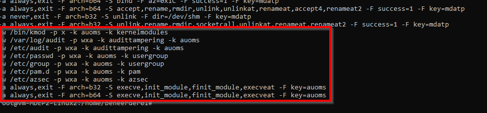
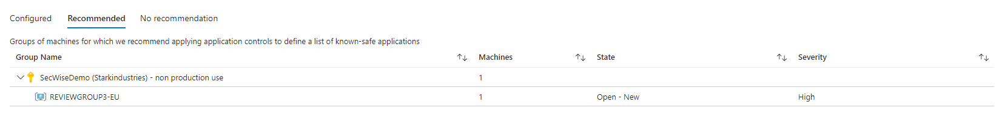
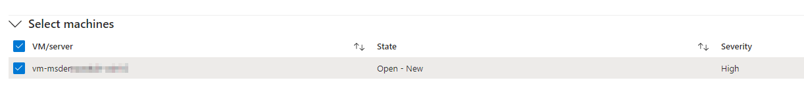
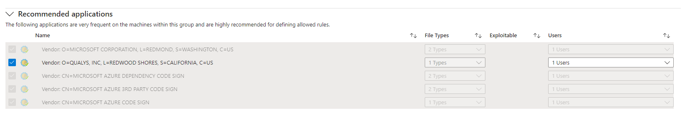
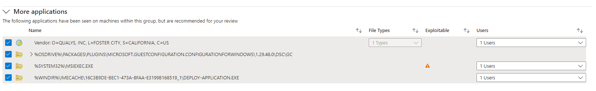
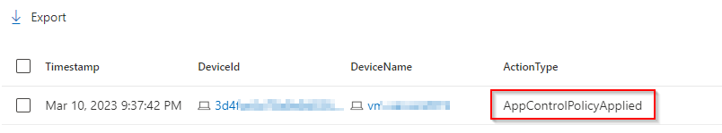
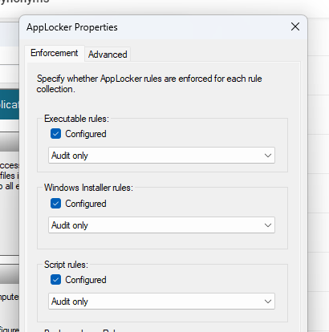
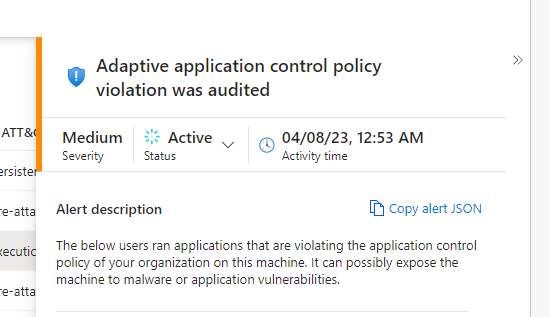
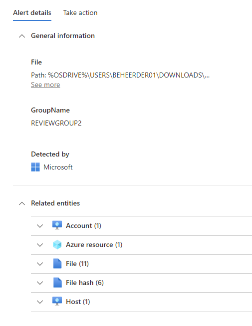

+++
date = '2023-05-17T15:50:15+01:00'
lastmod = '2023-06-12T12:27:40+01:00'
draft = false
title = "Unleash the power of Defender for Servers Plan 2: Adaptive Application Controls – Part 2"
slug = 'advanced-protection-features-in-defender-for-servers-plan-2-adaptive-application-controls-part-2'
description = "Welcome, this is the second part of the Defender for server P2 advanced protection series I will blog about.  If you want to read the other parts they can be found here: The topic of this blog…"
author = 'Thomas Verheyden'
tags = ["Advanced protection features series", "Defender for Cloud", "Defender for Servers"]
categories = ["Defender for Cloud"]
+++

Welcome, this is the second part of the Defender for server P2 advanced protection series I will blog about.  If you want to read the other parts they can be found here:

- [Part 0](/2023/04/07/advanced-protection-features-in-defender-for-servers-plan-2-the-intro-part-0/)
- [Part 1](/2023/04/19/advanced-protection-features-in-defender-for-servers-plan-2-file-integrity-monitoring-part-1/)

The topic of this blog will be about how to start with adaptive application controls (ACC). Let’s begin with explaining high level what adaptive application controls is and later on we will dive into the technical configuration of this security feature.

## What is Adaptive application controls

Adaptive applications controls is a security control designed to protect machines against malware and other untrusted software. It works by defining a list of applications that you allow to run on your machines hosted in Azure VM, Non-Azure machines or Azure Arc machines running either Windows or Linux operating systems. You don’t have to start with a blank allow list on paper, you can use Defender for Cloud machine learning capabilities to analyze the applications running on your servers and create a list of know-safe applications for you. It even looks for possibilities to group the different servers so the same policy can apply to multi servers.

Currently no enforcement options are available, when adaptive applications controls detect a application which is not in the know applications list it will create an alert in Defender for Cloud. This feature is available in commercial clouds, National (Azure Government , Azure China 21Vianet and Connected AWS accounts.

In the background it leverage AppLocker capabilities on windows devices to configure the allowed list in Audit mode only, which limits you to controlling applications only running on the system.  Because it’s using Applocker you don’t have the chain of trust from the hardware to the kernel that Windows Defender Application Control(WADC) offers. In my opinion WDAC is much more powerful and versatile, but if you don’t have any experience the learning curve can be hard and ACC can be a good starting point. Additionally, you will have the benefit that you can audit your applications also on Linux machines. Especially if you want a simple to deploy and quick overview of what the impact will be if you start using application white listing security controls ACC is a good starting point.

## How does it work: behind the scenes

> ℹ️ Disclaimer: Before I begin to explain how this work in more detail, the information I’m providing is all unofficial information. It’s all being gained by monitoring the product behavior. It can be that I’m missing some details but the bigger picture should be correct.

### For windows devices:

1. It all starts when you are deploying the Azure Monitor Agent. The AMA agent will also deploy additional required extensions to the device like the Azure Security Agent (ASA).
2. The Azure Security Agent (ASA) gets deployment on the machine. Called ‘AzureSecurityWindowsAgent’ extension in the Azure.
3. The ASA extension is responsible for enabling Applocker in Audit mode for Executable rules, Windows Installer rules, scripts rules. You can verify this in your Local Security Policy > Application Control Policies > Applocker
4. Applocker start creating audit events of all the running applications. You can check this in the event viewer and the AMA agent will forward the events to your configured Log Analytics Workspace. You can hunt for them with eventID 8002 in the SecurityEvent table.
5. Defender for Cloud will use machine learning to analyze the App Locker events in your workspace.

### For linux:

1. It all starts when you are deploying the Azure Monitor Agent. The AMA agent will also deploy required additional extensions to the device like the Azure Security Agent (ASA).
2. The Azure Security Agent (ASA) gets deployment on the machine. Called ‘AzureSecurityLinuxAgent’ extension in the Azure.
3. The ASA extension is responsible for created rules in the audit deamon. Like you can see in the example below.

*Audit deamon configuration on Linux*

4. Audit deamon will create events and will store them in audit.log file. You can verify this on your machine on the follow location: “/var/log/audit/audit.log”
5. Those events will be forwarded by the AMA agent to Defender for Cloud
6. Defender for Cloud will used machine learning to analyze the events and will propose a recommendation

## How to start with adaptive application controls

### Design principals

A short section on proposed design principals, my advice will be the following design principals:

- Keep it simple
- Pick your targets
- Have a well-defined process for application management and deployment.

By keeping it simple I mean don’t try to  push different AppLocker/ACC policies on the same device or mix the different application controls policies like AppLocker, WDAC, ADD. It’s good to know that ACC will not provide any know-safe application list if there already other AppLocker policies active coming from GPO or local security. Try to determine where ACC can be most used full or where it will be very difficult to manage. Domain controllers are a good target to start from because normally installing or running software other than the roles, admin tools and security applications aren’t  necessary for domain controllers.  A well-defined process for application management will make your implementation trouble-free because you will have an overview of the (approved) applications being deployed in your organization which make the process of creating on the allowed list less painless.

### Requirements

**License:** Requires Microsoft defender for server plan 2

**Required Roles and permissions:**

- Security Reader and Reader roles can both view groups and the lists of know-safe applications
- Contributor and Security Admin roles can both edit groups and the lists of known-safe applications

**Required Agents:** Azure Monitoring Agent or Log Analytics Agent

### Configure adaptive application controls

I would suggest to begin with reviewing the suggested allowlist provided by defender for cloud per group of servers.

Before you can use this it is good to know that defender for cloud needs at least two weeks of data to define the unique recommendations per group of servers and a working Azure Monitoring Agent or Log Analytics Agent sending events to the correct workspace.

You can find adaptive application controls by going to Defender for cloud >  Workload protection > adaptive application controls. Under Recommend you will find a group of machines which Defender for Cloud recommend applying application controls for. In my environment, you see the group ‘REVIEWGROUP3-EU’:

**Overview of recommend audit settings**

When you click on the group, you can see all the recommend guidance to configure the Application control rule:

Select machines: All the machines Defender for cloud suggest to bundle

**Selected machine**

Recommend applications: here you see frequently used applications on the selected machines and highly recommended for defining in the allowed rules determined by the machine learning technology in DFC.  In the example all the applications are defined by their publisher. You will see a path rule created when an application isn’t signed. You can also define which users this rule need to apply to. My advice is here is to apply it to all users or at least use the principle of least privilege. One of the negatives I don’t like is that you can’t see the file type from this policy. Later on I will demonstrate a solution to determine the file type of the rule. Currently three file types are supported for windows:

- Exe
- MSI
- Script

**Recommended applications**

More Applications: Applications that have been seen on the machines but are requires a review. You will also see a warning icon indicates that a specific application could be used by an adversary to bypass an Adaptive application control. You can always deselect an application recommendation if you don’t want it to be allowed.

**Additional Applications**

When you are agree with the defined policy, you can click on Audit on the bottom of the page.

### Monitor your deployment

I was wondering how fast the policy would kick in on a Window machine. I’m aware that Microsoft sends telemetry data of Applocker/WDAC events to your Defender for Endpoint tenant. I was hoping to see if you could see the audit of potentially blocked applications also from the telemetry data.

But this wasn’t the case. After enabling the ACC policy I could only see event data appearing about the policy being applied in the DeviceEvents table located under the actiontype ‘AppControlPolicyApplied’.

*MDE telemetry data*

This telemetry data is created if the process (%SystemRoot%\System32\AppIdPolicyConverter.exe) started running on the machine which reads the new applocker XML rules and try to apply them. If you like to read more detail about this, I suggest to read [this article](https://www.microsoftpressstore.com/articles/article.aspx?p=2228450&seqNum=11).  
  
I didn’t find any more data that was related to ACC/Applocker in the tables. It also explains that Microsoft just create audit rules in applocker and allows every application to run for everyone. Otherwise we would see more telemetry data related to this. You can also verify if this is the case in the configuration of the Local Security Policy AppLocker.

*Local Applocker properties*

### Alerting

Defender for Cloud will create an alert when you violate an adaptive application control policy. Within the alert you will receive more additional Information about the incident. For instance, related entities (Account ,Azure resource, file , file hash etc. ), general information with file or publisher detection logic.

*Example Alert*

*Alert details*

## Conclusion

Adaptive application controls is a security feature that could be a good starting point when you want to implement application white listing on your machines and you have minor experience with other solutions. It’s currently limited only to audit mode. If you would like to use a more versatile solution i would advise to have a look at Windows Application Control.

I hope this was instructive. If you have any comments or questions you can always contact me on my socials ( @ThomasVrhydn ) or via [the contact form](/contact/).

*Source*s  
  
*<https://www.microsoftpressstore.com/articles/article.aspx?p=2228450&seqNum=11>  
<https://learn.microsoft.com/en-us/azure/defender-for-cloud/adaptive-application-controls>*
