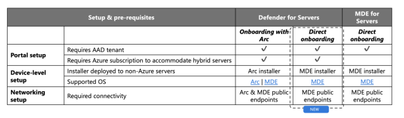
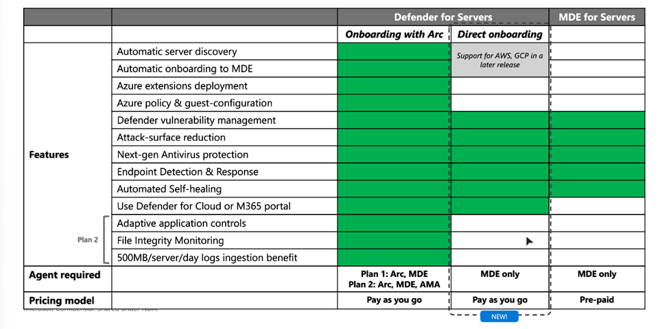
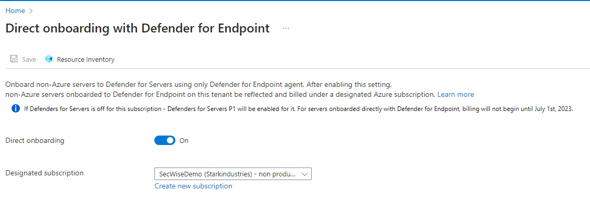
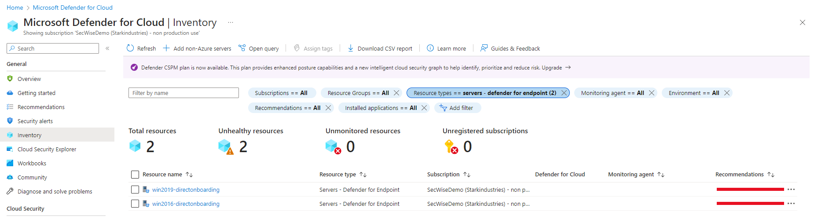
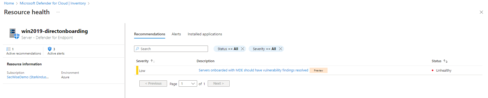
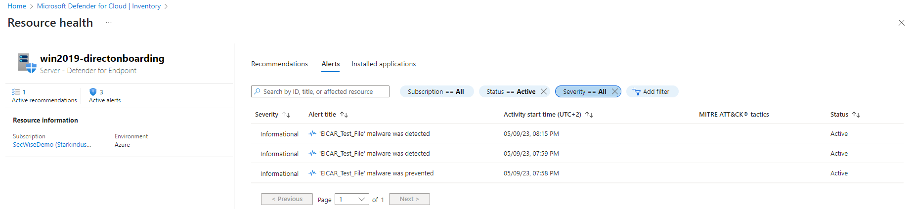
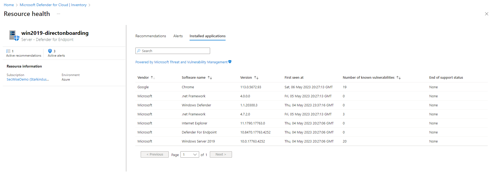

+++
date = '2023-06-05T19:46:44+01:00'
lastmod = '2023-06-05T21:22:41+01:00'
draft = false
title = "Direct on board your non-Azure servers to defender for cloud WITHOUT Azure Arc"
slug = 'direct-on-board-your-non-azure-servers-to-defender-for-cloud-without-azure-arc'
description = "How to onboard non-Azure servers to Defender for Servers directly through the Defender for Endpoint agent, without deploying Azure Arc."
author = 'Thomas Verheyden'
tags = ["Defender for Cloud", "Defender for Servers"]
categories = ["Defender for Cloud"]
+++

## Intro

Up until now, onboarding non-Azure servers to Defender for Servers required Azure Arc as a mandatory pre-requisite. With this new release, Microsoft is introducing an additional direct onboarding path for non-Azure servers that does not require Azure Arc (making it optional rather than mandatory).

With this new onboarding capability, you can deploy the MDE agent directly to your non-Azure servers and seamlessly connect them to Defender for Servers. This option is ideal for customers who want to focus on core endpoint protection while utilizing the consumption-based licensing provided by Defender for Servers.

This new capability is currently only possible tenant wide and will have impact on newly and existing onboarded servers. All windows and Linux servers operating system supported by Defender for Endpoint are supported. This capability is created for On-premises servers and multicloud VMs (limited support).

Setup and pre-requisites

## Good to know

Before you begin there are some things which are good to know and will help you with deciding if you want to leverage this new capability.

**Required permissions**

To configure this setting, you need **Subscription Owner** (on the chosen subscription), and **AAD Global Administrator** or **AAD Security Administrator**

**Plan support**

Direct onboarding provides access to all Defender for Servers Plan 1 features. If you want to use Plan 2, not all features will work. This is because some features in Plan 2 still require the deployment of the Azure Monitor Agent, which is only available with Azure Arc on non-Azure machines. If you enable Plan 2 on your subscription, machines onboarded directly with Defender for Endpoint have access to all Defender for Servers Plan 1 features and the Defender Vulnerability Management Addon features included in Plan 2.

*Overview of the different onboarding capabilities*

**Multi-cloud support**

You can directly onboard VMs in AWS and GCP using the Defender for Endpoint agent. However, if you plan to simultaneously connect your AWS or GCP account to Defender for Servers using multicloud connectors, it’s currently still recommended by Microsoft to deploy Azure Arc.

**Simultaneous onboarding limited support**

Defender for Cloud makes a best effort to correlate servers onboarded using multiple billing methods. However, in certain server deployment use cases, there may be limitations where Defender for Cloud is unable to correlate your machines. This may result in overcharges on certain devices if direct onboarding is also enabled on your tenant. Microsoft created a good overview of the deployment use cases currently with this limitation:

| Location | Deployment use case |
| --- | --- |
| All | Windows Server (all versions) Azure VMs or Azure Arc machines already onboarded and billed by Defender for Servers via an Azure subscription or Log Analytics workspace, running the Defender for Endpoint agent without the MDE.Windows or MDE.Linux Azure extensions. For such machines, you can enable Defender for Cloud integration with Defender for Endpoint to deploy the extensions. |
| On-premises (not running Azure Arc) | Windows Server 2019: Servers already onboarded and billed by Defender for Servers P2 via the Log Analytics workspace  Windows Server 2012, 2016: Servers running the Defender for Endpoint modern unified agent, and already billed by Defender for Servers P2 via the Log Analytics workspace |
| AWS, GCP (not running Azure Arc) | Windows Server 2019: Servers already onboarded and billed by Defender for Servers via multicloud connectors, Log Analytics workspace, or both.  Windows Server 2012, 2016: AWS or GCP VMs using the modern unified Defender for Endpoint solution, already onboarded and billed by Defender for Servers via multicloud connectors, Log Analytics workspace, or both. |

Deployment use cases with current limitation

## How to get started?

**Enabling direct onboarding**

1. Go to **Defender for Cloud** > **Environment Settings** > **Direct onboarding**.
2. Switch the **Direct onboarding** toggle to **On**.
3. Select the subscription you would like to use for servers onboarded directly with Defender for Endpoint. I will advise to use a separate subscription. This subscription is only used for licensing, billing, alerts and security insights but doesn’t provide server management.
4. Select **Save**.

*Direct onboarding in the portal*

**Deploying Defender for Endpoint on your non-Azure servers**

Before you begin your non-Azure servers need to be onboarded in Defender for Cloud. You can use the same guidance as if you would not use the defender for cloud integration. Refer to the [Defender for Endpoint onboarding guide](https://learn.microsoft.com/en-us/microsoft-365/security/defender-endpoint/onboarding) for further instructions.

**Monitor the status**

After you enabled the direct onboarding on your tenant level, you non-Azure machines will create a object in Defender for Cloud. You can validate this by reviewing the Inventory and filter on resource type “Servers – Defender for Endpoint”

*Inventory: new resource type*

**Recommendation**

Defender for Cloud will also provide some recommendation for your onboarded machine as you can see in the example below:

*Recommendations in DFC*

**Alerts**

When malware is detected on the devices , an alert will be created which will be available both in the Defender for Endpoint portal as in the Defender for Cloud portal:

*Alerts in DFC*

**Installed applications**

A list of installed applications will be available powered by Microsoft Treat and vulnerability Management.

*Installed applications in DFC*

**Conclusion**

This new onboarding capability is a nice welcomed solution. With this Microsoft created an answer for a requested solution by a lot of customers. But be aware that this is currently a tenant wide setting and it will have impact on already onboarded non-Azure servers (non Azure-ARC). If you have a mixed environment with different Defender for Servers Plans it is recommend in my opinion to work with different landing zones. I’m looking forward till more features gets supported.

*Sources*

[Onboard non-Azure machines with Defender for Endpoint | Microsoft Learn](https://learn.microsoft.com/en-us/azure/defender-for-cloud/onboard-machines-with-defender-for-endpoint#availability)

*Private preview – **Direct Onboarding with MDE to Defender for Servers without arc Private Preview***
