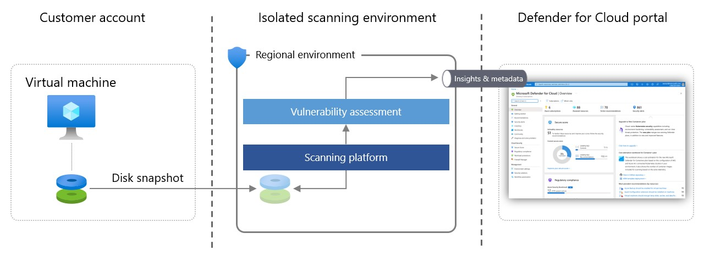
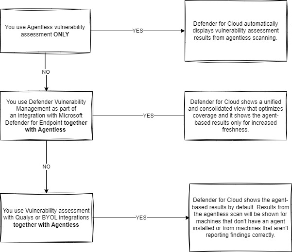
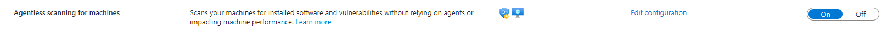
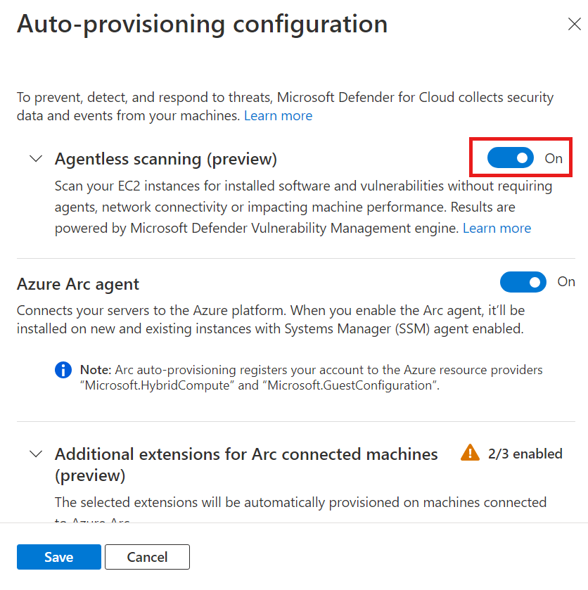
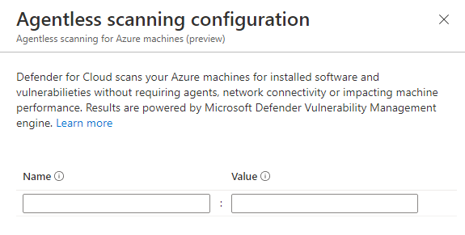
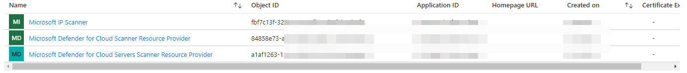
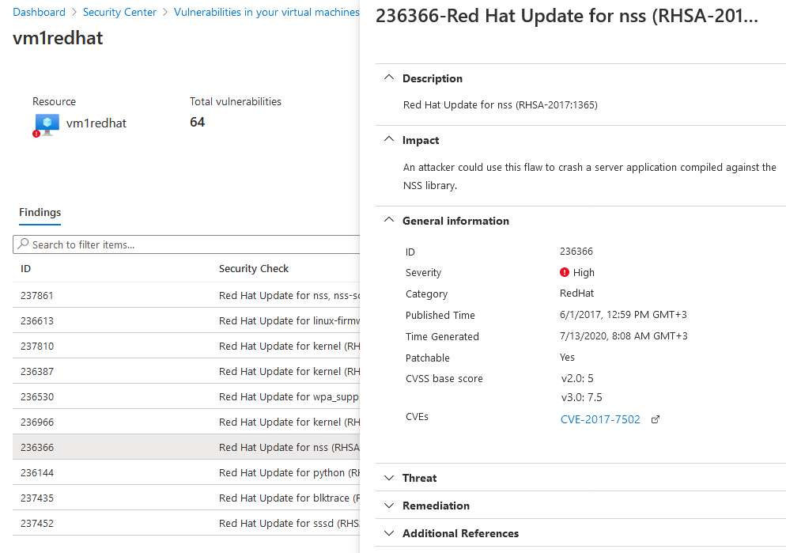

+++
date = '2023-06-14T13:53:39+01:00'
lastmod = '2023-06-14T14:34:32+01:00'
draft = false
title = "Unleash the power of Defender for Servers Plan 2: Agentless scanning – part 3"
slug = 'unleash-the-power-of-defender-for-servers-plan-2-agentless-scanning-part-3'
description = "What agentless scanning in Defender for Servers Plan 2 is, how it works behind the scenes and how to enable it. Part 3 of the series."
author = 'Thomas Verheyden'
tags = ["Advanced protection features series", "Defender for Cloud", "Defender for Endpoint", "Defender for Servers"]
categories = ["Defender for Cloud"]
+++

## Intro

Welcome to part three of the blog series on Unleach the power of Defender for Servers Plan 2! In our previous blog, we explored how to start implementing Adaptive Application control.  In part 3, we’ll dive into the concept of agentless scanning, which is included in Defender for Cloud Plan 2. We’ll explore what agentless scanning is, how it works, and how to get started implementing this tool for securing your cloud environment. By the end of this post, you’ll have a solid understanding of what agentless scanning is.

## What is Agent less scanning

Agentless scanning for virtual machines (VMs) doesn’t require any installation, it utilizes cloud APIs for data collection. Defender for Cloud captures snapshots of VM disks and performs a offline analysis of the operating system configuration and file system contained within the snapshot which leverage Microsoft Defender Vulnerability Management in the backend. Because the scanning process is offline analysis, it doesn’t have any impact on the actual workload.

This copied snapshot remains within the original compute region of the VM and each VM is scanned every 24 hours.

Once the required data is collected from the disk, the copied snapshot is immediately deleted, and the (meta)data is sent to Microsoft engines for analysis of potential threats and configuration gaps. Since the scanning process is an out-of-band analysis of snapshots, it doesn’t impact the actual workloads and isn’t visible by the guest operating system.

Agentless scanning protects disk snapshots according to Microsoft’s security standards. To ensure VM snapshots are private and secure during the analysis process, some of the measures taken by Microsoft are:

- Data is encrypted at rest and in-transit.
- Snapshots are immediately deleted when the analysis process is complete.
- Snapshots remain within their original AWS or Azure region. EC2 snapshots aren’t copied to Azure.
- Isolation of environments per customer account/subscription.
- Only metadata containing scan results is sent outside the isolated scanning environment.
- All operations are audited.

The scanning environment in which disk analysis is conducted is regional, volatile, isolated, and highly secure according to Microsoft. Disk snapshots and any data unrelated to the scan are not stored for any longer than necessary to gather the metadata, usually only a few minutes.



Agentless scanning is included in Defender Cloud Security Posture Management (CSPM) and Defender for Servers P2 plans, agentless scanning is enabled on by default.

It’s currently only available for:

- Azure
  - Standard VMs
  - Virtual machine scale set – Flex
- AWS
  - EC2
  - Auto Scale instance

When enabling this feature you also need to keep in mind your Encryption active on your VM. Unencrypted and Encrypted with managed disks using Azure Storage Encryption with PMK is only supported for Azure VMs. For AWS, encrypted and encrypted with PML/CMK is supported.

## Compatibility with agent-based vulnerability assessment solutions

Defender for Cloud already supports different agent-based vulnerability scans, including [Microsoft Defender Vulnerability Management](https://learn.microsoft.com/en-us/azure/defender-for-cloud/deploy-vulnerability-assessment-defender-vulnerability-management), [BYOL](https://learn.microsoft.com/en-us/azure/defender-for-cloud/deploy-vulnerability-assessment-byol-vm) and [Qualys](https://learn.microsoft.com/en-us/azure/defender-for-cloud/deploy-vulnerability-assessment-vm). Agentless scanning extends the visibility of Defender for Cloud to reach more devices which currently don’t have a vulnerability agent installed.

I created the following flow chart to understand the compatibility with agent-based vulnerability assessment solutions.



## Enabling agentless scanning for machines

When you enable [Defender Cloud Security Posture Management (CSPM)](https://learn.microsoft.com/en-us/azure/defender-for-cloud/concept-cloud-security-posture-management) or [Defender for Servers P2](https://learn.microsoft.com/en-us/azure/defender-for-cloud/defender-for-servers-introduction), agentless scanning is enabled on by default.

If you have Defender for Servers P2 already enabled and agentless scanning is turned off, you need to turn on agentless scanning manually.

### Agentless vulnerability assessment on Azure

**To enable agentless vulnerability assessment on Azure**:

1. From Defender for Cloud’s menu, open **Environment settings**.
2. Select the relevant subscription.
3. Select **Settings & monitoring**.
4. In the settings pane, turn on **Agentless scanning for machines**.



### Agentless vulnerability assessment on AWS

1. From Defender for Cloud’s menu, open **Environment settings**.
2. Select the relevant account.
3. Select **Settings**, turn on **Agentless scanning for machines**.
4. Select **Save and Next: Configure Access**.



6. Download the CloudFormation template.
7. Using the downloaded CloudFormation template, create the stack in AWS as instructed on screen. If you’re onboarding a management account, you’ll need to run the CloudFormation template both as Stack and as StackSet. Connectors will be created for the member accounts up to 24 hours after the onboarding.
8. Select **Next: Review and generate**.
9. Select **Update**.

## Exclude machines from scanning

Agentless scanning applies to all of the eligible machines in the subscription. To prevent specific machines from being scanned, you can exclude machines from agentless scanning based on your pre-existing environment tags. When Defender for Cloud performs the continuous discovery for machines, excluded machines are skipped.

To configure machines for exclusion:

1. From Defender for Cloud’s menu, open **Environment settings**.
2. Select the relevant subscription or multicloud connector.
3. For either the Defender Cloud Security Posture Management (CSPM) or Defender for Servers P2 plan, select **Settings**.
4. For agentless scanning, select **Edit configuration**.
5. Enter the tag name and value that applies to the machines that you want to exempt. You can enter multiple tag:value pairs.
6. Select **Save** to apply the changes.

## Deploy by using Azure policy

If you want to enable Agentless scanning on all your subscription and subscriptions made in the future I would advise to enable this feature with Azure Policy. They ARM template can be found [here](https://github.com/Azure/Microsoft-Defender-for-Cloud/tree/main/Pricing%20%26%20Settings/Azure%20Policy%20definitions/Servers%20agentless%20scanning).

You will need to have the Object id of the Microsoft Defender for Cloud Scanner Resource provider, which is unique for every Azure AD. You can find the ID in Azure AD under Enterprise applications. Don’t forget to change the filter to ‘All applications’.



In the next couple of weeks I will create a separate blog how to deploy all the support Vulnerability managed solution in defender for cloud with Azure Policy.

## View and remediate findings

There are different solutions available to review your findings in Defender for Cloud. In this section I will describe the following presentations:

- By using recommendations
- By using a workbook
- By using the Azure Resource Graph

### Recommendations

To view vulnerability assessment findings (from all of your configured scanners) and remediate identified vulnerabilities:

1. From Defender for Cloud’s menu, open the **Recommendations** page.
2. Select the recommendation **Machines should have vulnerability findings resolved**. Defender for Cloud shows you all the findings for all VMs in the currently selected subscriptions. The findings are ordered by severity.
3. To filter the findings by a specific VM, open the “Affected resources” section and click the VM that interests you. Or you can select a VM from the resource health view, and view all relevant recommendations for that resource. Defender for Cloud shows the findings for that VM, ordered by severity.



4. To learn more about a specific vulnerability, select it. The details pane that appears contains extensive information about the vulnerability, including:
   - Links to all relevant CVEs (where available)
   - Remediation steps
   - Any additional reference pages
5. To remediate a finding, follow the remediation steps from this details pane.

### Disable findings

If you have an organizational need to ignore a finding, rather than remediate it, you can optionally disable it. Disabled findings don’t impact your secure score or generate unwanted noise.

When a finding matches the criteria you’ve defined in your disable rules, it won’t appear in the list of findings. Typical scenarios include:

- Disable findings with severity below medium
- Disable findings that are non-patchable
- Disable findings with CVSS score below 6.5
- Disable findings with specific text in the security check or category (for example, “RedHat”, “CentOS Security Update for sudo”)

## Workbook: Vulnerabilities by CVE IDs

Tom Janetscheck, Senior program manager at Microsoft, created a very useful workbook that i suggest to start using. It’s an interactive workbook which provides an overview of machines in your environment that are affected by open vulnerabilities with a focus on CVE IDs.

The workbook can be found [here](https://github.com/Azure/Microsoft-Defender-for-Cloud/tree/main/Workbooks/CVE%20Dashboard).  
  
As you might notice the workbook would not show data directly from Agentless scanning but either Microsoft Defender Vulnerability Management, or the integrated Qualys VA scanner. Still i find it worth to mention it. Especially if you are combining agentless with agent based solutions.

## Azure Resource Graph

To export vulnerability assessment results, you can leverage the Azure Resource Graph (ARG). This tool provides instant access to resource information across your cloud environments with filtering, grouping, and sorting capabilities. It’s a quick and efficient way to query information across Azure subscriptions programmatically or from within the Azure portal. Is also has a API available. Below you can find a query where you can look up the vulnerability based on source and CVE IDs:

```kql
securityresources
| where type == "microsoft.security/assessments/subassessments"
| extend assessmentKey = extract(".*assessments/(.+?)/.*",1, id)
| where assessmentKey == "1195afff-c881-495e-9bc5-1486211ae03f"
| project Resource = tolower(extract("([\\s\\S]*?)(/providers/Microsoft.Security.*)",1,id)), ResourceGroup = trim_end("/",extract(".*resourceGroups/(.+?)/",0,id)), ResourceType = tolower(split(id,"/").[6]), subscriptionId, status = tostring(parse_json(properties).status.code), VulnId = tostring(parse_json(properties).id), description = tostring(parse_json(properties).displayName), cve = parse_json(properties.additionalData).cve, SoftwareVendor = tostring(properties.additionalData.softwareVendor), SoftwareName = tostring(properties.additionalData.softwareName), SoftwareVersion = tostring(properties.additionalData.softwareVersion), Source = tostring(properties.additionalData.source),  severityFilter = tostring("'High','Medium','Low'")
| where status == 'Unhealthy'
| where Source == "Microsoft threat and vulnerability management"
| mvexpand todynamic(cve)
| extend severity = tostring(cve['severity']),
    publishedDate = todatetime(cve['publishedDate']),
    lastModifiedDate = todatetime(cve['lastModifiedDate'])
| where severityFilter has severity
| summarize affectedMachines = dcount(Resource) by CVEID = tostring(cve['title']), cvssScore = todouble(cve['cvssScore']), severity, description = tostring(cve['description']), format_datetime(publishedDate, 'yyyy-MM-dd, hh:mm'), format_datetime(lastModifiedDate, 'yyyy-MM-dd, hh:mm'), hasPublicExploit = tostring(cve['hasPublicExploit']), isExploitVerified = tostring(cve['isExploitVerified']), exploitabilityLevel = tostring(cve['exploitabilityLevel'])
| order by cvssScore, affectedMachines
```

There are two important fields to keep in mind. The first one is the assessmentKey with value  “1195afff-c881-495e-9bc5-1486211ae03f”, This is the value for the security recommendation “Machines should have vulnerability finds resolved” . The other one is the Vulnerability agent source value. Here you can determine if you only want to see the results of one source or of all the sources. The value for Qualys is “Built-in Qualys vulnerability assessment”. The source value for findings founds by agentless scanning is Microsoft threat and vulnerability management.

Sources:

[Exporting Vulnerability Assessment Results in Microsoft Defender for Cloud – Microsoft Community Hub](https://techcommunity.microsoft.com/t5/microsoft-defender-for-cloud/exporting-vulnerability-assessment-results-in-microsoft-defender/ba-p/1212091)

[Microsoft-Defender-for-Cloud/Workbooks/CVE Dashboard at main · Azure/Microsoft-Defender-for-Cloud · GitHub](https://github.com/Azure/Microsoft-Defender-for-Cloud/tree/main/Workbooks/CVE%20Dashboard)

Sean Stark – CCP program for the Azure policy overview
