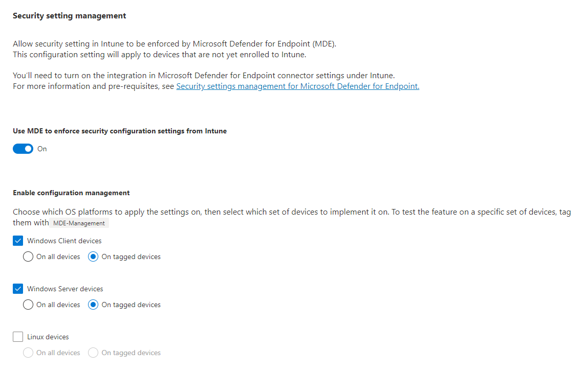
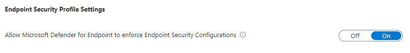
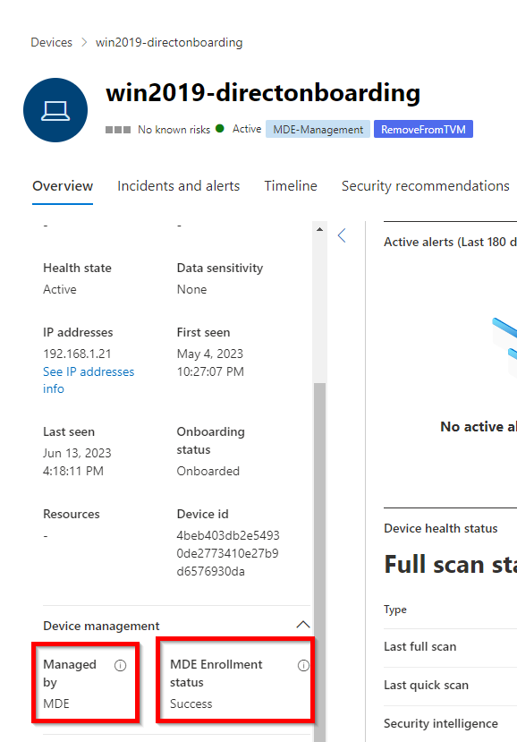
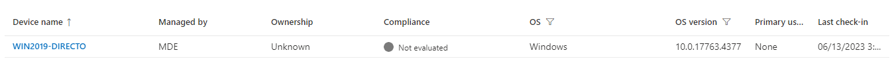
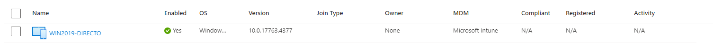

+++
date = '2023-06-15T10:54:47+01:00'
lastmod = '2023-07-17T20:37:17+01:00'
draft = false
title = "Microsoft Defender for Endpoint settings management: Enhancements"
slug = 'microsoft-defender-for-endpoint-settings-management-enhancements'
description = "*UPDATE 17/07/2023* Added extra information about system labels Intro Microsoft is doing a very good job at listening to their customers, partners and MVP’s lately. One of the highly requested…"
author = 'Thomas Verheyden'
tags = ["Defender for Endpoint", "Defender for Servers"]
categories = ["Defender for Endpoint"]
+++

\*UPDATE 17/07/2023\* Added extra information about system labels

## Intro

Microsoft is doing a very good job at listening to their customers, partners and MVP’s lately. One of the highly requested feature was to simplify the requirements for their MDE settings management (AKA ‘MDE Attach’) . But that’s not all, more exciting news will be announced soon. So stay tuned !

## Whats New?

MDE Settings Management (AKA “MDE Attach”) was made Generally Available in May 2022 for Windows Operating Systems. Microsoft decided to simplify its AAD-registration component by relying on a lightweight ‘synthetic’ registration.

In the current version of MDE Security Configuration Management, (AKA “MDE Attach V1”), devices leveraging this feature require to be fully registered to Azure AD in order to be managed. The new process Microsoft is introducing (AKA “MDE Attach V2”) will not require this anymore. Instead, the lightweight ‘synthetic’ registration process will create a ‘placeholder’ identity for a device in the AAD tenant that is affiliated to the MDE tenant. Thanks to this object in the Azure directory, devices can be grouped and targeted with policies – despite not being fully registered to the Azure AD.

If a device is in scope for MDE Attach V2 and already has an Azure AD identity (fully registered), Microsoft will not create a duplicate entry in Azure AD. The existing identity will be leveraged for targeting security settings.

## Migration impact

Customers already using this functionality will seamlessly transition to the updated infrastructure with no impact for their existing Windows devices managed by Defender for Endpoint that are using this functionality. Endpoint security policies will continue to apply as expected. Additionally, there will be no changes to the device, its identity, or registration type. Any new devices enrolled into security settings management for Defender for Endpoint will use the updated infrastructure.

> ⚠️ **Important:** If a Windows device was managed by Defender for Endpoint via security settings management for Defender for Endpoint but was unable to enroll due to not being Azure AD joined or Hybrid Azure AD joined (like domain controllers), these devices will now succeed enrollment and policies targeted to the device will apply. Once enrolled, the device will appear in the device lists for Microsoft 365 Defender, Microsoft Intune, and Azure AD portals. Note that while the device won’t be fully registered with Azure AD it’ll still count as one device object.

> ⚠️ To filter for devices that were previously unable to enroll in Defender for Endpoint due to not meeting the Azure AD join or Hybrid Azure AD join pre-requisite, navigate to the Microsoft 365 Defender portal > **Devices** list and filter by enrollment status. Since these devices are still not fully registered, they’ll show the device attributes where **MDM = Intune** and **Join Type = Blank**. With the new release, these will begin to successfully enroll.

## Enabling the MDE settings management “V2”

### Prerequisites

Supported Operating Systems  
Windows OS:  
▪ Windows 10 Professional/Enterprise (from KB5006738)  
▪ Windows 11 Professional/Enterprise  
▪ Windows Server 2012 R2 with Microsoft Defender for Down-Level Devices\*  
▪ Windows Server 2016 with Microsoft Defender for Down-Level Devices\*  
▪ Windows Server 2019 (with KB5006744)  
▪ Windows Server 2022 (with KB5006745)  
\*Down level servers will be supported by MDE Attach starting June 1st via the Windows Update  
(KB5005292 containing Sense version 10.8295.22621.1023).

### User Permissions

In Microsoft Defender for Endpoint portal, as a security admin, you’ll need at minimum permissions to view/edit security settings (“Manage security settings in Security Center”). In the Intune/Microsoft Endpoint Manager (MEM) portal, request for your IT administrator to grant you (security admin) with the Microsoft Endpoint Manager’s Endpoint Security Manager built-in RBAC role.

## Configure M365D tenant

If you are using MDE Attach V1 already then you don’t have to configure anything new. Otherwise, you need to follow the steps below to enable the MDE Settings management V2.

While onboarding your Windows endpoint to MDE, make sure they are also in scope for MDE attach, by going to the “Enforcement Scope” section of the M365D portal. I recommend to initially test the feature only on tagged devices (by adding the “MDE-Management” tag on a device in the  
M365D portal).

M365 Defender portal > Settings > Enforcement Scope

Security setting management

### Configure Intune Tenant

In the Intune portal, select Endpoint security > Microsoft Defender for Endpoint, and set Allow  
Microsoft Defender for Endpoint to enforce Endpoint Security Configurations to On.  
Select Save

Enble MDE integration for security Configuration

When you set this option to On, all devices in the platform scope in Microsoft Defender for Endpoint that aren’t managed by Microsoft Endpoint Manager will qualify to onboard Microsoft Defender for Endpoint.

## Create AAD group

After devices onboard to Defender for Endpoint, you’ll need to create device groups to support  
deployment of policy for Microsoft Defender for Endpoint. To identify devices that have enrolled with  
Microsoft Defender for Endpoint but aren’t managed by Intune or Configuration Manager:

1. Sign in to Microsoft Endpoint Manager admin center.
2. Go to Devices > All devices, and then select the column Managed by to sort the view of devices. Devices that onboard to Microsoft Defender for Endpoint but aren’t managed by Intune display Microsoft Defender for Endpoint in the Managed by column. These are the devices that can receive policies via MDE-attach. ( systemlables property containing the ‘MDEmanaged’ value’ )
3. You can create groups for these devices in Azure AD or from within the Microsoft Endpoint  
   Manager admin center

\*UPDATE 17/07/2023\*  
  
The V2 mechanism will not support the System Labels ([“MDEJoined” and “MDEManaged”](https://learn.microsoft.com/en-us/mem/intune/protect/mde-security-integration#create-azure-ad-groups)) which were previously supported. Action Item: If you haven’t created dynamic AAD groups based on these system labels, please ignore the steps below. If you did create dynamic groups based on these, Microsoft recommendation is to review your AAD groups:

1. Microsoft recommend dynamically grouping based on device’s OS type and not using the management channel as a grouping criteria. Note that you can now also dynamically [group servers in AAD](https://techcommunity.microsoft.com/t5/intune-customer-success/windows-server-devices-now-recognized-as-a-new-os-in-intune/ba-p/3767773).
2. *(less preferred)* If you still intend to dynamically group devices in Azure AD based on the management channel, Microsoft recommend using the “Management Type” = “MicrosoftSense” attribute instead of the “MDEManaged” system label
3. *(less preferred)* use the supported “MDEManaged” system label

## Troubleshooting TIPS

### Enrollment issues

1. In the M365D device inventory, confirm that the device is using MDE-attach by checking its  
   status in the “Managed By” column. This is available also available in the device side panel or  
   device page and should consistently indicate Managed By “MDE”.
2. In the device side panel or device, you can also confirm it’s successfully enrolled by checking the device’s ‘MDE Enrollment status’ is “Success”

Managed by and MDE Enrollment status

3. In the Intune portal, search for the device name in the All Devices page. The device should  
appear here as well with the Managed By column field set to “MDE”:

Managed by MDE

4. In the Azure AD portal you will see the join Type blank and MDM: Microsoft intune

*Blank Join type*

*Sources*:

*[Update to enrollment pre-requisites for Windows devices managed by Defender for Endpoint with Intune – Microsoft Community Hub](https://techcommunity.microsoft.com/t5/intune-customer-success/update-to-enrollment-pre-requisites-for-windows-devices-managed/ba-p/3847037)  
  
Dan Levy – M365D CCP – MDEAttach V2 private preview*
