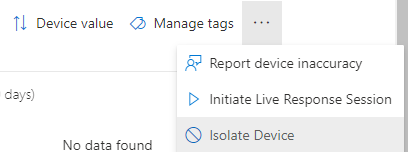
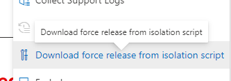

+++
date = '2023-06-23T21:23:01+01:00'
lastmod = '2023-06-23T21:23:02+01:00'
draft = false
title = "Your isolated device stuck in Defender for Endpoint Isolation mode , not anymore !"
slug = 'your-isolated-device-stuck-in-defender-for-endpoint-isolation-mode-not-anymore'
description = "When you want to investigate a endpoint that has indication of being comprised you might want to put the endpoint in Defender for Endpoint isolation mode. Isolation will disconnected the potential…"
author = 'Thomas Verheyden'
tags = []
categories = []
+++

## Intro

When you want to investigate a endpoint that has indication of being comprised you might want to put the endpoint in Defender for Endpoint isolation mode. Isolation will disconnected the potential comprised endpoint from the network and will only allow connection to Defender for Endpoint Service. Depending on your OS level you can also choose to enable ‘Selective Isolation’.

Enable Isolation mode

## The problem?

After you did you investigation and cleared the endpoint, you want to disable isolation mode and allow the device back on the network and in the business. You can do this with the same steps that you used for enable device isolation. By going to the M365 defender portal > Devices. Select the device and the three dots. You will have the option to ‘Release from isolation’ available. Normally the device will be able to reconnect to the network, but the reality has learned us that is not always the case.

Microsoft was aware of this issue and released today a solution for this ‘problem’ called ‘Forcibly release device from isolation’. Starting today you can download a script for every instance that isn’t responding after enable isolation mode. They made the script available though the M365 defender portal:

Release from isolation mode

Downloading the script in only available if you are admin or you have the manage security settings in M365 Defender portal and the script is only valid for the specific device only and will expire in three days. Currently only supported on Windows endpoints and the following versions:

- Windows 10 21H2 and 22H2 with KB KB5023773
- Windows 11 version 21H2, all editions with KB5023774
- Windows 11 version 22H2, all editions with KB5023778

## The script

It triggered me to have a look at the content of the script. You cannot run the script as a local user because the script will add a registry blob in a key called ‘offlineCommand’ to the following location HKLM\SOFTWARE\Policies\Microsoft\Windows Advanced Threat Protection”, that requires admin rights. The value of the reg keys contains timestamp info, device id info and tenant id etc. This confirm that the script is only for a specific device and will expire in three days. To investigate if the script successfully has run, you have a look in the event viewer under **Applications and services logs > Microsoft-Windows-SENSE** and look for the following text: “unisolation”.

*Reference*:

[*Take response actions on a device in Microsoft Defender for Endpoint | Microsoft Learn*](https://learn.microsoft.com/en-us/microsoft-365/security/defender-endpoint/respond-machine-alerts?view=o365-worldwide)
