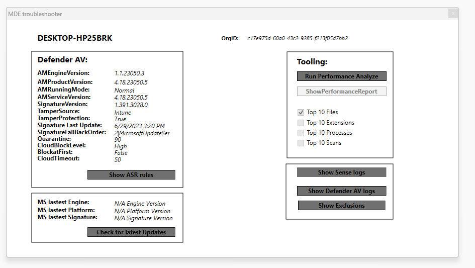

+++
date = '2023-06-30T10:00:00+01:00'
lastmod = '2023-06-30T12:29:40+01:00'
draft = false
title = "Tool: MDE-Troubleshooter is born !"
slug = 'tool-mde-troubleshooter-is-born'
description = "Introducing MDE-Troubleshooter: a free PowerShell GUI that shows the Defender for Endpoint configuration, logs and exclusions of a device in one place."
author = 'Thomas Verheyden'
tags = []
categories = []
+++

## Background story

During my consultancy work, I have received feedback from numerous clients indicating that they consistently encountered difficulties when attempting to troubleshoot issues with Defender for Endpoint on their local endpoints. They often found it a struggle to navigate through various locations, such as PowerShell for security configuration, the event viewer for log files, the registry for exclusions, and a separate section in the registry for tenant information.

Therefore, I made the decision to develop a tool that could assist both myself and my clients in overcoming this struggle. Initially, I began by creating a graphical user interface (GUI) wrapper around the well-known PowerShell commands “Get-MpPreference” and “Get-MpComputerStatus.” However, I soon realized that additional features were necessary. This realization led to the birth of the MDE-Troubleshooter, a PowerShell script integrated with a GUI built using WPF. The tool is currently in version 1, and although I am not completely satisfied with the available features, I wanted to gather feedback from the community regarding its usefulness before proceeding with further development. I warmly welcome new ideas and features, and I am open to incorporating them into the tool. If you have any suggestions, please feel free to reach out to me on my social media platforms, such as Twitter (@thomasvrhydn) or LinkedIn.

THE MDE-troubleshooter tool

## Features

The MDE-troubleshooter consist currently of the following feature:

- Computername and tenant ID
- Security configuration settings
- Attack surface reduction rules
- Check for latest Engine, platform and signature version with Microsoft (loading takes while)
- Quick access to the Performance Analyzer
- Show performance report when the performance analyzer has been run by the tool (saves locally the .ETL file)
- View Top 10 Files, Extensions, Process , Scans in seperated reports
- Show SENSE logs files
- Show Defender AV log files
- Show Exclusions

## Download

link: <https://github.com/ThomasVrhydn/MDE-troubleshooter/>

## Feedback

I warmly welcome new ideas and features, and I am open to incorporating them into the tool. If you have any suggestions, please feel free to reach out to me on my social media platforms, such as Twitter (@thomasvrhydn) or LinkedIn.

*Reference*

*<https://github.com/ugurkocde/Intune/blob/main/Defender%20for%20Endpoint/MDE%20-%20Update%20Tool/MDE_Update_Tool.ps1>  
<https://github.com/directorcia/Office365/blob/master/win10-asr-get.ps1>*<https://docs.microsoft.com/en-us/windows/security/threat-protection/microsoft-defender-atp/overview-attack-surface-reduction> *<https://docs.microsoft.com/en-us/windows/security/threat-protection/microsoft-defender-atp/attack-surface-reduction>  
<https://docs.microsoft.com/en-us/windows/security/threat-protection/microsoft-defender-atp/attack-surface-reduction-faq>*
