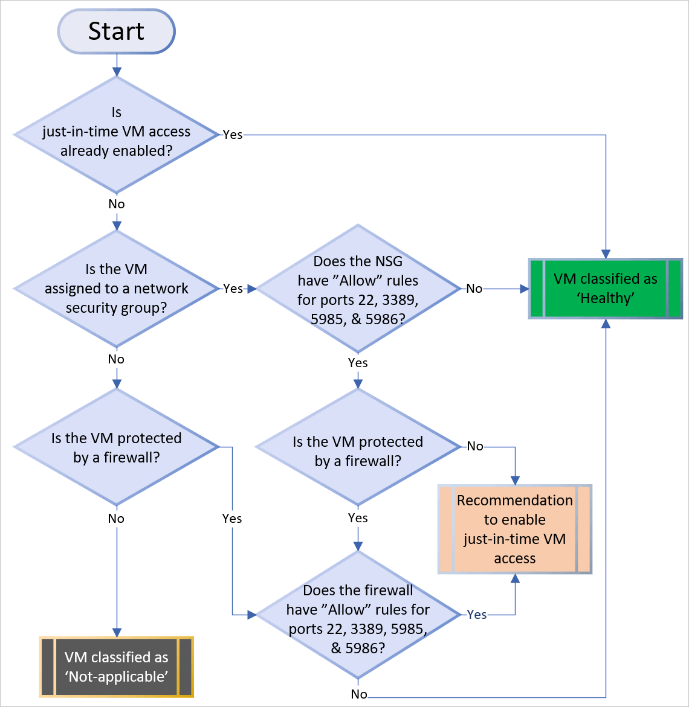
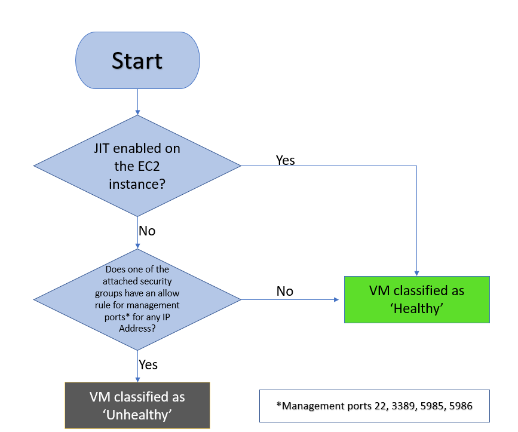
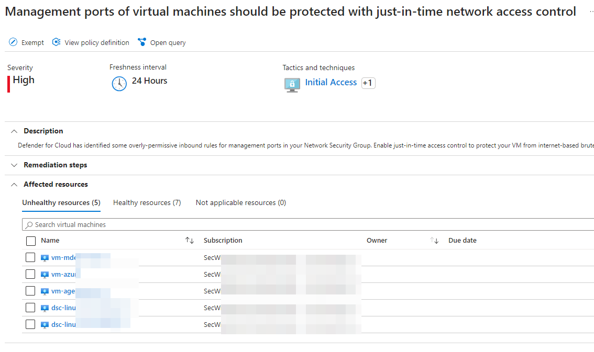
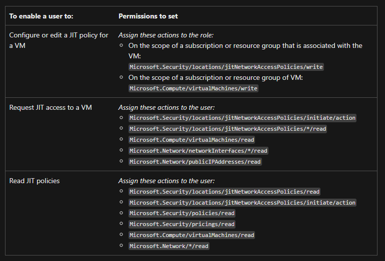
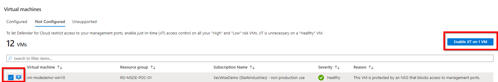
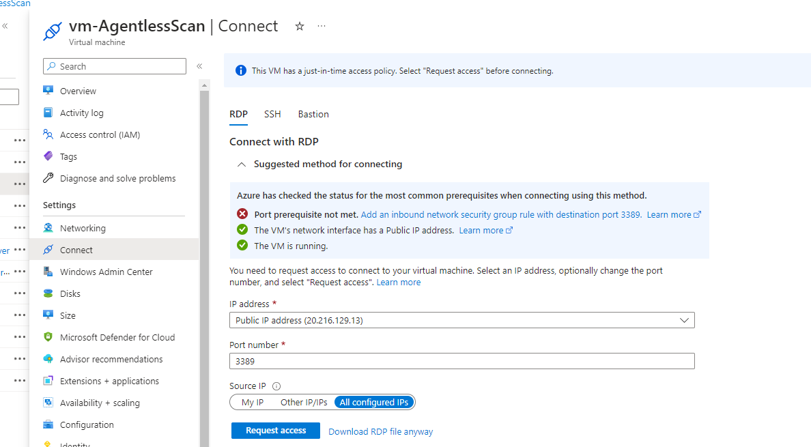
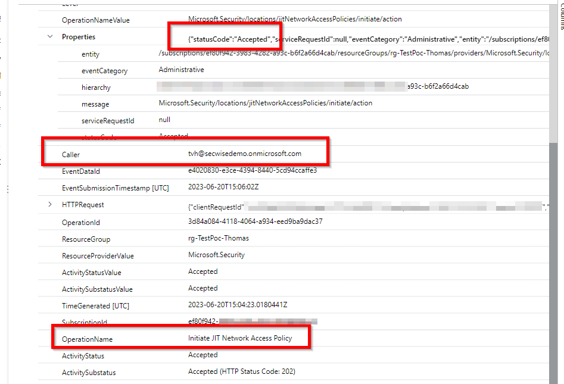

+++
date = '2023-07-20T12:29:20+01:00'
lastmod = '2023-08-04T12:52:13+01:00'
draft = false
title = "Unleash the power of defender plan 2: Just-in-time VM access – part 4"
slug = 'unleash-the-power-of-defender-plan-2-just-in-time-vm-access-part-4'
description = "Malicious actors actively search for machines with open management ports, such as RDP or SSH, to exploit. All of your virtual machines are potential targets for these attacks if you have those…"
author = 'Thomas Verheyden'
tags = ["Defender for Cloud", "Defender for Servers", "Just-in-time"]
categories = ["Defender for Cloud"]
+++

## Intro

Malicious actors actively search for machines with open management ports, such as RDP or SSH, to exploit. All of your virtual machines are potential targets for these attacks if you have those ports open. Once a VM is compromised, it serves as a entry point for the attackers to target other resources within your environment.  
  
Microsoft Defender for Cloud provides a just-in-time (JIT) access feature that protects Azure virtual machines (VMs) against unauthorized network access. In the blog post i will talk about JIT and provide my experience with the product.

## How JIT operates with network resources in Azure and AWS

In Azure, you can block inbound traffic on specific ports, by enabling just-in-time VM access. Defender for Cloud ensures “deny all inbound traffic” rules exist for your selected ports in the [network security group](https://learn.microsoft.com/en-us/azure/virtual-network/network-security-groups-overview#security-rules) (NSG) and [Azure Firewall rules](https://learn.microsoft.com/en-us/azure/firewall/rule-processing). These rules restrict access to your Azure VMs’ management ports and defend them from attack.

If other rules already exist for the selected ports, then those existing rules take priority over the new “deny all inbound traffic” rules. If there are no existing rules on the selected ports, then the new rules take top priority in the NSG and Azure Firewall.

> ⚠️ JIT does not support VMs protected by Azure Firewalls controlled by [Azure Firewall Manager](https://learn.microsoft.com/en-us/azure/firewall-manager/overview). The Azure Firewall must be configured with Rules (Classic) and cannot use Firewall policies.

In AWS, by enabling JIT-access the relevant rules in the attached EC2 security groups, for the selected ports, are revoked which blocks inbound traffic on those specific ports.

When a user requests access to a VM, Defender for Cloud checks that the user has [Azure role-based access control (Azure RBAC)](https://learn.microsoft.com/en-us/azure/role-based-access-control/role-assignments-portal) permissions for that VM. If the request is approved, Defender for Cloud configures the NSGs and Azure Firewall to allow inbound traffic to the selected ports from the relevant IP address (or range), for the amount of time that was specified. In AWS, Defender for Cloud creates a new EC2 security group that allows inbound traffic to the specified ports. After the time has expired, Defender for Cloud restores the NSGs to their previous states. Connections that are already established are not interrupted.

## How Defender for Cloud identifies which VMs should have JIT applied

Microsoft created a fine diagram which shows the logic that Defender for Cloud applies when deciding how to categorize your supported VMs. For Azure:

For AWS:

## Multilayered protection for Azure virtual machine access

If you already using Azure Bastion you can reduce the attack surface by adding JIT to your protection. If you want to leverage this, I suggest to read Wim Matthyssen blog about: ‘Azure Azure Bastion: Combine JIT with Azure Bastion’. Which can be found [here](https://wmatthyssen.com/2022/11/28/azure-bastion-combine-jit-with-azure-bastion/).

## Recommendation

Microsoft will also created a recommendation when Defender for Cloud finds a machine that can benefit from JIT, it adds that machine to the recommendation’s **Unhealthy resources** tab. You can find the recommendation by the name ‘Management ports of virtual machines should be protected with just-in-time network acccess control’.

## How to start with JIT

### Availability

| Aspect | Details |
| --- | --- |
| Release state: | General availability (GA) |
| Supported VMs: | screenshot VMs deployed through Azure Resource Managerscreenshot VMs deployed with [classic deployment models](https://learn.microsoft.com/en-us/azure/azure-resource-manager/management/deployment-models) screenshot VMs protected by Azure Firewalls on the same VNET as the VM screenshot VMs protected by Azure Firewalls controlled by [Azure Firewall Manager](https://learn.microsoft.com/en-us/azure/firewall-manager/overview)screenshot AWS EC2 instances (Preview) |
| Clouds: | screenshot Commercial cloudsscreenshot National (Azure Government, Azure China 21Vianet) screenshot Connected AWS accounts (preview) |

### Permissions

I recommend to create a custom roles that can work with JIT. This will create a least-privilegede role for users. To create a least-privileged role for users that need to request JIT access to a VM, and perform no other JIT operations, use the [Set-JitLeastPrivilegedRole script](https://github.com/Azure/Azure-Security-Center/tree/main/Powershell%20scripts/JIT%20Scripts/JIT%20Custom%20Role) from the Defender for Cloud GitHub community pages. Microsoft created a new overview of all the required permissions if you want to create custom roles:

*Source: [Just-in-time virtual machine access in Microsoft Defender for Cloud | Microsoft Learn](https://learn.microsoft.com/en-us/azure/defender-for-cloud/just-in-time-access-usage)*

## Enable JIT in Defender for Cloud

From Defender for Cloud, you can enable and configure the JIT VM access.

1. Open the **Workload protections** and, in the advanced protections, select **Just-in-time VM access**.
2. In the **Not configured** virtual machines, mark the VMs to protect with JIT and select **Enable JIT on VMs**.The JIT VM access page opens listing the ports that Defender for Cloud recommends protecting:
   - 22 – SSH
   - 3389 – RDP
   - 5985 – WinRM
   - 5986 – WinRMTo customize the JIT access:
   1. Select **Add**.
   2. Select one of the ports in the list to edit it or enter other ports. For each port, you can set the:
      - **Protocol** – The protocol that is allowed on this port when a request is approved
      - **Allowed source IPs** – The IP ranges that are allowed on this port when a request is approved
      - **Maximum request time** – The maximum time window during which a specific port can be opened
   3. Select **OK**.
3. To save the port configuration, select **Save**.

### Edit the JIT configuration on a JIT-enabled VM using Defender for Cloud

You have the ability to alter the just-in-time configuration of a virtual machine by introducing and setting up a fresh port to protect that particular VM, or by adjusting any other parameter associated with an existing secured port.

To edit the existing JIT rules for a VM:

1. Open the **Workload protections** and, in the advanced protections, select **Just-in-time VM access**.
2. In the **Configured** virtual machines, right-click on a VM and select edit.
3. In the **JIT VM access configuration**, you can either edit the list of port or select **Add** a new custom port.
4. When you finish editing the ports, select **Save**.

## Request access to a JIT-enabled VM from Microsoft Defender for Cloud

There are different methodes to request access to a JIT-enabled VM:

- By using Defender for Cloud
- On your VM from Azure virtual machines
- Powershell
- REST API

I will only demonstrate on your VM, details by the other methodes you can find [here](https://learn.microsoft.com/en-us/azure/defender-for-cloud/just-in-time-access-usage).

To request access from Azure virtual machines:

1. In the Azure portal, open the virtual machines pages.
2. Select the VM to which you want to connect, and open the **Connect** page.Azure checks to see if JIT is enabled on that VM.
   - If JIT isn’t enabled for the VM, you’ll be prompted to enable it.
   - If JIT is enabled, select **Request access** to pass an access request with the requesting IP, time range, and ports that were configured for that VM.

## Auditing – Hunt with KQL

If you are using a SIEM, like Sentinel, you can audit your JIT environment, to accomplish this I highly suggest to forward your Azure Activity logs and Resource logs to your SIEM. In the Azure Activity logs you can view who requested and initiated a JIT access to a Virtual machine. If you leverage Sentinel a table will be created in your log analytics workspace with the following name: ‘AzureActivity’. With KQL you can filter on OperationName with the value ‘Initiate JIT Network Access Policy’. Then you will receive all the JIT requests by caller. Like in the example below:

This can also very useful if your SOC needs to do investigations or can detect anomalies based for example on host IP address.

Sources:

[*Azure Bastion: Combine JIT with Azure Bastion – Wim Matthyssen (wmatthyssen.com)*](https://wmatthyssen.com/2022/11/28/azure-bastion-combine-jit-with-azure-bastion/)

[Just-in-time virtual machine access in Microsoft Defender for Cloud | Microsoft Learn](https://learn.microsoft.com/en-us/azure/defender-for-cloud/just-in-time-access-usage)

[Overview of Azure platform logs – Azure Monitor | Microsoft Learn](https://learn.microsoft.com/en-us/azure/azure-monitor/essentials/platform-logs-overview)
