+++
date = '2023-08-04T12:51:51+01:00'
lastmod = '2023-08-04T13:07:15+01:00'
draft = false
title = "Microsoft Defender for Endpoint security management (MDE Attach v2) on Linux : A deep dive"
slug = 'microsoft-defender-for-endpoint-security-management-mde-attach-v2-on-linux-a-deep-dive'
description = "This blog post is inspired by Rudy Ooms, who wrote a excellent write up about the behind the scenes of the MDE attach v2 process and security configuration on Windows endpoints. Which can be found…"
author = 'Thomas Verheyden'
tags = ["Defender for Endpoint"]
categories = ["Defender for Endpoint"]
+++

## Intro

This blog post is inspired by Rudy Ooms, who wrote a excellent write up about the behind the scenes of the MDE attach v2 process and security configuration on Windows endpoints. Which can be found [here](https://call4cloud.nl/2023/07/mmpc-mde-attach-v2-enroll-checkin-onboard/). A must read if you want a better understanding how MDE attach v2 is working…  
  
I was getting triggered during reading the explanation on what Rudy found about MDE attach v2 on his Windows endpoint. Is the same happening behind the scenes on Linux? Because Microsoft lately announced that the security management of Linux endpoints also was in public preview. In this blog I will show you my journey in debugging the solution on a Linux endpoint and trying to find a answer on the following questions:

- How are already MDE onboarded devices getting enrolled into MDE attach v2?
- How does the devices get they policy defined in Intune?
- How are the policies getting applied?

## The start of the journey: enrollment in MDE attach v2

> ⚠️ *Note: This research is based on my own assumptions and isn’t official documented information from Microsoft. The possibility exist that the assumptions aren’t 100% correct.*

First, I wanted to have a look at the running processes on my Linux endpoint which was currently onboarded to MDE and enrolled in MDE attach v2 . I was looking for **the process that was responsible for getting the policy deployed** to the endpoint as a start. After searching for a tool i bumped into “strace”. With strace you can monitor syscall from the running processes on your linux endpoint. After analyzing the different possibilities of the tool I quickly realized that the tool wasn’t build for the goal i wanted to reach now. For example, the tool is more useful to monitor know processes, because by this time I still didn’t know which process I had to look at and running it for all processes gave me to many calls, which made it hard to capture they ones I was looking for.   
  
So I took another approach. What if i start with monitoring the file system. I know that MDE for linux logs and stores a lot of configuration files in the following location: “/etc/opt/microsoft/mdatp/”. By monitoring this path i can see which process opens and write down some files, maybe the process responsible for MDE Attach v2 is also active here.  
  
‘Fatrace’ is the tool I’m going to start using. ‘fatrace’ reports file access events (Open, Read, Write, Close) from all running processes. So i started ‘fatrace’ and clicked the ‘policy sync’ option in M365 defender on the device that was onboarded into MDE:

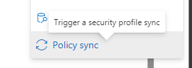

Policy sync in M365 Defender

After 2 minutes, I saw the following data popping up in my terminal:

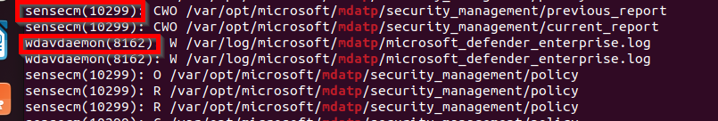

*Prove of both processes*

Two very interesting processes were opening/writing to the path I was monitoring:

- **wdavdaemon** – Core daemon, uses fanotify for both antimalware and EDR purposes
- **senseCM** – Sense configuration management

Already biased by the write up of Rudy, i was pretty sure i needed to monitor the senseCM. So I rebuild my Linux endpoint back to the state where it was only onboarded in MDE but not enrolled in MDE Attach v2.  
  
After this, the first thing i was thinking of was where does the process comes from. By digging in the binary files of mdatp I saw the binary **senseCM** was stored in the ‘/opt/microsoft/mdatp/sbin/’ folder. Microsoft supports MDE attach v2 linux only from a particular mdatp version. My wild guess is that older versions doesn’t have this binary included.

I now can use ‘**strace**‘ tool because i know the process name but i quickly noticed that the **senseCM** is a self terminating process and being started by the **wdavdaemon**. You cannot start ‘strace’ on a process that is not yet running. This limitation made me create a bash script that looks for the process being created and after that capture the PID so i could use it with ‘strace’.

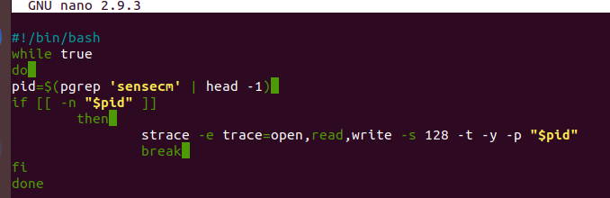

Custom bash script to start strace when process starts

So how does the senseCM process getting started? It all begins with the **wdavdaemon** receiving an instruction from the cloud ‘**EndpointConfigManagementEnrollCommand**‘ which means the start of the enrollment. This instruction is sent during the tagging of your endpoint in M365 Defender if you use the selective option with the MDE-Management tag. This is followed by a **managed authority check,** which gave for my endpoint back the staus: ‘**NotEnrolled**‘.

Authority Check

This status trigged the wdavdaemon to initialize the binary SenseCM, which created process PID 9855 on my endpoint. Wdavdaemon is also the **parent process** of senseCM. A parameter json is delivered to the senseCM with the CommandType: ‘**Enroll**‘ with different parameters like OrgID, a challenge nonce, AadtenetID , etc.

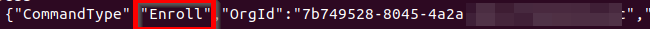

Enroll

Now, it’s time for the senseCM to do his work and here we going to see some similar steps as on the Windows Endpoints. The senseCM will first check the state of the device by calling the GetRegistrationStatusV2.

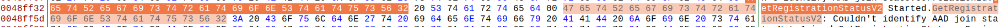

Checking senseCM with hex editor

We see here the Siam mode and **senseCmModeSwitch** set to 2. Which means MDE attach v2, we don’t see any signs of the v1. The function **GetRegistrationSatusV2** provides the following return:

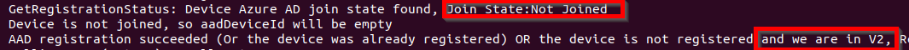

Device join state

They MEM (intune) enrollment will be called, which start with the calling the discovery with the url:

Calling MEM service

Again no signs of v1 here, like you would have on the windows endpoints. When the discovery succeed the device receive the **MemEnrollmentUrl** and the **MemUnenrollmentUrl**:

MEM enrollment URL

Time to start the enrollment. The enrollment will be called also with the **LeviathanToken**, as Rudy described. The token is being used to authenticate to the ‘atpenroll’ service. I couldn’t capture the token in the HTTP request but i saw signs of it in the monitoring of the senseCM because the ‘**LeviaThanTokenFetcher**‘ is being called. You want more information about this token i will suggest to read Rudy [separate section about it](https://call4cloud.nl/2023/07/mmpc-mde-attach-v2-enroll-checkin-onboard/#part7). The token is being stored in the binary ‘authentication\_state’ under ‘/var/opt/microsoft/mdatp’.

> ℹ️  Side not: a Leviathan is a sea serpent noted in theology and mythology.

and after a couple off seconds we receive the ‘Enrollmnet succeeded’ status and what we also notice is a intuneDeviceId in the received results:

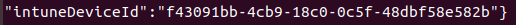

Intune Device ID

After checking intune we see the same id appearing:

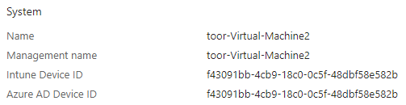

We also see, what Microsoft calls a synthetic object, being created in Entra AD (AzureAD):

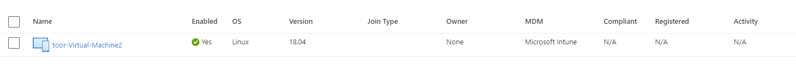

The senseCM process do a self-termination after this. That’s is, my endpoint is now onboarded into MDE Attavh V2. As you can see there isn’t much difference between the enrollment process on Linux and Windows. Time to have a look how the policy that you define in Intune/M365 Defender tenant gets applied on your Linux endpoint.

## How does the policy get applied?

The next question I was seeking an answer to was how the policy gets applied. I started again with the strace tool. This time monitoring both processes the **wdavdeamon** and **senseCM** (when its gets started). Next, I triggered a sync policy from the M365 Defender portal. Now lets the magic happen!

It’s begin with the mdavdaemon getting a notification from the cloud called ‘**EndpointconfigurationCheckin**‘. Currently the senseCM process isn’t running and the mdavdaemon will start the process and will provide a JSON argument with commandtype ‘**Checkin**‘ and some additional information.

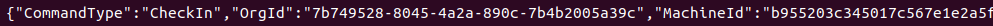

*Checking-in JSON*

Before the Check-in happens i saw that some preparation work is being done. The current policy which is applied on the endpoint will be checked and a checksum will be created of that policy. My guess is that it will be used to check the new policy with the old Policy later on. Afterwards , the Check-in will be called:

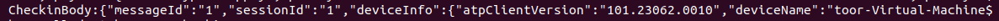

*Check-in body*

Authentication will happen again with the Leviathan token because i see signs of the ‘**LeviathanTokenFetcher**‘ being called. The senseCM receives a **payload** with a checksum in it. It will validated the checksum with the previous checksum, when there is a difference the new policy will be merged with the old policy, just as I thought.

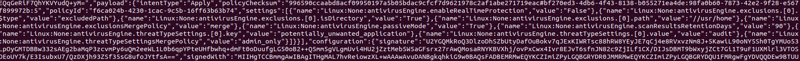

*Received payload*

Depending if there was already a policy applied, the following file will be modified **mdatp\_managed.json** on the location ‘/etc/opt/microsoft/mdatp/managed/’ with the new policy. After, the new policy will be enforced. I also noticed that the policy checksum reports are also stored in the following location: ‘/etc/opt/microsoft/mdatp/managed/’.

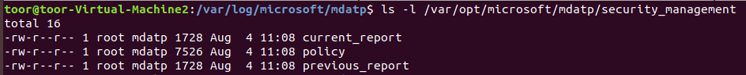

*Policy reports*

The senseCM terminate after this and the operation is completed. So, that’s it. We found the answers on how the policies are getting applied. As a closing note i want to thank Rudy Ooms because his write up made finding out what is happening much easier. Again if you didn’t yet read it his write up , you can find it [here](https://call4cloud.nl/2023/07/mmpc-mde-attach-v2-enroll-checkin-onboard/) .  
  
Reference:  
  
[MDE Attach V2 | MMP-C | Intune | Security Management | SENSE (call4cloud.nl)](https://call4cloud.nl/2023/07/mmpc-mde-attach-v2-enroll-checkin-onboard/)  
[MDE Attach V2 | MMP-C | Intune | Security Management | SENSE (call4cloud.nl)](https://call4cloud.nl/2023/07/mmpc-mde-attach-v2-enroll-checkin-onboard/#part7)
