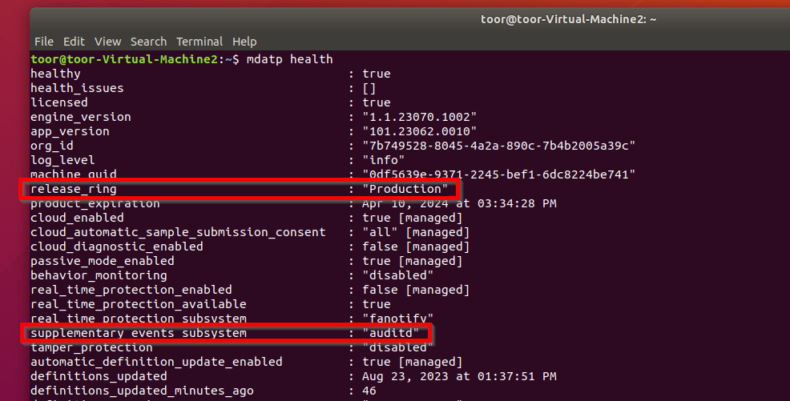
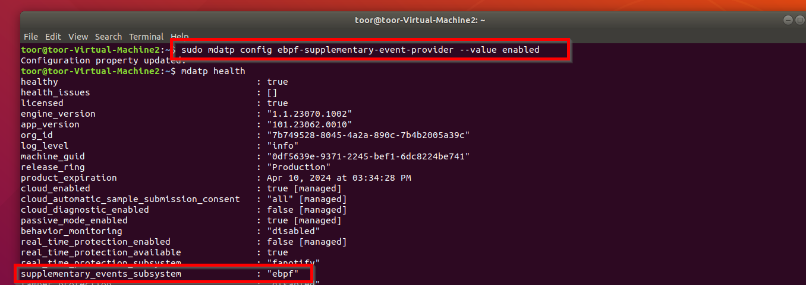
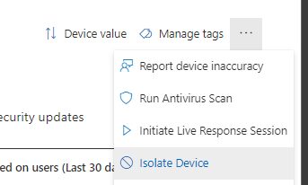
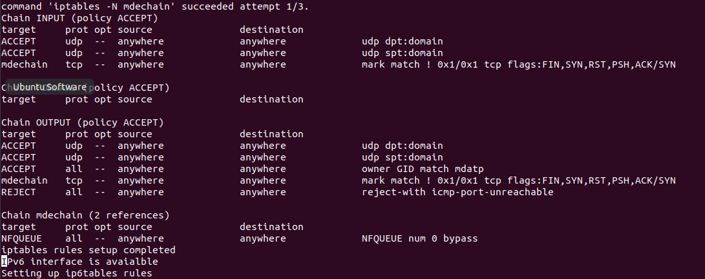
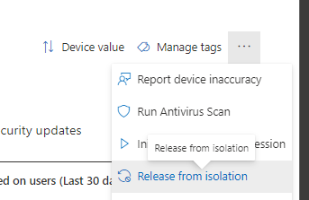
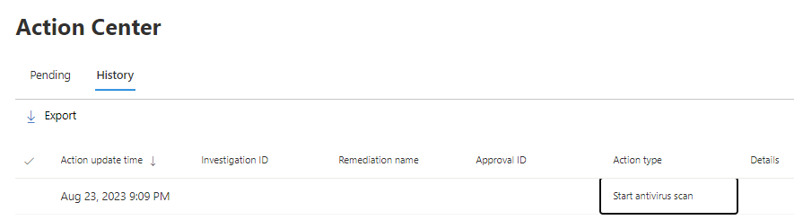
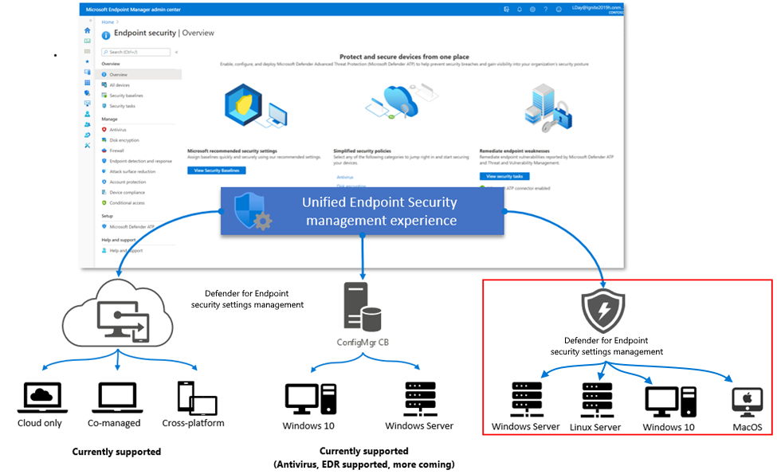

+++
date = '2023-08-28T12:05:10+01:00'
lastmod = '2023-08-28T12:06:16+01:00'
draft = false
title = "Defender for Endpoint for Linux: new capabilities and enhancements"
slug = 'defender-for-endpoint-for-linux-new-capabilities-and-enhancements'
description = "Microsoft published this summer new capabilities and enhancements for Defender for Endpoint on linux. In my opinion Defender for Endpoint on linux is a lot of times overlooked and the new features…"
author = 'Thomas Verheyden'
tags = ["Defender for Endpoint", "Linux", "Microsoft Security"]
categories = ["Defender for Endpoint"]
+++

## Intro

Microsoft published this summer new capabilities and enhancements for Defender for Endpoint on linux. In my opinion Defender for Endpoint on linux is a lot of times overlooked and the new features are a very good improvement to the performance of Defender for Endpoint on linux which deserve more exposure. In this blog i will talk about the new capabilities features and how you can benefit from them.

## eBPF-based sensor for Defender for Endpoint (Preview)

Microsoft Defender for Endpoint on Linux OS distributions uses AuditD framework to collect certain types of telemetry events which are captured by rules added to the /etc/audit/rules. In the past during my consultancy work i observed performance issues related to auditd. The most common issue i saw was high CPU resource consumption. After reporting the incident to Microsoft we were able to resolve this issue at my client environment. I’m speaking about issues we had 2 years ago. In the mean time Microsoft also updated their agent for linux with improvements and have a lot of great documented troubleshooting tips are now available on the Microsoft docs website which where not there 2 years ago. If you reading this and you are still having performance issues, i recommend to read the following docs:  
  
[Troubleshoot performance issues for Microsoft Defender for Endpoint on Linux | Microsoft Learn](https://learn.microsoft.com/en-us/microsoft-365/security/defender-endpoint/linux-support-perf?view=o365-worldwide)

Maybe you are thinking what has auditd have to do with eBPF? Well, now you can use eBPF as an alternative technology as a event provider. By Microsoft, it will deliver additional system ability and performance optimizations for all supported linux-based machines.

Here are some of the key benefits of using eBPF as the primary supplementary event provider occurring to Microsoft:

- Reduced system-wide auditd-related log noise
- Optimized system-wide event rules causing conflict between applications
- Reduced overhead for file event monitoring
- Improved event rate troughput
- Optimized performance for specific configurations

If you are using the insider build of Defender for Endpoint agent the change to eBPF sensor will be automatically turned on if you have a version 101.23062.005 or later. If you’re running a production build and interested in evaluating the eBPF preview functionality like for instance in your testing environment, you can use the following mdatp config command:

```bash
sudo mdatp config ebpf-supplementary-event-provider --value enabled
```

Something to keep in mind, the eBPF sensor for Micorsoft Defender for Endpoint on linux is supported on the following distribution and kernel versions:

| Linux Distribution | Distribution version | Kernel Version |
| --- | --- | --- |
| Ubuntu | 16.04 | 4.15.0 |
| Fedora | 33 | 5.8.15 |
| CentOS | 7.6 | 3.10.0-957 |
| SLES | 15 | 5.3.18-18.47 |
| RHEL | 7.6 | 3.10.0-957 |
| Debian | 9.0 | 4.19.0 |
| Oracle Linux RHCK | 7.9 | 3.10.10-1160 |
| Oracle Linux UEK | 7.9 | 5.4 |

You can validate the setup by running the mdatp health command. Before enabling eBPF, you will see events\_subsystem with value ‘auditd’:



*Auditd Enabled*

After enabling eBPF, you must see the events\_subsystem with value ‘eBPF’:



*eBPF Enabled*

## NEW response actions

### Device Isolation

Previous you could only isolate a device that was running the Windows OS, because Microsoft wants to align the capabilities between Windows en Linux, they recently announced that this capability will also be available on Linux. if you are not familiar with device isolation, it will disconnect the possible compromised device from your environment network while maintaining connectivity to Defender for Endpoint service so you can still do you investigation.

If you want to isolate an endpoint you can do this from the portal or via API. Side note: the action is not currently available for Live response on Linux devices.

From the M365 defender protal navigate to the device details and select ‘Isolate Deivce’ from the drop-down list.



Isolate Device

If you want to use the API, you can create a HTTP POST request:

```
POST https://api.securitycenter.microsoft.com/api/machines/{id}/isolate

{ 
  "Comment": "Isolate machine due to alert 1234", 
  "IsolationType": "Full"  
}
```

When you trigger the action, the MDE agent on your linux endpoint will receive a command to run the isolation script. The isolation script will configure Linux firewall by using the iptables command both for ipv4 and ipV6. On my endpoint it looked like this:



You can always release your Endpoint when your are done investigating and the risk is mitigated:



Release device from isolation

### Run Antivirus Scan

In the past , if you want to check if there is no malware stored on the Linux endpoint you couldn’t run Scan from the M365 defender portal and you need to it manually on the endpoint. This is history, from now on you can run a scan remotely, both quick scan or a full scan, from the M365 defender portal or API.

From the portal, navigate to the device details and select ‘Run Antivirus Scan’ from the drop-down list:

You will get the option the choose your scantype, quick or full scan.

If you want to use the API: you can create a HTTP POST request:

```
POST https://api.securitycenter.microsoft.com/api/machines/1e5bc9d7e413ddd7902c2932e418702b84d0cc07/runAntiVirusScan

{
  "Comment": "Check machine for viruses due to alert 3212",
  "ScanType": "Full"
}
```

Alerts will be created when the Defender for Endpoint scan detects malware on the endpoint.   
  
A record will be logged into the Action Center:



*M365 Defender Action Center*

The progress cannot be followed remotely. You can still do this locally on the endpoint by looking in the following logs file on the endpoint for investigations:

- /var/log/microsoft/Microsoft\_defender\_enterprise.log
- /var/log/microsoft/Microsoft\_defender\_ir.log

## Security Configuration natively in Defender for Endpoint (Preview)



*Overview of the management solutions for MDE*

This was one of biggest announcement Microsoft made and will make the security configuration management managed on your linux endpoints a lot easier. Previous you needed to create a configuration file and deploy the file with your desired automation tool. From now on you can use the M365 defender portal to create your linux policy and deploy it to your endpoint. In one of my previous blogs, I took a deep dive on the process behind it. If you interested to read this , you can find it [here](/2023/08/04/microsoft-defender-for-endpoint-security-management-mde-attach-v2-on-linux-a-deep-dive/). You will learn how the devices get onboarded and how the policies get applied. If you want to get started with the new capability , i suggest the [following Microsoft documentation.](https://learn.microsoft.com/en-us/mem/intune/protect/mde-security-integration?pivots=mdssc-preview#configure-your-tenant-to-support-microsoft-defender-for-endpoint-security-configuration-management)   
  
Reference:

[Now in Public Preview: Device isolation and AV scanning for Linux and macOS in Microsoft Defender for Endpoint](https://techcommunity.microsoft.com/t5/microsoft-defender-for-endpoint/now-in-public-preview-device-isolation-and-av-scanning-for-linux/ba-p/3869646)  
[Now in Public Preview: Device isolation and AV scanning for Linux and macOS in Microsoft Defender for Endpoint](https://techcommunity.microsoft.com/t5/microsoft-defender-for-endpoint/now-in-public-preview-device-isolation-and-av-scanning-for-linux/ba-p/3869646)
