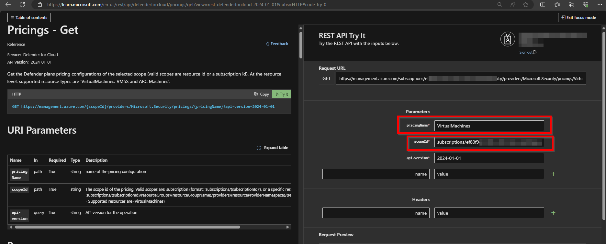
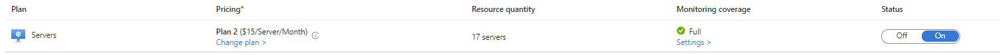
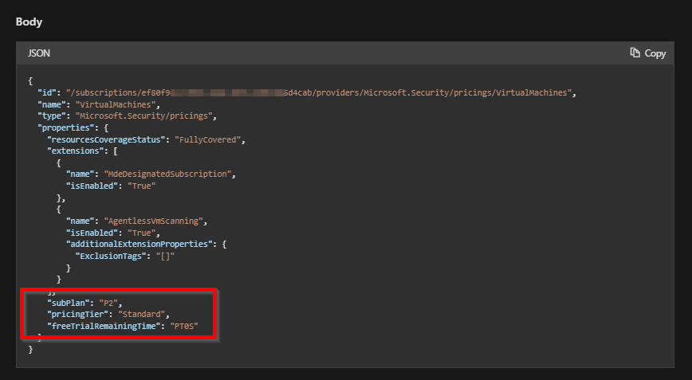
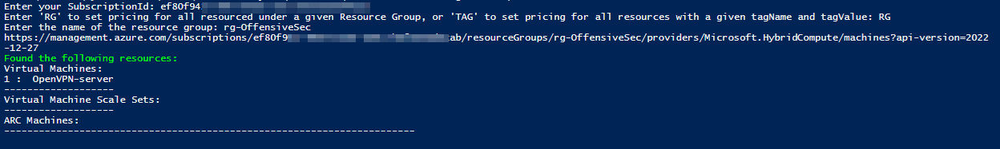
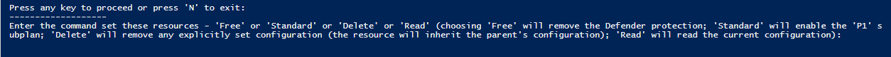
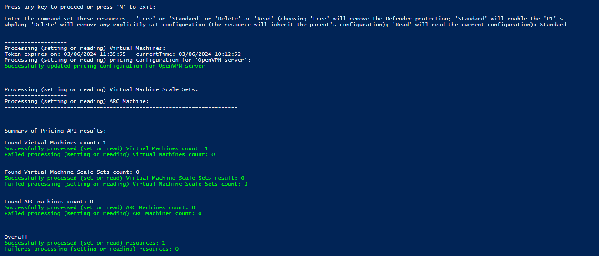
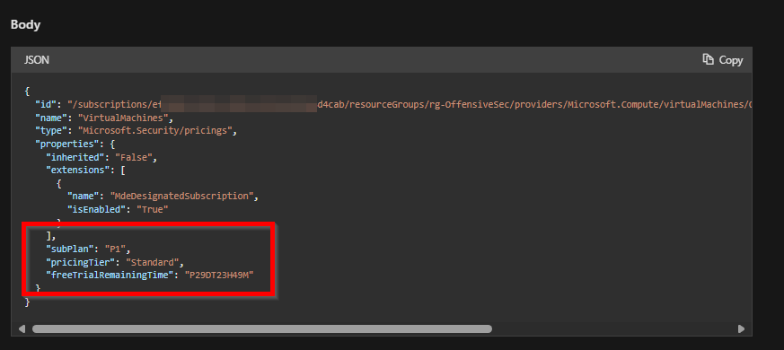
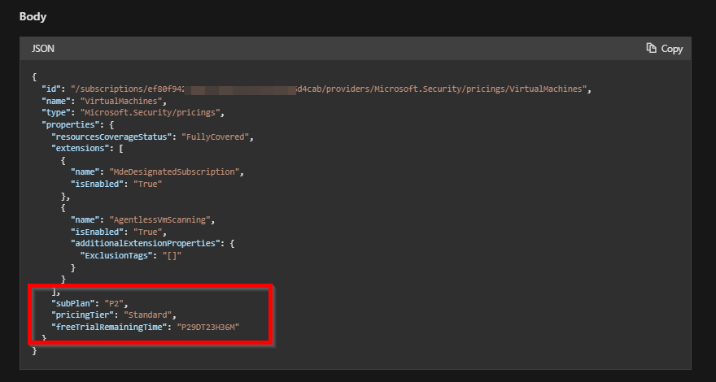

+++
date = '2024-03-06T10:47:14+01:00'
lastmod = '2024-03-06T11:10:52+01:00'
draft = false
title = "Tutorial: How to enable/disable Defender for Servers Plans at resources level "
slug = 'tutorial-how-to-enable-disable-defender-for-servers-plans-at-resources-level'
description = "I noticed that more and more clients are starting to use mixed license model for Defender for Servers. Previous you could only enable Defender for Server at the subscription level. Microsoft also…"
author = 'Thomas Verheyden'
tags = ["Defender for Cloud", "Defender for Endpoint", "Defender for Servers", "Microsoft Security"]
categories = ["Defender for Cloud", "Defender for Endpoint"]
+++

## Intro

I noticed that more and more clients are starting to use mixed license model for Defender for Servers. Previous you could only enable Defender for Server at the subscription level. Microsoft also noticed this and they made an option available to enable Defender for Servers at the resource level ! The ability to enable or disable Defender for Servers at the resource level is available exclusively via REST API. Is the blog I wil explain how to do this by leveraging the REST API.

## Prerequisites

You need the following values to follow this walkthrough:

- Sub id
- Full resource id

## Validate you current Defender for Server license model

The easiest way in my opinion to validate you current Defender for Server license model is to use the REST API try it function from the Microsoft learn page. There are sure other options available but i want to keep it simple but effective.

REST API Try It: [Pricings – Get – REST API (Azure Defender for Cloud) | Microsoft Learn](https://learn.microsoft.com/en-us/rest/api/defenderforcloud/pricings/get?view=rest-defenderforcloud-2024-01-01&tabs=HTTP#code-try-0)

When you use this for the first time your need to authenticate, of course with credentials with the right permissions to handle the subscription/resource.

After logging in you will see the following screen:

Fill in the parameters with the following values:

- pricingName: “VirtualMachines”
- Scopeid : %your subscription id%

In my test tenant i have Defender for Servers Plan 2 enabled on the subscription level:

If that is the same case in your own tenant you will receive the following response from the REST API:

The meaning of subPlan2 is that you have Defender for Server Plan 2 enabled on your subscription.

## How to change Defender for Servers Plan on resource level

Microsoft made a powershell script available that allows you to select machines based on Azure resource tags, or a resource group to configure them individually rather than using the same plan setting for all machines in a subscription. You can find it here.

Start by downloading the script and execute it:

1. Login in with your credentials
2. Enter your subscription ID
3. You will receive the option to set pricing for all resources under a given Resource Group, or ‘TAG’ to set pricing for all resources with a given tagName and tagValue. In this case I choose Resource Group. Using tagging as option is also very useful option in bigger environments.
4. When everything went successful you will receive feedback with the found resources:

4. Press enter when you want to proceed.

5. Choose Standard if you want to downgrade to Defender for Server P1. Choosing ‘Free’ will remove the Defender protection; ‘Standard’ will enable the ‘P1’ subplan; ‘Delete’ will remove any explicitly set configuration (the resource will inherit the parent’s configuration); ‘Read’ will read the current configuration

6. The script will process your input and provide feedback when everything is done

## Validate the change

Now we can use the REST API Try It again to validate the change; use for the scopeID this time the full resource id. If everything when like expected you will receive the following response:

You will see that the subPlan is changed to P1. When we check the subPlan on subscription level it is still the same , with subPlan equals p2.

That’s it. You are now abel to change the Defender for Server Plan at resource level !
