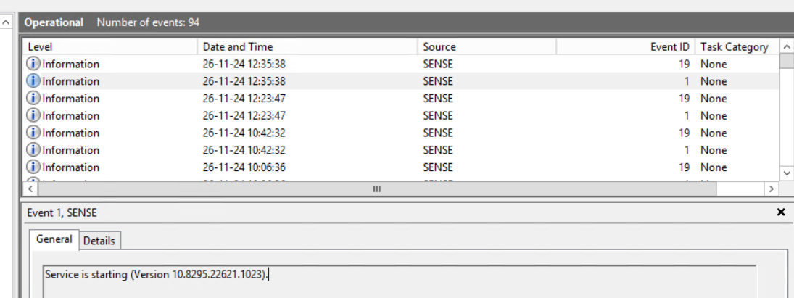
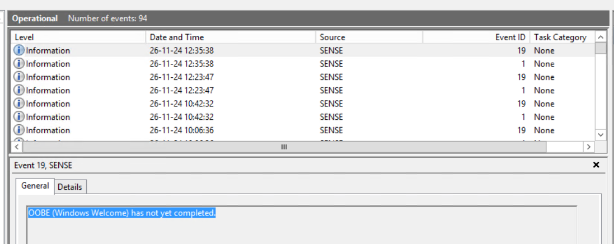
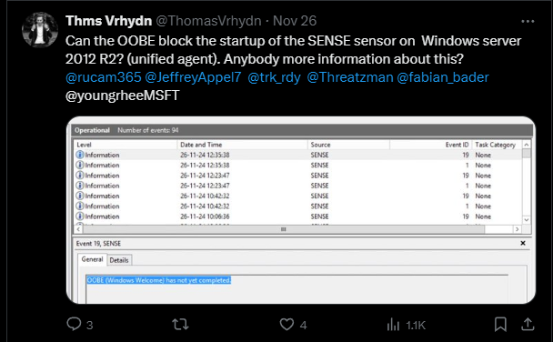
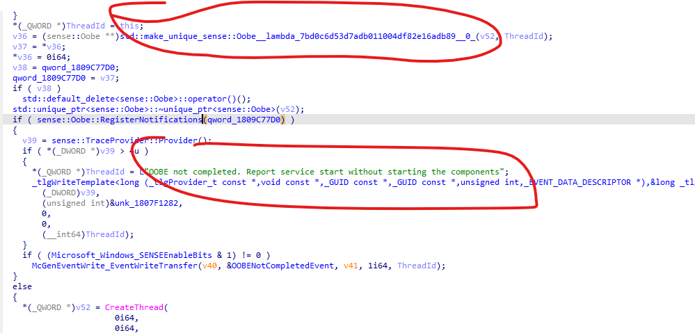
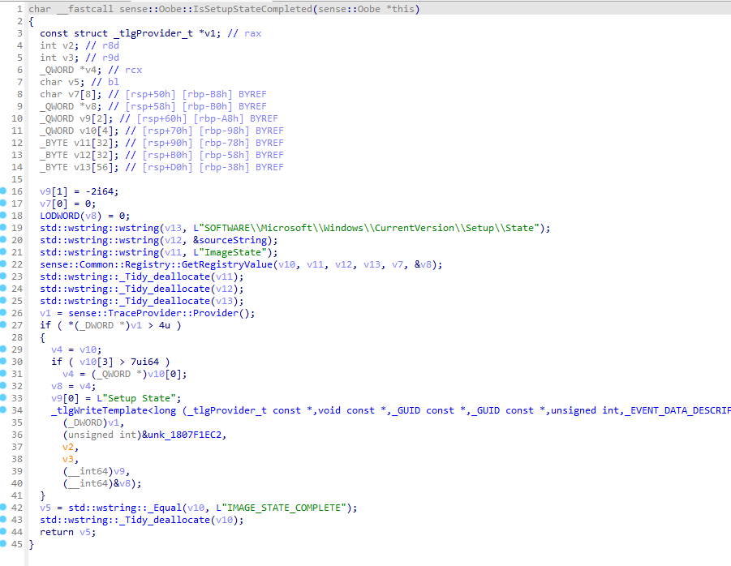
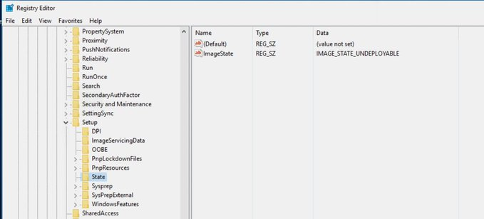
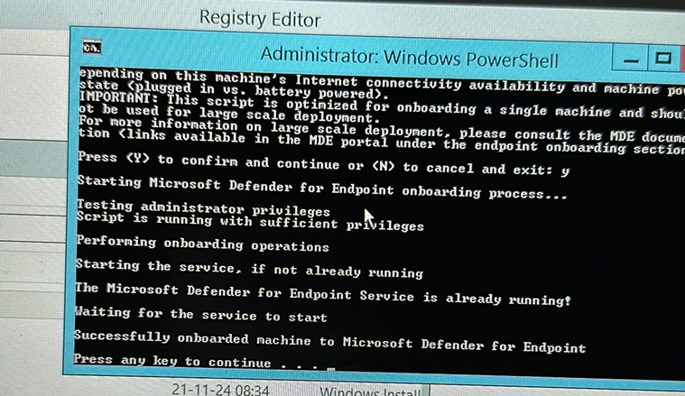
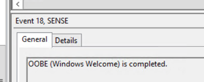

+++
date = '2024-11-27T14:57:16+01:00'
lastmod = '2024-11-27T15:25:57+01:00'
draft = false
title = "Fix: SENSE Service stuck in START_PENDING on WS2012R2 or WS2016? Check OOBE !"
slug = 'fix-sense-service-stuck-in-start_pending-on-ws2012r2-or-ws2016-check-oobe'
description = "This blog discusses a challenge I encountered with a client. They reached out for assistance in addressing issues during the deployment of Defender for Endpoint on Windows Server 2012 R2 and…"
author = 'Thomas Verheyden'
tags = ["Defender for Endpoint", "Defender for Servers", "Microsoft Security"]
categories = ["Defender for Endpoint"]
+++

## **Intro**

This blog discusses a challenge I encountered with a client. They reached out for assistance in addressing issues during the deployment of Defender for Endpoint on Windows Server 2012 R2 and Windows Server 2016. Yes, despite being end-of-life (EOL), these operating systems are still in use.

**If you’re only interested in the solution, skip ahead to the section titled The Solution.**  
  
A special thanks to Rudy who helped me a lot !   
  
Follow him on twitter: [Rudy Ooms | MVP 🇳🇱 (@Mister\_MDM) / X](https://x.com/Mister_MDM)  
Linkedin: [(2) Rudy Ooms | LinkedIn](https://www.linkedin.com/in/rudy-ooms-90810136/)  
Blogs: <https://call4cloud.nl/>

## **The start**

The first step I always take when troubleshooting onboarding issues is to check the Event Viewer. Right away, something unusual caught my attention. The Sense was trying to start ‘***Sevice is starting’*** and stuck in **‘*start\_pending’*.** After that another event was created which reported back ***‘OOBE (Windows Welcome) has not yet completed’.***

SENSE event viewer: ‘Sevice is starting’

OOBE (Windows Welcome) has not yet completed

The OOBE event was unfamiliar to me; I had never encountered it in other environments. I decided to focus on troubleshooting this first, as the client had already done extensive troubleshooting with Microsoft support without any success.

What on earth does the OOBE have to do with starting the SENSE service or Defender for Endpoint? I had some background knowledge of the OOBE from my early days as an SCCM consultant, where I worked on building task sequences and customizing the OOBE experience. However, I was still perplexed—after all, I was already logged into the Windows Server 2012 R2, so you would expect the OOBE to have been completed by that point.

After some research, I came across several Microsoft articles discussing the connection between OOBE and Defender for Endpoint. The first one I found was this:

*“Sensor doesn’t start because the Out-of-box experience (OOBE) or first user logon hasn’t been completed”*

Aha there is link between them… but there was a additional note:

*“User Logon after OOBE is no longer required for SENSE service to start on the following or more recent Windows versions: Windows 10, version 1809 or Windows Server 2019, or Windows Server 2022 with [April 22 2021 update rollup](https://support.microsoft.com/kb/5001384). Windows 10, version 1909 with [April 2021 update rollup](https://support.microsoft.com/kb/5001396). Windows 10, version 2004/20H2 with [April 28 2021 update rollup](https://support.microsoft.com/kb/5001391).”*

Alright, so it’s no longer a requirement on newer operating systems, but it must still be a requirement for Windows Server 2012 R2 and Windows Server 2016. The article also provided a solution for environments using SCCM, but since the client didn’t have an SCCM setup, that option wasn’t viable.

Then I started thinking, how can I bypass the OOBE, restart it, or terminate it? I knew that you could rerun the OOBE using sysprep, but that would have a significant impact on the server, and I still wasn’t 100% certain that I was heading in the right direction with my troubleshooting…

## **The community for the HELP**

I asked the question to the community to see if there was a connection between the OOBE and the SENSE service, or if anyone else had encountered this issue. I quickly received a response from one of the Program Managers for Defender for Endpoint, who said he would ask it internally.

Community question about the OOBE and MDE

Shortly after, I received a message from Rudy Ooms ([Everything you need to know about Rudy Ooms](https://call4cloud.nl/about/)), who decided to reverse engineer the SENSECM.dll files of the SENSE service to check for any references to the OOBE. Within 10 minutes, he hit the jackpot. Rudy found a reference to the OOBE:

Reference of the OOBE in the SENSE .dll

He also discovered a function that checks whether the OOBE had been completed. In the image below, you can see the function, and you’ll notice that the check is based on a registry key:

Reference to the validation key

When I checked the value of the registry key on the device I was troubleshooting, it had the following value: **‘IMAGE\_STATE\_UNDEPLOYABLE’ .**

Interesting isn’t it. Now, back to the function. The function returns true when the value is **‘IMAGE\_STATE\_COMPLETE’.** What if i just change the value on my troubleshooting server and then start the service or rerun the onboarding script? Will it be so easy?

## **The solution**

In this section i will explain the solution:

1. Change the following reg key to:  
     
   *HKLM:SOFTWARE\Microsoft\Windows\CurrentVersion\Setup\State*  
   Value: **IMAGE\_STATE\_COMPLETE**
2. Rerun the onboarding script:

That is it! It’s working, a very simple solution for a hard to troubleshoot issue. If you check the SENSE Events again, you will notice a event that says: ‘OOBE (Windows Welcome) is completed.

OOBE is completed
