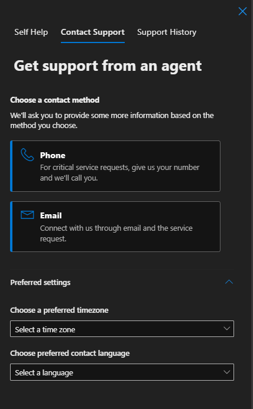
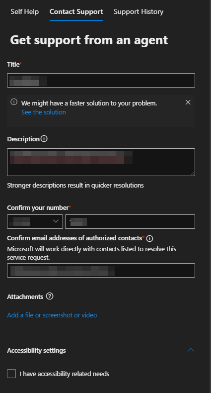

+++
date = '2025-02-04T10:02:44+01:00'
lastmod = '2025-02-04T10:15:16+01:00'
draft = false
title = "Tutorial: The fastest way to report a False negative in Defender for Endpoint!"
slug = 'tutorial-the-fastest-way-to-report-a-false-negative-in-defender-for-endpoint'
description = "The quickest route to report a false negative in Defender for Endpoint to Microsoft, based on a real case that was resolved in four days."
author = 'Thomas Verheyden'
tags = []
categories = []
+++

## Intro

Encountering a false negative during a customer engagement can be a critical issue. Recently, I faced a similar situation where a particular exploit went undetected. While I won’t delve into the specifics of the exploit, I want to highlight an efficient method to report false negatives promptly for resolution.

In my recent experience, the false negative case was addressed within just 4 days of thorough investigations.

> ⚠️ During my writing (25/12) , Microsoft updated their docs about “how to address Address false positives/negatives in Microsoft Defender for Endpoint” (12/01). I suggest to also read it. You can find it [here](https://learn.microsoft.com/en-us/defender-endpoint/defender-endpoint-false-positives-negatives) , it covers more use case then my blog.

## Evidence

My advise is before you submit your case, get as much evidence you can provide. Here is a list I put into my case:

- Described the steps that would allow Microsoft to reproduce the issue internally
- A document backed with screenshots of the process and devices involved incl. Device ID where the activity was observed, the org ID , the exact date/time of the event (in UTC preferably) , the event details and observed telemetry (device timeline)
- Clarified what was the vulnerability that was exploited and that was not alerted incl. CVE Reference.
- Reproduced the issue with the lasted version of MDATP and confirmed if the alert is triggered in the MDE portal
- Collected logs from the device that was exploited:
  - For linux use the XMDEClientAnalyzer *[http://aka.ms/XMDEClientAnalyzer](https://eur05.safelinks.protection.outlook.com/?url=http%3A%2F%2Faka.ms%2FXMDEClientAnalyzer&data=05%7C02%7Cthomas.verheyden%40secwise.be%7C0c8c1aade67e4c70fee608dd1a91f728%7C8b4f79cd3a77466ea58a1bc2a5e5cd2a%7C0%7C0%7C638695936452465028%7CUnknown%7CTWFpbGZsb3d8eyJFbXB0eU1hcGkiOnRydWUsIlYiOiIwLjAuMDAwMCIsIlAiOiJXaW4zMiIsIkFOIjoiTWFpbCIsIldUIjoyfQ%3D%3D%7C0%7C%7C%7C&sdata=%2FzP5D5E8GZIk9vMtPpt%2BR9%2BP2zjfew36EiXrHAbQWio%3D&reserved=0)*
  - For Windows use the MDATPanalyzer <https://aka.ms/mdatpanalyzer>

## Submission

### There are a couple public submission methods:

- [Microsoft Security Intelligence](https://www.microsoft.com/en-us/wdsi)
- [MSRC Researcher Portal](https://msrc.microsoft.com/report/vulnerability/new?c=icon)
- Support Case in costumer tenant

The first two didn’t fit into my category, its more if you want to report malicious files, URL’s or security research. So what I did was, I created a support case in the costumers tenant:

1. Go to <https://security.microsoft.com/>
2. On the right op click on ‘Help’

### 3. Choose a contact method and preferred settings

4. Fill in the additional required fields and upload the evidence you created earlier. It’s important to put the following line in your title: **“EDR False Negative (FN) Detection.”**

### 5. click on ‘Contact me’

That is! Now the waiting game can start and i hope you get your False negative resolved as soon as possible !
