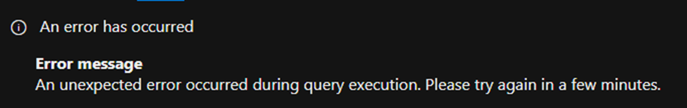
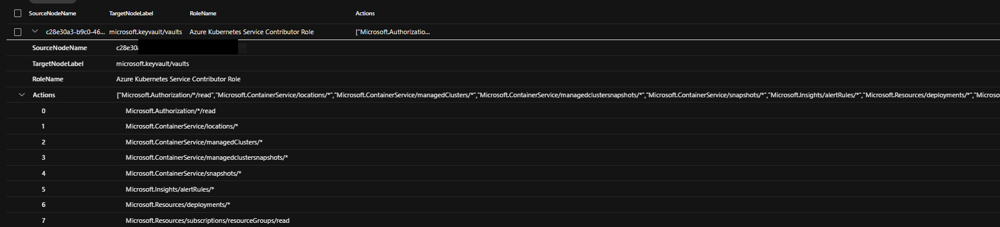
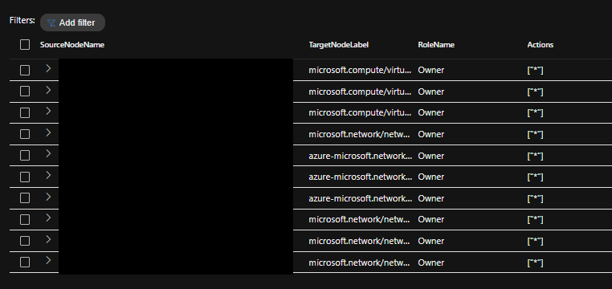

+++
date = '2025-02-19T16:57:07+01:00'
lastmod = '2025-02-19T17:00:07+01:00'
draft = false
title = "Unleash the power of Enterprise Exposure Graph: Create a Managed Identities Permissions Overview"
slug = 'unleash-the-power-of-enterprise-exposure-graph-managed-identities-permissions-overview'
description = "Use the Enterprise Exposure Graph in Microsoft Exposure Management to build an overview of all managed identities and their Azure permissions with KQL."
author = 'Thomas Verheyden'
tags = ["Azure Security", "Defender for Endpoint", "Defender XDR", "Enterprise Exposure Graph", "Microsoft Exposure Management"]
categories = ["Microsoft Exposure Management"]
+++

## Intro

Lately, I’ve been exploring Microsoft Exposure Management, particularly the data available in the Enterprise Exposure Graph. One interesting use case I’ve identified is leveraging this data to quickly gain an overview of all managed identities and their configured permissions in Azure.

I also created a technical talk about Microsoft Exposure management capabilities, hopefully my talk will be accepted soon, stay tuned!

Additionally I also created a GitHub repo with all the use case queries I already made in the past which you can find here: [Microsoft-Exposure-management-/ at main · ThomasVrhydn/Microsoft-Exposure-management-](https://github.com/ThomasVrhydn/Microsoft-Exposure-management-/tree/main)

In the meantime I suggest to read Sami Lamppu blog(s) if you want to learn more about Microsoft Exposure management:

[🔗 Microsoft Security Exposure Management (XSPM) Overview – Part 1](https://samilamppu.com/2024/04/15/microsoft-security-exposure-management-xspm-overview-part-1/)

## The fundamentals

The Enterprise Exposure Graph consist out of two important tables:

- ExposureGraphNodes
  - *ExposureGraphNodes contains organizational entities and their properties. These include entities like devices, identities, user groups, and cloud assets such as virtual machines (VMs), storage, and containers. Each node corresponds to an individual entity and encapsulates information about its characteristics, attributes, and security related insights within the organizational structure.*
- ExposureGraphEdges
  - *The ExposureGraphEdges schema, along with the complementing ExposureGraphNodes schema, provides visibility into relationships between entities and assets in the graph. Many hunting scenarios require exploration of entity relationships and attack paths. For example, when hunting for devices exposed to a specific critical vulnerability, knowing the relationship between entities, can uncover critical organizational assets.*

For the use case ‘Managed identities permissions overview’ I’m only going to use the ExposureGraphEdges tables, in later blogs i will explain more about the ExposureGraphNodes table and how you can use them together and even create your own multi relationships graphs!

### ExposureGraphEdges

The ExposureGraphEdges has some very interesting columns available. The colums I use the most are:

- `EdgeLabel` (`string`) – The edge label. Examples: “has permissions to” “routes traffic to,” “is running,” and “contains.”
- `SourceNodeId` (`string`) – Node ID of the edge’s source. Example: “12346aa0-10a5-587e-52f4-280bfc014a08”
- `SourceNodeName` (`string`) – The source node display name. Example: “mdvmaas-win-123”
- `SourceNodeLabel` (`string`) – The source node label. Example: “microsoft.compute/virtualmachines”
- `TargetNodeId` (`string`) – The node ID of the edge’s target. Example: “45676aa0-10a5-587e-52f4-280bfc014a08”
- `TargetNodeName` (`string`) – Display name of the target node. Example: gke-test-cluster-1
- `TargetNodeLabel` (`string`) – The target node label. Example: “compute.instances”
- `EdgeProperties` (`Dynamic` (json)) – Optional data relevant for the relationship between the nodes.

I really suggest to use this basic query to understand the possibilities of all the relationships, also have a look at all the different *SourceNodeLabel* and *TargetNodeLabel* that are available.

```kql
ExposureGraphEdges
| distinct EdgeLabel,  
// | distinct SourceNodeLabel
// | distinct TargetNodeLabel
```

### The Use Case: Managed Identities permissions Overview

The Enterprise Exposure Graph has a lot of RAW data available. Part of this available data is about EntraID and Azure resource data. There is an EdgeLabel that has the value “has permissions to” which can help us with building our one to one relationship between an EntraID entity( a managed identity in this case) and an Azure Resources and that’s exactly what we going to use for this use case: “Managed identities permissions overview”.

The RAW data we are looking for in this use case is available in the *EdgeProperties* column. When you print out you will notice the raw data is formatted in a JSON structure. Besides the EdgeProperties the SourceNodeName , TargetNodeLabel, (Roles)Name can be interesting.

```kql
ExposureGraphEdges
| where SourceNodeLabel == "managedidentity" 
| extend d = parse_json(EdgeProperties)
| extend Roles = d.rawData.permissions.roles
| mv-expand Roles
| extend Actions = Roles.actions
| extend RoleName = Roles.name
| project  SourceNodeName, TargetNodeLabel, RoleName, Actions
```

Depending on your environment this query can time-out and you will receive the following error:



What I suggest when you recieve that error is to start filtering early in your query. You can use the *TargetNodeLabel* for this. In the example below I only want to see the permissions on my Key Vault resources. You can do this by filtering on “microsoft.keyvault/vaults”:

```kql
ExposureGraphEdges
| where SourceNodeLabel == "managedidentity" and TargetNodeLabel == "microsoft.keyvault/vaults" 
| extend d = parse_json(EdgeProperties)
| extend Roles = d.rawData.permissions.roles
| mv-expand Roles
| extend Actions = Roles.actions
| extend RoleName = Roles.name
| project  SourceNodeName, TargetNodeLabel, RoleName, Actions
```

Example out put:



*Output of permissions on KeyVault*

Or mabye you first want to start with high privilege roles such as Owner or Contributor. You can achieve this by filtering on the *RoleName*:

```kql
ExposureGraphEdges
| where SourceNodeLabel == "managedidentity" and TargetNodeLabel == "microsoft.keyvault/vaults" 
| extend d = parse_json(EdgeProperties)
| extend Roles = d.rawData.permissions.roles
| mv-expand Roles
| extend Actions = Roles.actions
| extend RoleName = Roles.name
| where RoleName contains "Contributor" or RoleName contains  "Owner"
| project  SourceNodeName, TargetNodeLabel, RoleName, Actions
```

Or you just want to quickly see who has owner rights on your Azure Resources:

```kql
ExposureGraphEdges
| extend d = parse_json(EdgeProperties)
| extend Roles = d.rawData.permissions.roles
| mv-expand Roles
| extend Actions = Roles.actions
| extend RoleName = Roles.name
| where RoleName contains  "Owner"
| project  SourceNodeName, TargetNodeLabel, RoleName, Actions
```

Output:



*Output of all the Owners roles in Azure*

As you can see there are a lot of possibilities you can do when you have access to all the RAW data. I will create more blogs with additional use cases and more complex queries in the future! For example how you can create you own attacks paths with relationships 3 to 8 deep!
