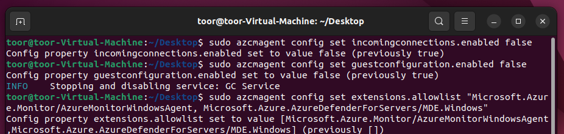
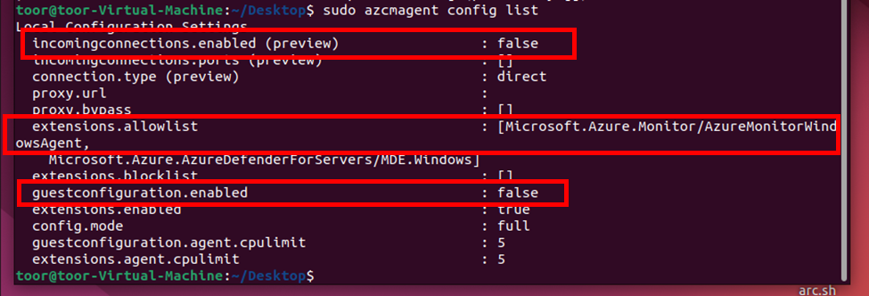
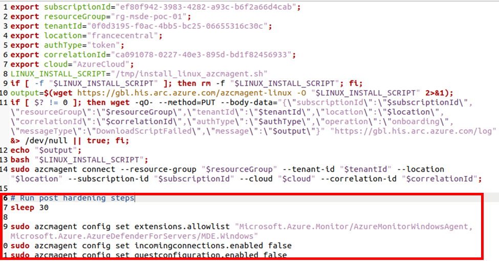
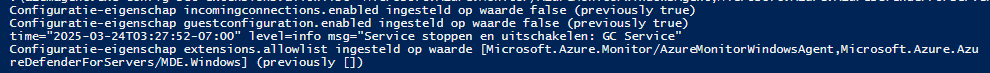
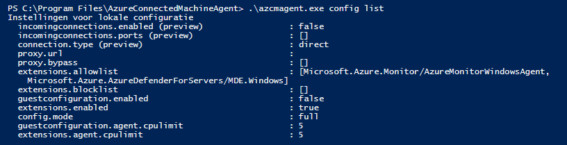

+++
date = '2025-04-14T11:09:13+01:00'
lastmod = '2025-04-14T11:09:14+01:00'
draft = false
title = "Using Azure Arc only for Defender for Servers or Azure monitoring Agent? Lock it down!"
slug = 'using-azure-arc-only-for-defender-for-servers-or-azure-monitoring-agent-lock-it-down'
description = "While reviewing Defender for Servers and AMA agent implementations across various customers, I noticed that not all of them are following best security practices for Azure Arc deployments. In this…"
author = 'Thomas Verheyden'
tags = ["Azure Monitor Agent", "Defender for Cloud", "Defender for Endpoint", "Defender for Servers", "Defender XDR"]
categories = ["Defender for Cloud", "Defender for Endpoint", "Defender XDR"]
+++

## Intro

While reviewing Defender for Servers and AMA agent implementations across various customers, I noticed that not all of them are following best security practices for Azure Arc deployments. In this blog, I want to highlight several security concerns and provide recommendations on how to mitigate them…

## Why should we care?

The Azure Connected Machine agent aka Azure Arc agent is a combination of four services/daemons that run on your server and help connect it with Azure. They’re installed together as a single application and are managed centrally using the azcmagent command line interface.

- Hybrid Instance Metadata Service
- Extension manager
- Guest configuration
- Azure Arc proxy

Two of those services, extension manager and guest configuration, run under the local system account and root on Linux. The **Local System** account in Windows is the **highest privilege built-in account**. It has **full administrative control** over the system, including:

- Can **start, stop, and manage services**, including system-critical ones.
- **Full access** to files, registry, and system processes.
- **Runs as NT AUTHORITY\SYSTEM**, which has more privileges than an administrator.
- **Acts as the computer account** (`DOMAIN\COMPUTERNAME$`) when accessing network resources.
- **Acts as the computer account** (`DOMAIN\COMPUTERNAME$`) when accessing network resources.

If **compromised**, an attacker gains **complete control** over the system, making it a **prime target** for privilege escalation attacks. The same can be said about root access on Linux.

The Azure Arc proxy service runs as Network Service account and a standard user on Linux. The **Network Service** account on Windows has **lower** privileges than **Local System**, but it still has more privileges than a standard user. It is considered a **built-in service account** designed to run network-facing services with **minimum necessary privileges**. **Network Service is not a high-privilege role**, but it has enough permissions that, if compromised, it could be used in an attack to escalate privileges. The good thing is that its disabled by default until you configure the agent to user the Azure Arc Gateway.

## Best practices implementation

There are two best practices I would recommend. These recommendation are not a requirement but I strongly recommend to maintain the security posture of your highly important assets:

- Disable unnecessary management features
- Dedicated Azure subscription

> ⚠️ **Before you proceed, make sure to consult with your server management stakeholders. You want to avoid disabling functionality that, while unused by you, may be essential for other stakeholders within your organization.**

### Disable unnecessary management features:

I will focus solely on how to lock down the Azure Arc agent in the **context of Defender for Server and the Azure Monitoring Agent** for collecting security logs, as these are the tools I use most frequently in my Defender XDR/Sentinel implementations. If you got an another use case i highly suggest to have a look at Wim Matthyssen blog post where he shows how to configure a broader allowlist for the Extensions manager:

[Azure Arc: Customize the extension allowlist for Azure Arc-enabled Windows Servers – Wim Matthyssen](https://wmatthyssen.com/2024/11/20/azure-arc-customize-the-extension-allowlist-for-azure-arc-enabled-windows-servers/)

We will use the Azure Connected Machine agent command line tool, azcmagent, which helps you configure , manage, and troubleshoot a server’s connection with Azure Arc. The good thing is this is supported both for Windows and Linux. Before you can use this command line tool you need access to the machine. There are different possibilities to have access on machines but in this example used the most basic on by logging on the asset.

Below we are going to disable any unused functionality in the agent to prevent any intentional or accidental use of those features to make changes to the server. This includes:

- Disabling the machine configuration agent if you don’t intend to use machine configuration policies
- Disabling remote access capabilities
- Setting an extension allowlist for the extensions you intend to use, or disabling the extension manager if you are not using extensions

### Linux

When connected to the machine, open your terminal with root permissions and type in the following commands:

```
azcmagent config set incomingconnections.enabled false

azcmagent config set guestconfiguration.enabled false

azcmagent config set extensions.allowlist “Microsoft.Azure.Monitor/AzureMonitorWindowsAgent,Microsoft.Azure.AzureDefenderForServers/MDE.Windows”
```

If everything went well you will receive the following output:



*execution of commands*

You can always validate your configuration by running the following command:



*Validation of configuration*

You can also automate the deployment by adding the lines to you onboarding script that you use for the installation of the Azure Arc agent:

```bash
# Run post hardening script
Sleep 30
sudo azcmagent config set incomingconnections.enabled false
sudo azcmagent config set guestconfiguration.enabled false
sudo azcmagent config set extensions.allowlist “Microsoft.Azure.Monitor/AzureMonitorWindowsAgent,Microsoft.Azure.AzureDefenderForServers/MDE.Windows”
```

Example:



*Screenshot of install script add on*

### Windows

When connected to the machine, open powershell with administrative permissions and type in the following commands:

```bash
cd "C:\Program Files\AzureConnectedMachineAgent"

.\azcmagent.exe config set incomingconnections.enabled false

.\azcmagent.exe config set guestconfiguration.enabled false

.\azcmagent.exe config set extensions.allowlist “Microsoft.Azure.Monitor/AzureMonitorWindowsAgent,Microsoft.Azure.AzureDefenderForServers/MDE.Windows”
```

Your normally receive a output that the values has been change (in my example in dutch):



*Configuration*

Also on Windows you can validate your configuration by running the following command (check your working directory):

```
 .\azcmagent.exe config list
```

Output:



*Validation of configuration*

You can also automate the configuration by adding the following lines to the bottom of your onboarding script:

```powershell
## Post Azure Arc hardening steps

try{

Start-Sleep -Seconds 30

$AgentLocation = "$env:ProgramW6432\AzureConnectedMachineAgent\azcmagent.exe"

if($AgentLocation){
cd "$env:ProgramW6432\AzureConnectedMachineAgent\"

./azcmagent.exe config set incomingconnections.enabled false
./azcmagent.exe config set guestconfiguration.enabled false
./azcmagent.exe config set extensions.allowlist “Microsoft.Azure.Monitor/AzureMonitorWindowsAgent,Microsoft.Azure.AzureDefenderForServers/MDE.Windows”
Write-Host  -ForegroundColor Green "Post Azure Arc hardenning settings configured !"

}Else{
Write-Host  -ForegroundColor red "Post Azure Arc hardenning settings FAILED !"
}

}catch{
    Write-Host  -ForegroundColor red $_.Exception
}
```

### Dedicated Azure subscription:

I totally understand that this recommendation is really depending on the Azure organizational structure but you should treat any **subscription or management group admin** as equivalent to a **local administrator** on **assets**. They can grant themselves access by assigning new roles to the **Azure Arc resource**. Additionally, **policies applied at these levels** may have the authority to modify the server’s configuration.

To reduce the number of accounts and policies with access to your **highly important assets**, use a **dedicated Azure subscription** that is tightly monitored and has **minimal persistent administrators**. Additionally, review **Azure policies in parent management groups** to ensure they align with your security objectives for these servers.

## Summary

That’s it! You can now lock down your Azure Arc agent to only include the necessary functionality on both Windows and Linux machines. **However, before you proceed, make sure to consult with your server management stakeholders. You want to avoid disabling functionality that, while unused by you, may be essential for other stakeholders within your organization.**
