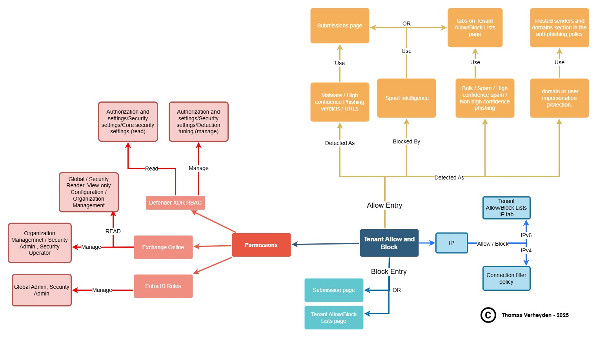

+++
date = '2025-05-07T10:45:49+01:00'
lastmod = '2025-05-07T10:45:50+01:00'
draft = false
title = "Defender for Office 365: Visualisation of the Tenant Allow/Block List features"
slug = 'defender-for-office-365-visualisation-of-the-tenant-allow-block-list-features'
description = "During my work with customers, when I explain the tenant allow and block features in Microsoft Defender for Office 365 P1/P2, I often get the question: why did Microsoft make this so hard to…"
author = 'Thomas Verheyden'
tags = ["Defender for Office 365", "Defender XDR", "Microsoft Security"]
categories = ["Defender for Office 365", "Defender XDR"]
+++

During my work with customers, when I explain the tenant allow and block features in Microsoft Defender for Office 365 P1/P2, I often get the question: why did Microsoft make this so hard to understand? That comment gave me the idea to create a visual representation of the features to make them easier to understand.

You can find the visualisation below or on my github:

[Defender-For-O365/MDO – Allow-Deny list.jpg at main · ThomasVrhydn/Defender-For-O365](https://github.com/ThomasVrhydn/Defender-For-O365/blob/main/MDO%20-%20Allow-Deny%20list.jpg)

