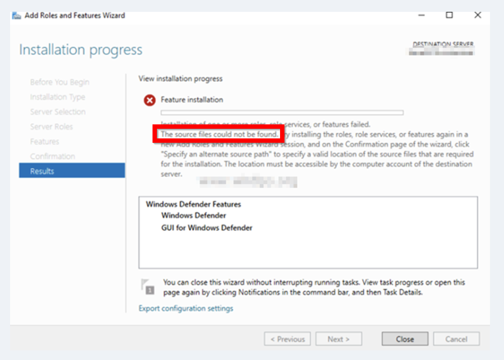
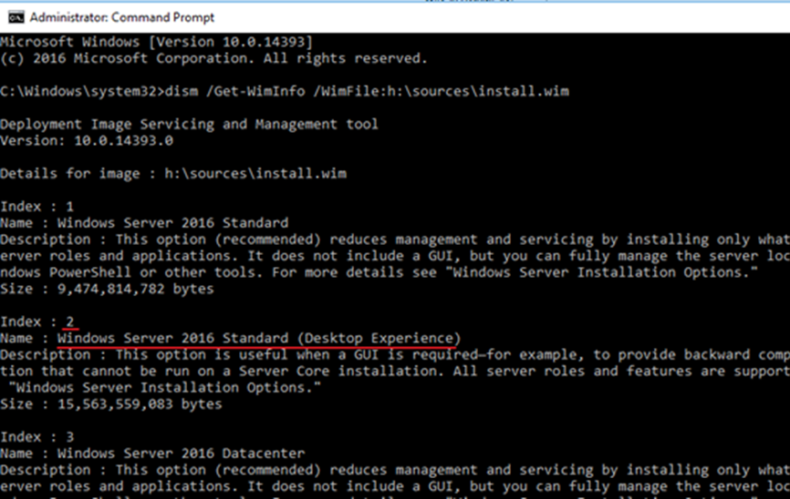
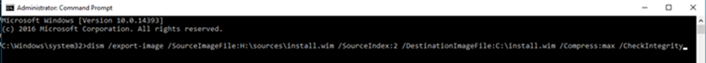
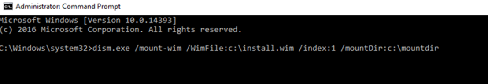
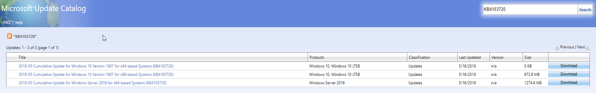
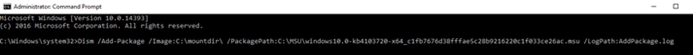
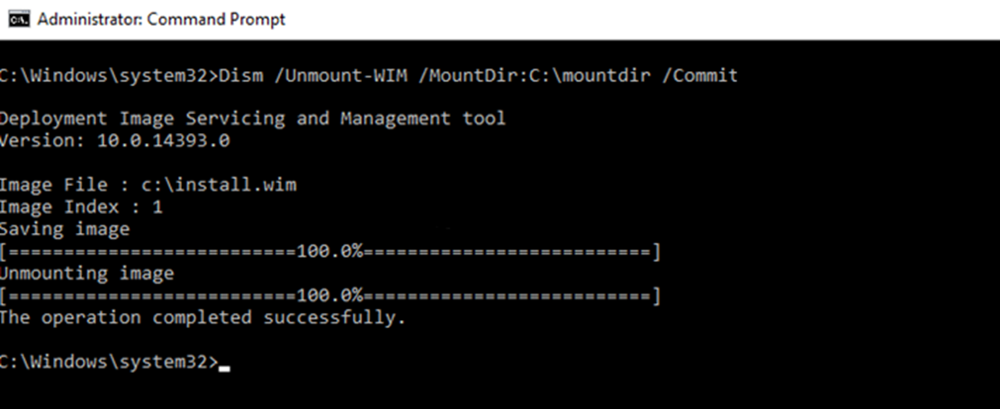
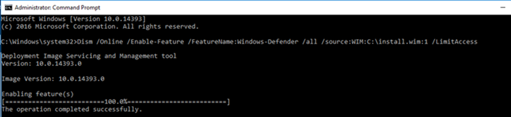

+++
date = '2025-06-23T19:39:17+01:00'
lastmod = '2025-06-24T10:06:37+01:00'
draft = false
title = "Defender AV Mystery: Solving the ‘Source Files could Not be Found’"
slug = 'defender-av-mystery-solving-the-source-files-could-not-be-found'
description = "Enabling the Defender Antivirus role on a Windows Server fails with \"source files could not be found\". Why this happens and how to solve it."
author = 'Thomas Verheyden'
tags = ["Defender for Endpoint", "Defender XDR", "Microsoft Security"]
categories = ["Defender for Endpoint", "Defender XDR"]
+++

## Intro

This week I bumped into a problem that I had not experienced for several years at one of my customers. The customer was migrating from a 3rd-party EDR to Defender for Endpoint on their servers. During the onboarding they wanted to enable the Defender Antivirus server role and they run against the following error:



Removing unnecessary Windows Server features was a best practice an couple of years ago because it reduced the attack surface, improving security by limiting potential vulnerabilities. It also made the server image smaller and faster to deploy, which enhanced performance and resource efficiency. I once saw it on a Windows Server 2016 image but this time it was on a windows server 2022 image, so its stil actual and the reality …

So, how can you import the sources back into the image? Let me explain in this blog post.

## High level – Prerequisite

As a prerequisite to get the sources back ingested you need the image of the partial operation system. After that you need to do the following steps:

- Upgrade the image with the latest patches , quality updates (Windows server 2016 only)
- Install the Windows defender binaires of the image

## Step by step approach

Step 1: Download the Operating system ISO file for the OS where you want to enable the Defender AV feature on from the microsoft evalution website. [Microsoft Evaluation Center](https://www.microsoft.com/en-us/evalcenter/?msockid=2df172bf89196b8b2764675a88516a41)

Step 2: Mount the image file by opening File Explorer and navigate to the ISO image file. Right-click on the file and select Mount. The image will be mounted to a drive and displayed in the File Explorer drives and folders tree. In my case the H: drive.

Step 3: The ISO contains multiple install images. We need to determine the correct installed version of the image. In my case it’s the ‘Windows Server 2016 Standard (Desktop Experience)”. This is depending on the operating system you are using and where you want to enable Defender AV feature role. You can determine the correct version with the following command:

```powershell
dism /Get-WimInfo /WimFile:h:\sources\install.wim
```



Step 4: Now we know the correct index of the image file we need, now its time to export that image:

```
dism /export-image /SourceImageFile:H:\sources\install.wim /SourceIndex:2 /DestinationImageFile:c:\install.wim /Compress:max /CheckIntegrity
```


> ⚠️ If you are using windows 2019 or high you can skip to step 9. Updating the image file is only recommend on Windows serve 2016 images.

Step 5: The next step is to mount the new image file so we can edit it

```
dism /mount-wim /WimFile:c:\install.wim /index:1 /mountDir:c\mountdir
```



Step 6: Now we need to download the lastest commulative update for the Windows server 2016



Step 7: Time to ad the update to the mounted image file

```
dism /Add-package /Image:c:\mountdir\ /PackagePath:c:\MSU\window10.0-kb4103720-x64_c1fb7676d38fffae5c28b9216220c1f033ce26ac.msu /logPath:ADDPackage.log
```



Step 8: Save the image file by unmouting it

```
dism /Unmount-WIM /MountDir:C:\mountdir /Commit
```



Step 9: As the last step is we need to enable the defender AV binaries from the image file we updated.

```
dism /Online /Enable-Feature /FeatureName:Windows-Defender /all /source:WIM:c\install.wim:1 /LimitAccess
```



After completing this step, the Windows Defender Antivirus feature should be enabled, allowing you to proceed with your Defender for Endpoint migration!!
