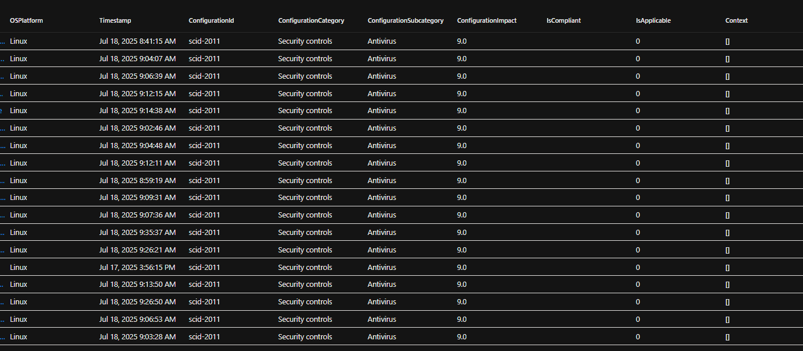
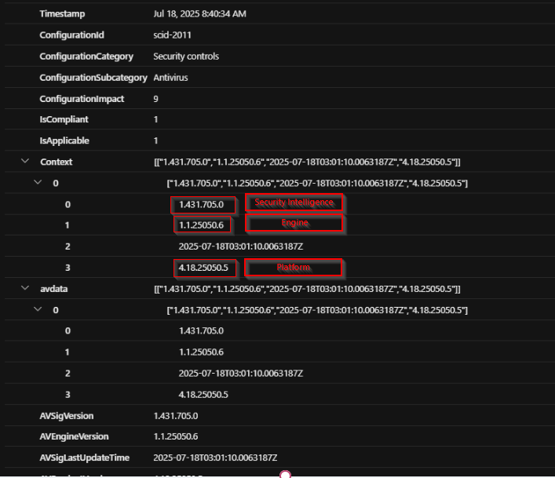
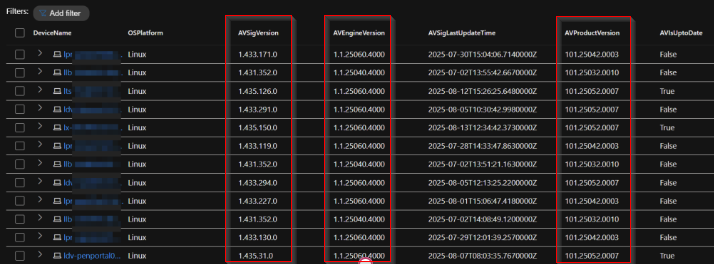
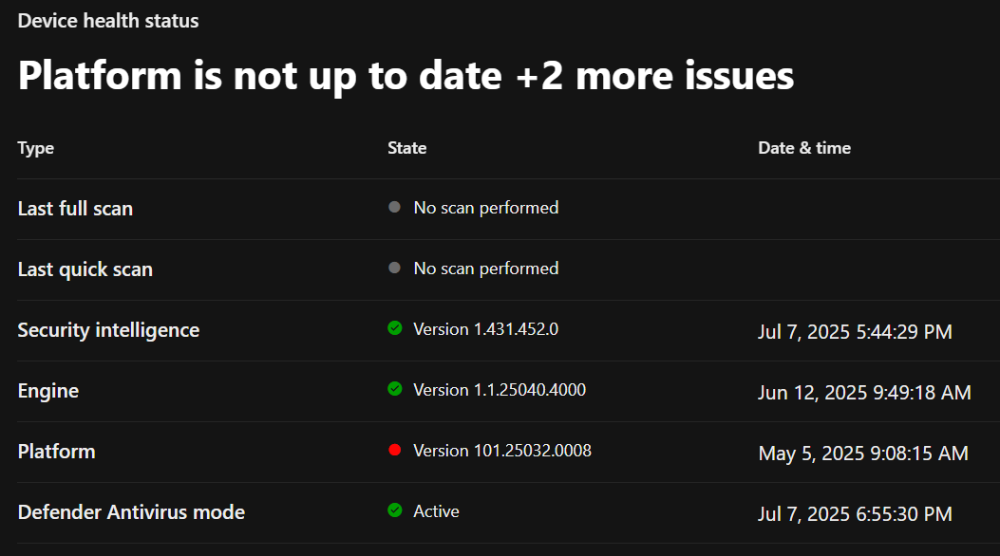

+++
date = '2025-08-27T08:43:50+01:00'
lastmod = '2025-09-29T20:03:29+01:00'
draft = false
title = "Guidance on how to manage products updates for Defender for Server on Linux distributions"
slug = 'guidance-on-how-to-manage-products-updates-for-defender-for-server-on-linux-distributions'
description = "How to manage Defender for Endpoint product updates on Linux servers: package managers, update rings and the approach I recommend to customers."
author = 'Thomas Verheyden'
tags = ["Defender for Endpoint", "Defender XDR", "Microsoft Security"]
categories = ["Defender for Endpoint", "Defender XDR"]
+++

## Intro

There are many helpful blog/videos posts about managing Microsoft Defender for Endpoint (MDE) updates on Windows, but there’s not much information available for MDE on Linux. In this blog post, I’ll share my experience with the product and how I usually recommend managing updates on Linux distributions.

On Linux, MDE updates are managed via the package manager native to your Linux distribution (e.g., apt for Ubuntu/Debian, yum or dnf for RHEL/CentOS/Fedora, zypper for SUSE). These updates ensure that the Defender components (like the antimalware engine, EDR sensor, etc.) are kept up-to-date.

## **Initial setup**

When you install Microsoft Defender for Endpoint on Linux, it sets up a repository (e.g., Microsoft’s package feed) specific to your distribution. This repository includes:

- mdatp (Microsoft Defender ATP)
- Dependencies (like libmtp or other helper tools)
- Repo config (e.g., /etc/apt/sources.list.d/microsoft.list)

Microsoft Defender for Endpoint on Linux receives two main types of updates to keep systems secure and performant:

- Product Updates – These include improvements to the core MDE agent, new features, performance enhancements, and bug fixes.
- Security Intelligence Updates – These are frequent updates to malware definitions and detection logic

Security intelligence updates for Microsoft Defender for Endpoint on Linux are delivered regularly, typically multiple times per day. You can configure your endpoints to receive updates automatically from Microsoft’s cloud, or set up a local mirror server for offline environments ( [Configure offline security intelligence updates for Microsoft Defender for Endpoint on Linux – Microsoft Defender for Endpoint | Microsoft Learn](https://learn.microsoft.com/en-us/defender-endpoint/linux-support-offline-security-intelligence-update) ) . Either way, the goal is to ensure your protection is always up to date.

Each product version of Defender for Endpoint on Linux is set to expire automatically after 9 months. While expired product versions continue to receive security intelligence updates, install the latest version to get all available fixes and enhancements. To check the expiration date, run the following command:

```bash
mdatp health --field product_expiration
```

Expired clients report a health issue and warning message when you run the following command:

```bash
mdatp health
```

Indicators of an expired client include the message, “**ATTENTION: No license found. Contact your administrator for help**.” with the following attributes:

```
ATTENTION: No license found. Contact your administrator for help.
healthy                                     : false
health_issues                               : ["missing license"]
licensed                                    : false
```

Microsoft publishes monthly product updates with release notes, version numbers, and changes. You can monitor these on the official Linux updates page.

Besides that MDE on Linux supports multiple update channels:

- Beta (Insider) – Early access to features for testing.
- Preview (External) – Pre-release builds for broader validation.
- Current (Production) – Stable, fully tested builds for enterprise deployment.

To switch update channels for Microsoft Defender for Endpoint on Linux, you’ll need to uninstall the current package and reinstall it from the desired channel’s repository. You can find full instructions and supported distros on [Microsoft’s official deployment guide](https://learn.microsoft.com/en-us/defender-endpoint/linux-updates).

## Good to know

When using **Microsoft Defender for Servers** with the **MDE.Linux extension**, **automatic updates** for Defender for Endpoint are **enabled by default**. This ensures that your security agent stays current without any manual intervention.

However, **some customers prefer to keep control in their own hands**, especially when managing updates in tightly regulated or mission-critical environments. For these cases, **manual update configuration** is possible and fully supported on **Azure VMs** and **Azure Arc-enabled machines**.

To **disable automatic updates**, simply tag the machine with:

- **Tag name**: ExcludeMdeAutoUpdate
- **Tag value**: true

This gives you full control over when and how Defender for Endpoint gets updated.Manual manage products updates

## Keep control in your own hands

But what if you want to keep control in your own hands and schedule the updates based on your company wide approved update cycle? Manual updating your defender for Linux? Manual tasks can be resource heavy because they often require significant time, focus, and repetitive effort, especially when done at scale. They increase the risk of human error and slow down workflows that could otherwise be streamlined. To tackle this, I created an OS independent script that automates the process, making it faster, more consistent, and easier to implement. You can also push the script with your favorite automation tool (puppet, ansible etc.).

It will not only configure when the product updates take place, it will also configure the intelligence update scan cycle and quick scan, if desired. All of these tasks are configured using **cronjobs**, giving you fine-grained control over execution times.

### Currently support package managers

- yum – Used in RHEL-based distributions (Red Hat, CentOS, Fedora older versions).
- apt-get – Used in Debian-based distributions (Debian, Ubuntu, etc.).
- zypper – Used in SUSE-based distributions (openSUSE, SUSE Linux Enterprise).

### Script details

Before diving into the script itself, here’s a high level overview of what it does behind the scenes to help automate and customize Defender for Endpoint updates on Linux systems:

1. Check if the script is running as root
2. Dump the current crontab to a temporary file
3. Check if crontab jobs are already present
4. Select the correct package manager
5. Add the scan, intel and quick scan entries to the crontab
6. Load the new crontab
7. Echo the new loaded crontab to validate configuration

### The full script

```bash
#!/bin/bash
# Created by Thomas Verheyden - 01-07-2025

# Verify we are running as root
if [ "$EUID" -ne 0 ]; then
        echo "Please run as root"
        exit
fi

echo "This script will install 3 cronjobs for Defender"
echo " - Update defender (Saturday)"
echo " - Defender quick scan (Sunday)"
echo " - Defender Intelligence update (Every hour)"
echo ""

# Dump the current crontab to a temporary file
tmpfile=$(mktemp /tmp/crontab.XXXXXX)
crontab -l 2>/dev/null > $tmpfile

# Check if crontab is already present
if cat ${tmpfile} | grep -q mdatp; then
        echo "It seems that there is already a cronjob present for mdatp. Aborting"
        exit
fi

# Select correct update command
which yum >/dev/null && update_command='yum update mdatp -y > /root/mdatp_update_cron_job.log'
which apt-get >/dev/null && update_command='apt-get install --only-upgrade mdatp > /root/mdatp_update_cron_job.log'
which zypper >/dev/null && update_command='zypper update mdatp > /root/mdatp_update_cron_job.log'
if [ -z "$update_command" ]; then
        echo "Script could not determine the package manager that should be used. Aborting"
        exit
fi

# Add our entries to crontab
scan_command='/bin/mdatp scan quick > /root/mdatp_cron_job.log'
Intel_command='/bin/mdatp definitions update > /root/mdatp_cron_job.log'
echo "0 2 * * sat ${update_command}" >> $tmpfile
echo "0 2 * * sun ${scan_command}" >> $tmpfile
echo "0 * * * sun ${Intel_command}" >> $tmpfile

# Load the new crontab
crontab $tmpfile

echo "Current crontab:"
crontab -l
echo ""
echo "Done."

# Cleanup
rm $tmpfile
```

You can also find it on my Github:

[Defender-for-endpoint/Linux – Config-UpdateScanIntel-CronJob .sh at main · ThomasVrhydn/Defender-for-endpoint](https://github.com/ThomasVrhydn/Defender-for-endpoint/blob/main/Linux%20-%20Config-UpdateScanIntel-CronJob%20.sh)

### Fields to edit

If you want to change the day/time when the different jobs run in the crontab , you need to edit row 39 till 41 of the script below by using the following syntax:

```
* * * * * yum update mdatp -y
│ │ │ │ │
│ │ │ │ └─── Day of the week (0 - 7) (Sunday = 0 or 7)
│ │ │ └───── Month (1 - 12)
│ │ └─────── Day of the month (1 - 31)
│ └───────── Hour (0 - 23)
└─────────── Minute (0 - 59)
```

Example:

```
0 3 * * 1 yum update mdatp -y
This product updates will run every Monday at 3:00 AM.
```

If you only want to configure the product update cycles , you need to remove the lines with the scan and intel commands( by default line 40 & 41):

```bash
echo "0 2 * * sat ${update_command}" >> $tmpfile
echo "0 2 * * sun ${scan_command}" >> $tmpfile
echo "0 * * * sun ${Intel_command}" >> $tmpfile
```

## Monitor product updates for MDE on linux

There are different ways to monitor the product updates on your endpoint:

- Use the CLI
- Track update history
- Device inventory Defender XDR portal
- Advanced hunting

### Advanced hunting

I usually use this following query for Windows endpionts to receive the products version information and MDE status:

```kql
let avmodetable = DeviceTvmSecureConfigurationAssessment
| where ConfigurationId == "scid-2010" and isnotnull(Context)
| extend avdata = parsejson(Context)
| extend AVMode = iif(tostring(avdata[0][0]) == '0', 'Active',
               iif(tostring(avdata[0][0]) == '1', 'Passive',
               iif(tostring(avdata[0][0]) == '4', 'EDR Blocked', 'Unknown')))
| project DeviceId, AVMode;
DeviceTvmSecureConfigurationAssessment
| where ConfigurationId == "scid-2011" and isnotnull(Context)
| extend avdata = parsejson(Context)
| extend AVSigVersion = tostring(avdata[0][0]),
         AVEngineVersion = tostring(avdata[0][1]),
         AVSigLastUpdateTime = tostring(avdata[0][2]),
         AVProductVersion = tostring(avdata[0][3])
//| project DeviceId, DeviceName, OSPlatform, AVSigVersion, AVEngineVersion, AVSigLastUpdateTime, AVProductVersion, IsCompliant, IsApplicable
| join kind=inner avmodetable on DeviceId
| project-away DeviceId1
```

The DeviceTvmSecureConfigurationAssessment table sometimes includes this in the Context field under ConfigurationId == “scid-2011”, but as you’ve seen, that field is often empty for Linux endpoints.



If you run run the same query for Windows platform you will give much more information about the MDE version:



There is another configuration item in the DeviceTvmSecureConfigurationAssessment “Update Microsoft Defender for Endpoint core components” under ConfigurationId == “scid-6095”. This item check if productversion update is required, meaning the agent is older then 9 months. When you combine everything you get the following query:

```kql
DeviceTvmSecureConfigurationAssessment
| where ConfigurationId == "scid-6095" and isnotnull(Context) and OSPlatform == "Linux"
| extend avdata = parsejson(Context)
| extend AVSigVersion = tostring(avdata[0][0]),
         AVEngineVersion = tostring(avdata[0][1]),
         AVSigLastUpdateTime = tostring(avdata[0][2]),
         AVProductVersion = tostring(avdata[0][3]),
         AVIsUptoDate = tostring(IsCompliant)
| project DeviceName, OSPlatform, AVSigVersion, AVEngineVersion, AVSigLastUpdateTime, AVProductVersion, AVIsUptoDate
```

As you can see i added a extra column AVIsUptoDate which will be true if the endpoint is compliant against the “Update Microsoft Defender for Endpoint core components”, also the AVSigVersion, AVEngineVersion and AVLastUpdateTime will be provided.  
  
If you run the query the output will look like this:



### CLI

Run the following command to view the current product version and expiration from the CLI:

```bash
mdatp health --field product_expiration
mdatp health --field app_version
```

You can check your system’s package manager logs for updates references:

- **Debian/Ubuntu**:

```bash
grep mdatp /var/log/dpkg.log
```

- **RHEL/CentOS**:

```bash
grep mdatp /var/log/yum.log
```

- **SLES**:

```bash
grep mdatp /var/log/zypper.log
```

### Defender portal

On the device inventory page in the defender portal you can check the product update state also:


