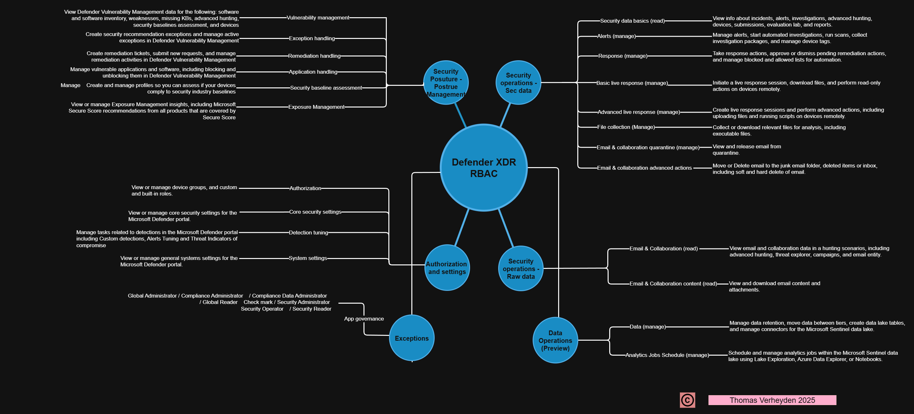

+++
date = '2025-09-29T19:51:14+01:00'
lastmod = '2025-09-29T19:56:33+01:00'
draft = false
title = "The ultimate Defender XDR RBAC visualization"
slug = 'the-ultimate-defender-xdr-rbac-visualization'
description = "Do you also struggle, like I do, to assign the correct permissions in Microsoft Defender XDR RBAC when designing your RBAC model? I recently created a visual overview of the current roles and…"
author = 'Thomas Verheyden'
tags = ["Defender XDR", "Microsoft Security"]
categories = ["Defender XDR"]
+++

Do you also struggle, like I do, to assign the correct permissions in Microsoft Defender XDR RBAC when designing your RBAC model?

I recently created a visual overview of the current roles and their functions. It helped me a lot in understanding how to structure RBAC properly and I hope it can help you too!

✅ Clear mapping of roles

✅ Easier decision-making for access control

✅ Useful for both technical and governance teams

Feel free to check it out and let me know your thought, feedback is always welcome!

Link to Github for download: [Defender-XDR/Defender XDR – RBAC design.png at main · v3rtho/Defender-XDR](https://github.com/v3rtho/Defender-XDR/blob/main/Defender%20XDR%20-%20RBAC%20design.png)

**#DefenderXDR** **#RBAC** **#SecurityArchitecture** **#MicrosoftSecurity**
