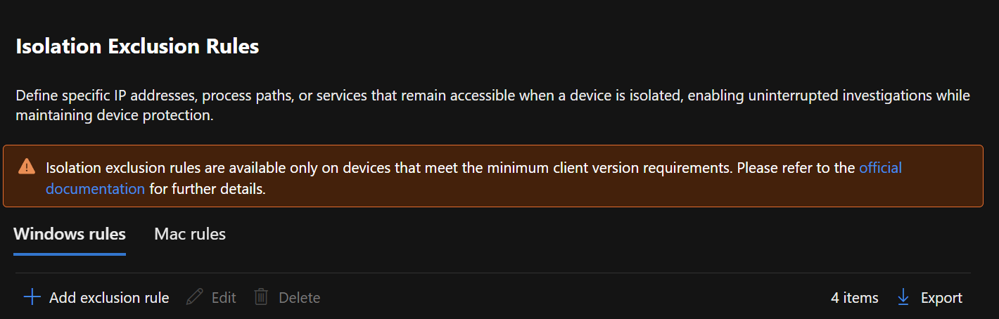
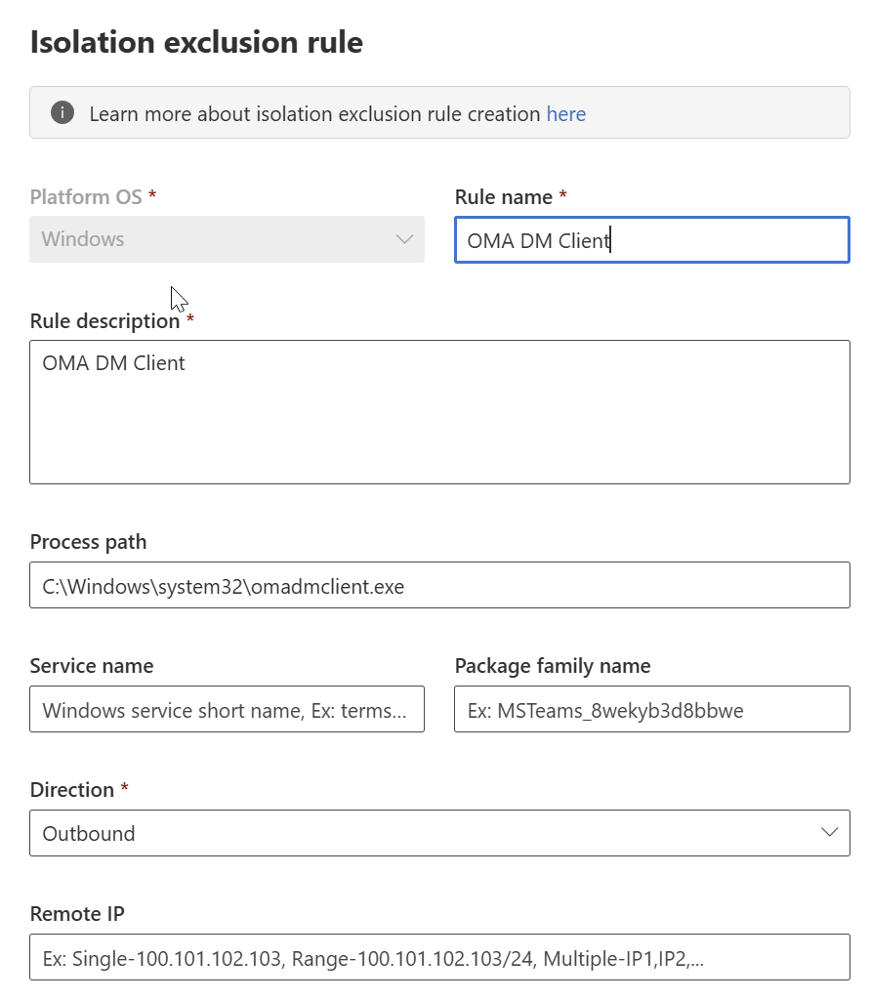
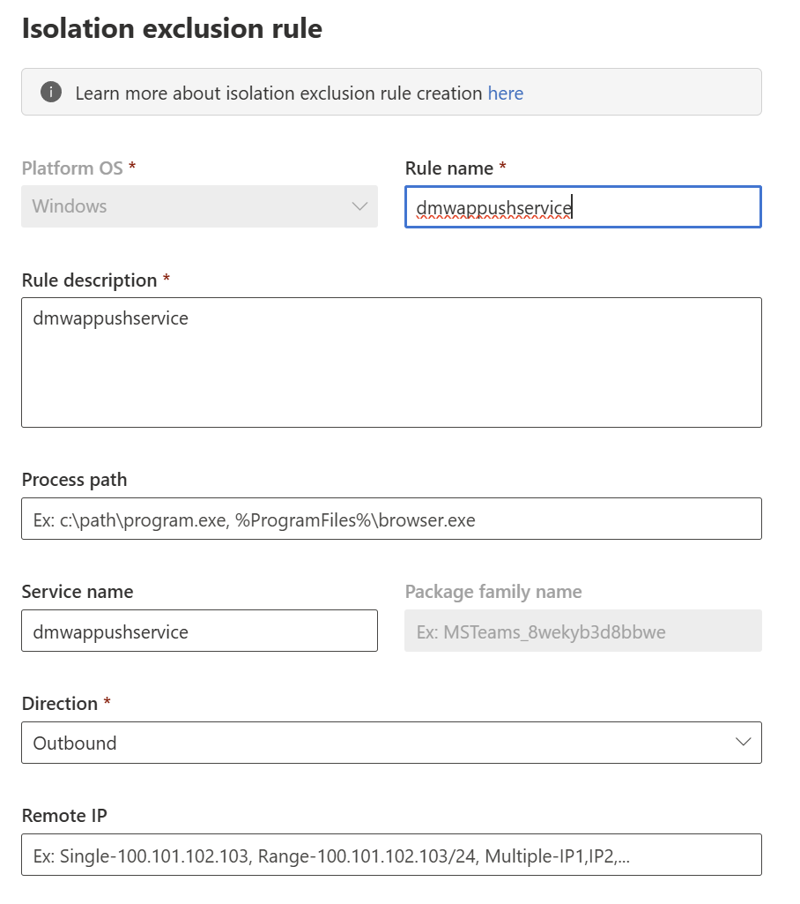
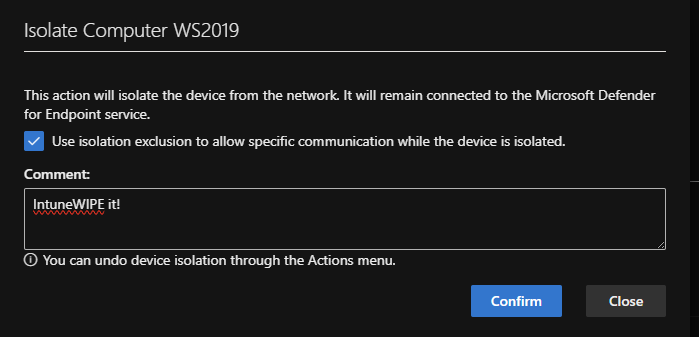

+++
date = '2025-10-22T15:12:10+01:00'
lastmod = '2025-10-22T15:57:33+01:00'
draft = false
title = "Remotely Intune wipe devices in Defender for Endpoint isolation mode!"
slug = 'remotely-intune-wipe-devices-in-defender-for-endpoint-isolation-mode'
description = "Using the new isolation exclusions in Defender for Endpoint to remotely wipe a device with Intune while it stays in isolation mode."
author = 'Thomas Verheyden'
tags = ["Defender for Endpoint", "Defender for Servers", "Defender XDR", "Microsoft Security"]
categories = ["Defender for Endpoint", "Defender XDR"]
+++

## Intro

Microsoft recently announced that device isolation exclusions in Defender for Endpoint are now generally available. This made me think about possible use cases for this new feature. Together with [Bjorn Claes](https://www.linkedin.com/in/bjornc/), we explored whether it’s possible to exclude the Intune wipe process from isolation mode. If this works, it would allow us to remotely wipe devices using Intune while keeping them in isolation mode within Defender for Endpoint.

A special thanks to [Rudy Ooms](https://www.linkedin.com/in/rudyooms/) for his Intune Insights blogs, which helped us quickly identify the processes and services we needed to investigate. His blogs can you find [here](https://call4cloud.nl/?_gl=1*pj5w4u*_ga*Nzk1MjkyOTM4LjE3NTc0OTU4OTM.*_ga_EQJM48HYCY*czE3NjExNDI0OTAkbzQkZzAkdDE3NjExNDI0OTAkajYwJGwwJGgw).

## What’s new

Isolation exclusions allow designated processes or endpoints to bypass the restrictions of network isolation, ensuring essential functions continue while limiting broader network exposure. Previously you had only the option to allow outlook, Teams and Skype for business communication to be excluded while in isolation mode.

Now we the new option you can exclude based on:

- **Process path** – *You can define a specific executable path. Wildcards are supported for flexibility.*
- **Service** – *You can exclude a Windows service (note: a service is not the same as an application).*
- **Package family** – *The Package Family Name (PFN) is a unique identifier assigned to Windows app packages.*

## Set an exclusion for Intune RemoteWipe

> ⚠️ **Any exclusion weakens device isolation and increases security risks. To minimize risk, configure exclusions only when strictly necessary**. Regularly review and update exclusions to align with security policies.

Before you can start with configurating the exclusion rules you first need to enable this new feature. You can do this by going to Defender XDR portal under Settings > Endpoints > Advanced Features > Isolation Exclusion Rules.

Now you are ready to configure the Isolation Exclusion Rules. You can find them again in the Defender XDR portal under Settings > Endpoints > Isolation Exclusion Rules . Click on ‘Add exclusion rule’

You will need to configure different policies for every process and services you want to exclude. The following list contains all those exclusions you need to configure to let the Intune remote Wipe work:

- **Process name:**
  - C:\windows\system32\omadmclient.exe

Example rule for the omadmclient.exe :

- **Service name:** 
  - WpnService
  - CrypSvc
  - TokenBroker
  - IntuneManagementExtension
  - dmpwappushservice

Example rule for the service dmpwappushservice:

Once you have configured the exclusions you will notice that isolation options have changed:

Previously, you could simply check a box to automatically exclude apps like Teams, Outlook, or Skype. Now, that checkbox instead controls whether your custom-defined Isolation Exclusion Rules are applied.

## Mapping Mitre attack techniques with allowed exclusions

I find it important to also point all the Mitre attack Techniques that available for the allowed exclusions. I suggest to review them one by one and determine the risk of them.

- **Omadmclient.exe**
  - **[T1569.002 – Service Execution](https://attack.mitre.org/techniques/T1569/002/)**
    - *Adversaries may abuse Windows services to execute malicious payloads. Since `omadmclient.exe` runs as a service, attackers may attempt to hijack or mimic it.*
  - **[T1021.006 – Windows Remote Management (WinRM)](https://attack.mitre.org/techniques/T1021/006/)**
    - *WinRM can be used to remotely trigger processes like `omadmclient.exe`, especially in lateral movement scenarios.*
  - **[T1059 – Command and Scripting Interpreter](https://attack.mitre.org/techniques/T1059/)**
    - *Attackers may use PowerShell or CMD to invoke or manipulate `omadmclient.exe` for execution or configuration changes.*
  - **[T1204.002 – User Execution: Malicious File](https://attack.mitre.org/techniques/T1204/002/)**
    - *If `omadmclient.exe` is tricked into executing a malicious configuration or script, it could be part of a user execution chain.*
  - **[T1134 – Access Token Manipulation](https://attack.mitre.org/techniques/T1134/)**
    - *Attackers may manipulate tokens to run `omadmclient.exe` under elevated privileges or impersonated contexts.*
- **WpnService (Windows Push Notification Service)**
  - **[T1046 – Network Service Discovery](https://attack.mitre.org/techniques/T1046/)**
    - *Adversaries may scan for services like WpnService to identify targets or vulnerabilities.*
- **CrypSvc (Cryptographic Services)**
  - **[T1496 – Resource Hijacking](https://attack.mitre.org/techniques/T1496/)**
    - *Attackers may abuse system services like CrypSvc for resource-intensive tasks such as cryptomining.*
- **TokenBroker**
  - **[T1134 – Access Token Manipulation](https://attack.mitre.org/techniques/T1134/)**
    - *TokenBroker is involved in authentication flows; attackers may manipulate access tokens to escalate privileges or evade defenses.*
  - **[T1078 – Valid Accounts](https://attack.mitre.org/techniques/T1078/)**
    - *Abuse of valid tokens and accounts for persistence or lateral movement.*
- **IntuneManagementExtension**
  - **[T1176 – Software Extensions](https://attack.mitre.org/techniques/T1176/)**
    - *Attackers may abuse software deployment mechanisms like IntuneManagementExtension to persist or execute payloads.*
  - **[T1021 – Remote Services](https://attack.mitre.org/techniques/T1021/)**
    - *Could be used for remote execution or lateral movement via Intune-managed scripts*.
- **Dmpwappushservice (WAP Push Message Routing Service)**
  - **[T1003 – OS Credential Dumping](https://attack.mitre.org/techniques/T1003/)**
    - *May be targeted or monitored during credential harvesting.*
  - T**[1046 – Network Service Discovery](https://attack.mitre.org/techniques/T1046/)**
    - *Could be discovered during scans for exploitable services.*
  - **[T1110 – Brute Force](https://attack.mitre.org/techniques/T1110/)**
    - *May be involved in brute force attempts if exposed to network authentication.*

## Set an exclusion for Outlook & Teams

If you are looking for a solution to exclude Outlook & Teams I can advise to have a look at Louis Mastelinck his blog post about this which you can find here: <https://www.lousec.be/mde/isolation-exclusion-rules-fixing-microsoft-teams-outlook-communication-during-isolation/>
