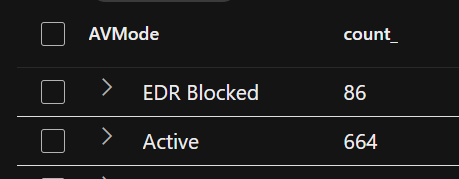
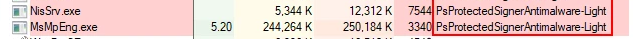
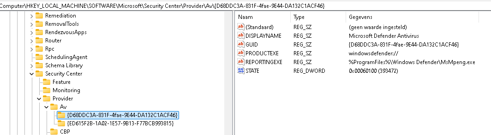
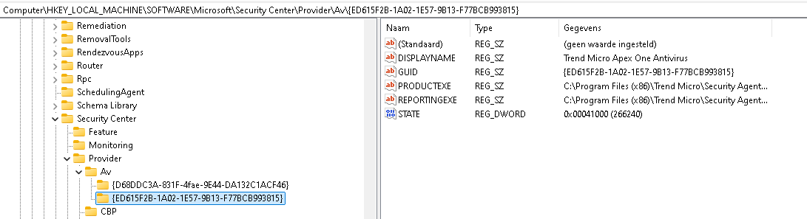

+++
date = '2026-01-28T22:59:34+01:00'
lastmod = '2026-01-28T22:59:35+01:00'
draft = false
title = "Defender for Endpoint Migration: Troubleshooting Persistent Third-Party AV Registration"
slug = 'defender-for-endpoint-migration-troubleshooting-persistent-third-party-av-registration'
description = "A third-party antivirus stays registered in Windows after uninstalling it and keeps Defender in a disabled state. How we found and removed the leftover registration."
author = 'Thomas Verheyden'
tags = ["Defender for Endpoint", "Defender XDR", "Microsoft Security"]
categories = ["Defender for Endpoint", "Defender XDR"]
+++

## Intro

I recently assisted a costumer with migrating to Defender for Endpoint. They had some windows 10/11 endpoints where the 3rd party Antivirus (AV) kept registered as primary Antivirus which by default put Defender for Endpoint in disable state on Windows 10/11:



Together with the Internal system engineers we tested multiple uninstall packages/scripts provided by the vendor or suggestions we found on various forums, we even tested the uninstall scripts in safe mode as a test, but still this 3rd party AV stayed registered until…

## Windows internals: Third-party AV Registration

I decided to dive into the Windows internals documentation to understand the issue better. Windows Security Center (WSC) is responsible for monitoring the health and status of security products like antivirus, firewall, and antispyware. When a third-party AV is installed, it must **register with WSC** to be recognized as the active protection provider.

- If registration is successful, **Microsoft Defender Antivirus** will automatically switch to **passive or disabled mode** to avoid conflicts, only on Windows 10/11.
- If registration fails, Defender remains active, potentially causing **dual AV conflicts**.

Some tools (e.g., `no-defender`, `defendnot`) exploit undocumented WSC API behavior to **falsely register as AVs**, causing Defender to disable itself. I high suggest to read the following article about this: [Windows Security Center API | es3n1n/no-defender | DeepWiki](https://deepwiki.com/es3n1n/no-defender/2.1-windows-security-center-api)

Starting with newer builds of Windows 10 and continuing in Windows 11, WSC requires that third-party AV software **runs as a protected process** to be registered. You can check this with procexp from sysinternals.



- This is enforced via the **Protected Process Light (PPL)** mechanism.
- AVs must be signed and meet integrity checks (e.g., IMAGE\_DLLCHARACTERISTICS\_FORCE\_INTEGRIT flag in the PE header)[.](https://cybersecuritynews.com/defendnot-disables-windows-defender/)

The **Windows Security Center API** is a Windows interface that lets security software (like antivirus programs) register themselves with Windows and allows applications to query what security products are installed on a system.

## Detection of 3rd party registration

There are alot of different ways you can validate which Antivirus solution is registered. In my case I check it first in the registry. You can find that information under *HKLM\software\Microsoft\Security Center\Provider\AV\{GUID}*




I suggest you remember the GUID being used here because later on we are going to use it to delete the registered 3rd party AV solution.

WMI can be used to query registered AV products via:

```
wmic /namespace:\\root\SecurityCenter2 path AntiVirusProduct get displayName
```

Note: I read in an article that Windows server editions may not support this namespace.

## Delete the registered 3rd party AV

I started first manually testing it with a tool called **WBEMTest** . **WBEMTest** is a built-in Windows tool used to interact with **WMI (Windows Management Instrumentation)**. It’s like a low-level browser for WMI, allowing you to:

- Connect to WMI namespaces
- Query WMI classes and instances
- View and edit properties
- Create or delete WMI objects

It’s mostly used by IT pros and developers for **debugging**, **testing**, and **manual inspection** of WMI data.

Registered antivirus products are stored in the WMI namespace:

```
root\SecurityCenter2
```

and the class:

```
AntiVirusProduct
```

Here’s a step-by-step guide:

1. **Open WBEMTest**
   - Press `Win + R`, type `wbemtest`, and hit Enter.
2. **Connect to Namespace**
   - Click **Connect…**
   - Enter: `root\SecurityCenter2`
   - Click **Connect**
3. **Query Antivirus Products**
   - Click **Query…**
   - Enter: `SELECT * FROM AntiVirusProduct`
   - Click **Apply**
4. **View Instances**
   - You’ll see a list of registered AV products.
   - Double-click one to inspect its properties.
5. **Delete an Entry**
   - In the instance window, click **Delete**.
   - Confirm deletion.

> ⚠️ Deleting AV entries from WMI does **not uninstall** the antivirus. It only removes its registration from Windows Security Center. This can cause Defender to re-enable itself or lead to inconsistent system behavior.

If you want to have an automated way so you can push a script on mass, you can use the following script i created:

```powershell
# Run this script as Administrator

$targetName = "Kaspersky"  # Change this to match the AV name you want to remove
$namespace = "root\SecurityCenter2"
$class = "AntiVirusProduct"
$logPath = "$env:USERPROFILE\Desktop\AV_Unregister_Specific_Log.txt"

# Create or clear the log file
New-Item -Path $logPath -ItemType File -Force | Out-Null
Add-Content -Path $logPath -Value "[$(Get-Date)] Starting targeted AV unregistration script.`n"

try {
    $avProducts = Get-WmiObject -Namespace $namespace -Class $class | Where-Object {
        $_.displayName -like "*$targetName*"
    }

    if ($avProducts.Count -eq 0) {
        Add-Content -Path $logPath -Value "[$(Get-Date)] No antivirus products found matching: $targetName"
    } else {
        foreach ($product in $avProducts) {
            $name = $product.displayName
            Add-Content -Path $logPath -Value "[$(Get-Date)] Deleting: $name"
            $product.Delete()
        }
        Add-Content -Path $logPath -Value "[$(Get-Date)] Completed deletion of matching AV entries."
    }
}
catch {
    Add-Content -Path $logPath -Value "[$(Get-Date)] ERROR: $_"
}

Write-Host "Operation complete. Log saved to: $logPath"
```

Script can also be found on my Github: [Defender-for-endpoint/Delete Specific AV by Name .ps1 at main · v3rtho/Defender-for-endpoint](https://github.com/v3rtho/Defender-for-endpoint/blob/main/Delete%20Specific%20AV%20by%20Name%20.ps1)

That’s it. Normally no 3rd party AV will be registered now and Defender AV will get in active mode!
