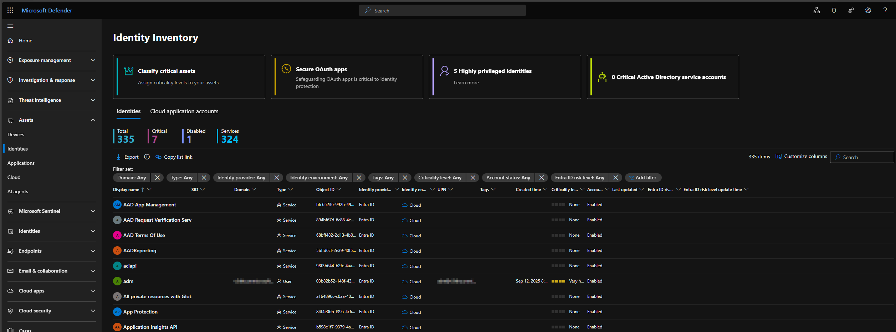
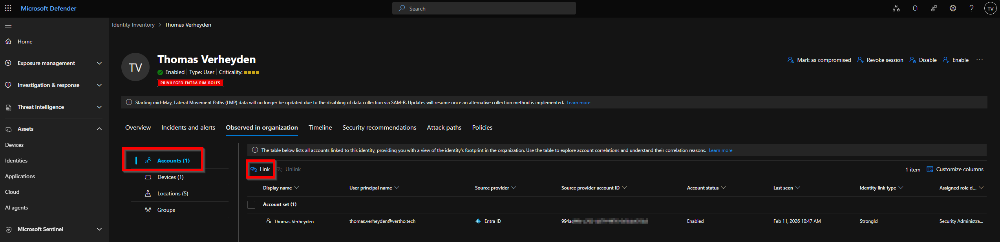
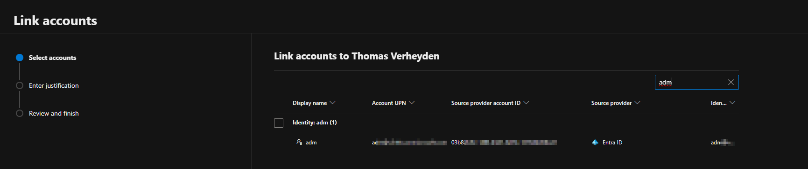
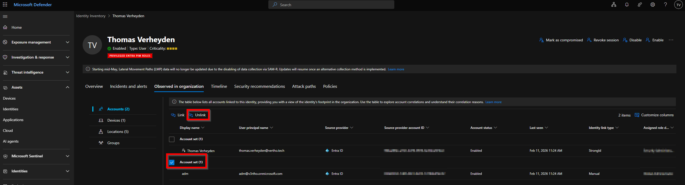
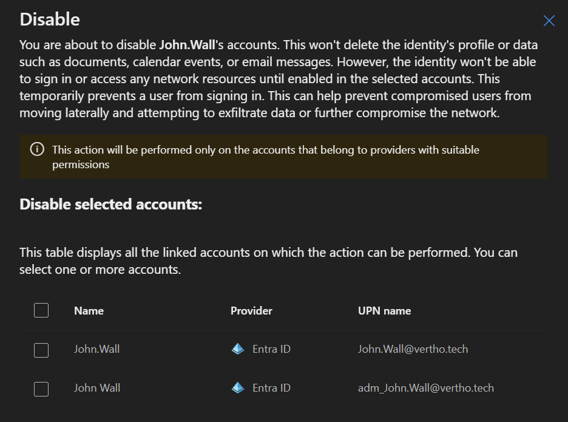
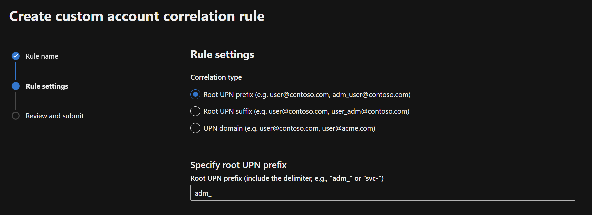
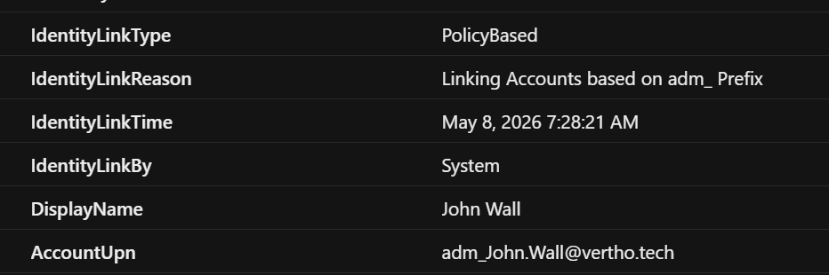
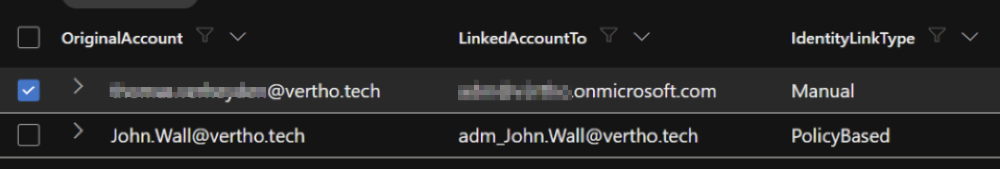

+++
date = '2026-02-11T11:53:18+01:00'
lastmod = '2026-05-11T13:31:40+01:00'
draft = false
title = "Identity threat detection and response: Linking accounts"
slug = 'identity-threat-detection-and-response-linking-accounts'
description = "This blog post covers a Defender for Identity feature that hasn’t received much attention. Despite flying under the radar, it’s a valuable setting for security teams who want to see all user…"
author = 'Thomas Verheyden'
tags = ["Defender for Identity", "Microsoft Security", "Defender XDR"]
categories = ["Defender for Identity", "Defender XDR"]
+++

## Intro

This blog post covers a Defender for Identity feature that hasn’t received much attention. Despite flying under the radar, it’s a valuable setting for security teams who want to see all user identities across the organization in one unified view.

> ℹ️ This blogpost is updated on 11/05/2026:  
> – Create custom account correlation rules  
> – Example of response actions on unified accounts  
> – Monitor automatic Account correlation

## Scattered Identities

In corporate settings, user identities tend to be scattered across multiple platforms. One person may hold several different accounts personal, admin-level, outdated, cloud-hosted, or abandoned spread across systems like on-premises Active Directory, Microsoft Entra ID, or third-party identity providers such as Okta.

This scattered landscape makes it hard to get a complete picture of who’s who across the organization. By manually connecting or disconnecting related accounts in Microsoft Defender for Identity, you can:

- Bring together identity data from different systems.
- Strengthen security by building a fuller understanding of each user’s identity.
- Streamline investigations and incident response through a consolidated view of user identities.

For example:

- **Personal and privileged accounts:** A user might have two accounts, one for everyday work and another with elevated permissions for administrative tasks.
  - For example:  
    thomas@meatsweater.be (regular account)  
    admin-thomas@meatsweater.be (privileged account)
- **Multiple domains:** Large organizations often manage several domains. Linking accounts across these domains provides full visibility into a user’s activity.
  - For example:  
    thomas@meatsweater.be  
    thomas@phishsweater.be
- **Personal and service accounts:** A user might have both a personal account and a service account they own or manage. Linking those accounts helps connect ownership and responsibility to the same identity.
  - For example:  
    thomas@meatsweater.be  
    backup.service@meatsweater.be
- **Accounts in multiple services:** A user might have a Microsoft Entra ID account, an Okta account, and a Ping account. Manually linking these accounts to the user’s identity creates a consolidated view that supports identity-centric protection and investigation.
- **Legacy accounts:** A user might still have an active account in a legacy system. Linking accounts ensures the legacy account is monitored and tied back to the correct identity. For example:  
  thomas@meatsweater.be  
  thomas@meatsweater.local

Use the procedures in this article to manually link accounts to identities, and to manually unlink unused, legacy, or orphaned accounts from identities in Defender for Identity.

## Manually link accounts to an identity in Defender for Identity

In the Microsoft Defender portal at [https://security.microsoft.com](https://security.microsoft.com/), go to **Assets** > **Identities**. Or, to go directly to the **Identity Inventory** page, use <https://security.microsoft.com/identity-inventory>.



On the **Identities** tab of the **Identity Inventory** page, select an identity from the list by clicking on the **Display name** value.   
On the identity details page that opens, select the **Observed in organization** tab, and verify the **Accounts** tab is selected.

On the **Accounts** tab, select  **Link**.



The **Link accounts** wizard opens. On the **Select accounts** page, use the search box to find an account. You can search by Display name, User principal name (UPN), Security identifier (SID), Source provider account

Select one account by selecting the check box next to the **Display name** column, and then select **Next**.



On the **Enter justification** page, enter a short explanation why you’re linking these accounts. A valid explanation includes:

After the account is successfully linked, select **Done**

## Unlinking Accounts

If you are not happy with the result or you want to unlink accounts again , you can follow those steps:

On the **Identities** tab of the **Identity Inventory** page at <https://security.microsoft.com/identity-inventory>, select an **Identity** from the list by clicking on the **Display name** value.

On the identity details page that opens, select the **Observed in organization** tab, and verify the **Accounts** tab is selected.

On the **Accounts** tab, select the account you want to unlink from the identity by selecting the check box next to the **Display name** column, and then select  **Unlink**.



## Example of response actions on unified accounts

Below is an example of the benefit of this new capability. When a SOC analyst wants to disable a compromised account he will get the following screen. Telling that there is another account linked to this account and with the question if you want to disable this linked account too.



## Create custom account correlation rules

There is a new capability called ‘Custom account correlation rules’ which help you with automating the linking of accounts. Custom account correlation rules allow you to correlate accounts that don’t share strong identifiers such as account ID, SID, object ID, or UPN. This is especially useful for privileged accounts with unique naming conventions. The following correlation types are available:

| Correlation type | Description | Example |
| --- | --- | --- |
| **Root UPN Prefix** | Correlates accounts with matching prefixes before the ‘@’ symbol. | `user@acme.com` and `adm_user@acme.com` share the prefix `user`. |
| **Root UPN Suffix** | Correlates accounts with matching suffixes after the ‘@’ symbol. | `user@acme.com` and `user_svc@acme.com` share the suffix `@acme.com`. |
| **Domain UPN** | Correlates accounts across different domains with the same username. | `user@acme.com` and `user@contoso.com`. |
| **Employee ID** | Correlates accounts that share the same employee ID. | Two accounts with the same employee ID value are linked to one identity. |

> ⛔ 11/05/2026 Employee ID is currently not available in the GUI of defender. This is reported to Microsoft and currently no update about it. Maybe its a capability that comes available in the next stage!

## Add a correlation rule

In the Microsoft Defender portal at [https://security.microsoft.com](https://security.microsoft.com/), go to **Settings** > **Identities**.

Select **Account Correlation Rules**.

Select **Add Rule**.

In the wizard, enter a **Rule Name** (up to 50 characters). You can use letters, numbers, and the following special characters: `. - _ ! # ^ ~`.

Select the **Correlation Type** (Root UPN Prefix, Root UPN Suffix, Domain UPN, or Employee ID).



Enter the required values for the selected correlation type, such as prefixes, suffixes, domains, or employee   
  
IDs.Review the summary, which includes the rule name, correlation type, and selected values.

Select **Submit** to create the rule. Correlation rule changes take effect within 12 hours.

## Monitor automatic Account correlation

Out of the box you don’t get insights on what correlation are happing in the background. That’s why i started digging into the different XDR tables.

I quickly found that in the IdentityAccountInfo there is new field called ‘IdentityLinkType’. Which had 3 values in my (test) environment:

- StrongID
- Manual
- PolicyBased

I think the names speak for them self but espcially the Manual and PolicyBased where interesting for me.  
  
When you have a look at the PolicyBased logs, you noticed that you also have IdentityLinkReason that you can use to validate which rules caused the correlation. Idem for the IdentityLinkBy which is System.



Another interesting value is the:

| `IdentityId` | `string` | Identifier for the identity that the account is linked to |
| --- | --- | --- |

this value is also available in the IdentityInfo table. If we combine those together we can get all identities that are Linked to each other by policy or manual:

```kql
IdentityInfo
| join kind=inner IdentityAccountInfo on IdentityId
| where IdentityLinkType == "PolicyBased" or IdentityLinkType == "Manual"
| extend OriginalAccount = AccountUpn
| extend  LinkedAccountTo = AccountUpn1
| distinct OriginalAccount, LinkedAccountTo, IdentityLinkType
```

If you run this the result is:



Now you have a nice overview of all the account which are linked to each other!
