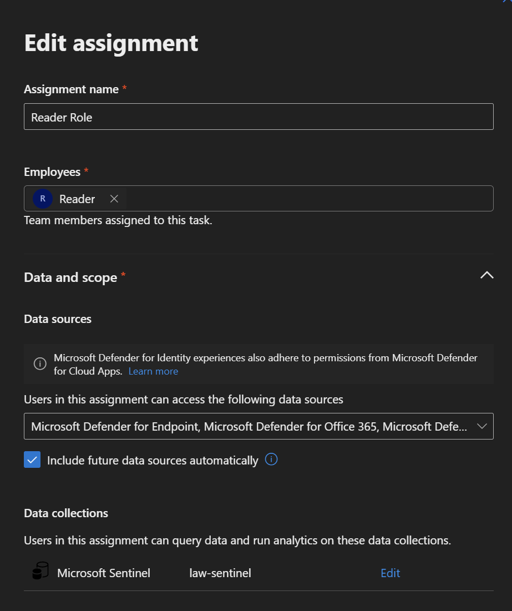
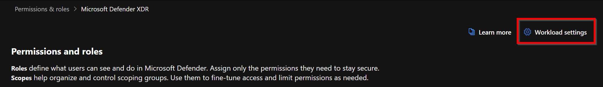
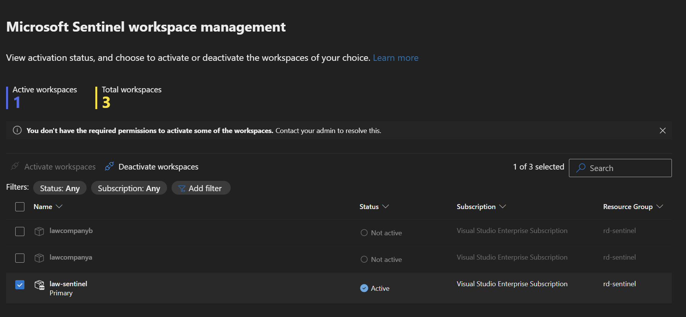

+++
date = '2026-03-22T11:31:04+01:00'
lastmod = '2026-03-23T16:32:29+01:00'
draft = false
title = "Defender Unified Role-Based Access Control (RBAC) support for Microsoft Sentinel is here"
slug = 'defender-unified-role-based-access-control-rbac-support-for-microsoft-sentinel-is-here-tool-urbac-mapper'
description = "Defender Unified RBAC now supports Microsoft Sentinel, so Azure permissions are no longer needed for workspace data in the Defender portal. Limitations and tips."
author = 'Thomas Verheyden'
tags = []
categories = []
+++

## Intro

During my **latest** engagements with different **customers** I frequently received the question why you still have to configure Azure permissions if you want to use the unified portal experience in Defender to access log analytics workspace log data. I can finally say this isn’t the case anymore, Microsoft recently announced that Unified RBAC supports Sentinel permissions in the Defender Portal. I tested it **out** already and will share some limitations and **tricks** and tips!  
  
The Microsoft Defender Unified Role based access mapper [RBAC XDR – Vertho | Verheyden Thomas](https://vertho.tech/rbac-xdr/)

## What’s new: Defender Unified RBAC for Sentinel

- **Sentinel permissions in the Defender Portal**: Sentinel permissions can now be managed directly in the Microsoft Defender portal without the need to switch to the Azure portal for access management. This includes data lake support.
- **Unified Permissions Model**: Manage user privileges for Sentinel and other Defender workloads in a single, consistent system.
- **Future-Proof Scoping**: Assignments can automatically include future data sources and workspaces as they’re added.

### Prerequisites

- **Access to the Microsoft Defender portal**: Ensure you can sign in at [https://security.microsoft.com](https://security.microsoft.com/).
- **Global Administrator** **or Security Administrator role and Unified RBAC enabled**: For more details, see [Manage RBAC in Defender XDR](https://learn.microsoft.com/en-us/defender-xdr/manage-rbac).
- **Sentinel workspaces onboarded to Defender portal**: Sentinel workspaces must be available in the Defender portal before roles and permissions can be assigned.

### Important notes

- Azure: Once URBAC is activated for Sentinel, URBAC should be used to manage Sentinel permissions (as opposed to the Azure portal). Making permission changes in Azure once URBAC is active may lead to sync-errors. If this happens, you will see a notification on the Permissions page, with instructions on how to resolve this
- In URBAC, being a Global Administrator does not grant you automatic permissions over workspaces. It does grant you the right to assign permissions, including to yourself
- Sentinel experiences in the Defender portal continue to respect ARM roles and permissions in addition to URBAC. Therefore, users with more permissions in ARM than in URBAC may see more data in the Sentinel pages in the Defender portal than configured in their URBAC permissions

### Limitations

- Not supported: the Microsoft Sentinel Playbook Operator, Automation Contributor and Workbook Contributor role. These continue to be managed in Azure for the moment.
- Not yet supported: importing existing roles and assignments from Azure Sentinel for easy migration. This is planned to be introduced soon.
- Permissions are set at the workspace level. More granular (row-level) scoped access control is under development; to be introduced in a separate preview.

### Instructions

1. **Create a Custom Role**

- Go to the Permissions page in Defender, and select ‘Defender XDR’ -> ‘Roles’

- In the Roles page, click **Create a custom role**.

- Enter a role name and description.

- Select the required permissions using this mapping table:

| **Sentinel Role** | **Unified RBAC Permissions** |
| --- | --- |
| Microsoft Sentinel Reader | Security operations / Security data basic (read) |
| Microsoft Sentinel Responder | Security operations / Security data basic (read)  Security operations / Alerts (manage) Security operations / Response (manage) |
| Microsoft Sentinel Contributor | Security operations / Security data basic (read)  Security operations / Alerts (manage) Security operations / Response (manage) Authorization and settings / Detection tuning (manage) |

- Click **Next**.
- Click **Add assignment**.
- Name the assignment.
- Select users and/or groups.
- Choose the Sentinel workspaces for the assignment.
- (Optional) Enable “Include future data sources automatically.”
- Click **Submit**.

2. **Activate Unified RBAC for Sentinel**

- Go back to the Roles page
- Click on ‘Activate workloads’ button in the top

- Click on ‘Manage workspaces’
- Select the desired workspaces to enable URBAC on
- Click ‘Activate workspaces’

3. **Edit, Delete, or Export Roles**

- To edit: Select the role, click **Edit**, and update as needed.
- To delete: Select the role and click **Delete**.
- To export: Click **Export** to download a CSV of roles, permissions, and assignments

### F**requently asked questions**

What happens to legacy Sentinel roles after activating Unified RBAC?

*URBAC becomes the primary source of your permissions for Sentinel. While you can still manage permissions in Azure, doing so may create sync issues with URBAC. Once URBAC is activated for a Sentinel workspace, continue to manage your permissions in URBAC.*

Can I revert to managing Sentinel roles in Azure after enabling Unified RBAC?

*Yes, you can deactivate Unified RBAC for Sentinel in the Defender portal’s workload settings. This will revert to legacy Sentinel roles and their associated access controls.*

How granular is access control in Unified RBAC for Sentinel (workspace, row-level, etc.)?

*Currently, permissions are set at the workspace level. More granular (row-level) scoped access control is under development.*

Are there any limitations or unsupported features in the current preview?

*The Microsoft Sentinel Playbook Operator and Automation Contributor roles are not yet supported in URBAC; these continue to be managed in Azure for now.*

Does Unified RBAC support both Sentinel Analytics and Lake workspaces?

*Yes, Unified RBAC supports both Sentinel Analytics and Lake workspaces for consistent access management.*

Source: [Microsoft Sentinel is now supported in Unified RBAC with row-level access | Microsoft Community Hub](https://techcommunity.microsoft.com/blog/microsoftsentinelblog/microsoft-sentinel-is-now-supported-in-unified-rbac-with-row-level-access/4503121)
