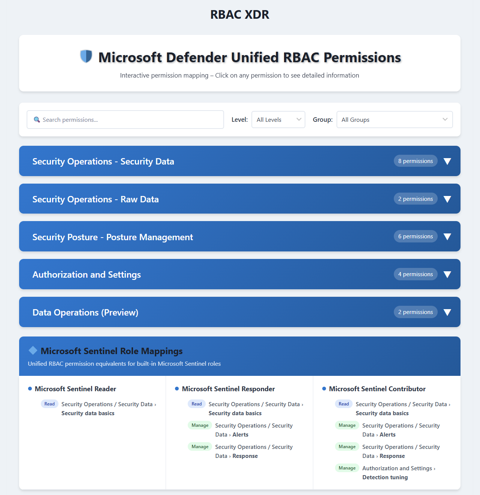
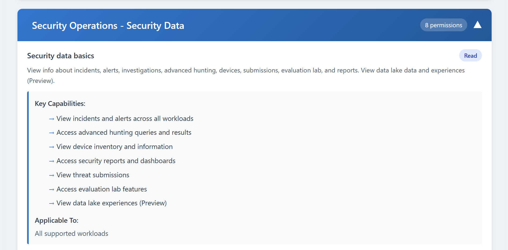

+++
date = '2026-03-23T16:29:13+01:00'
lastmod = '2026-03-23T16:29:14+01:00'
draft = false
title = "Microsoft Defender Unified Role based access mapper"
slug = 'microsoft-defender-unified-role-based-access-mapper'
description = "Retired: an interactive web tool that mapped Microsoft Defender Unified RBAC permissions to capabilities and workloads, to help find the permission you need."
author = 'Thomas Verheyden'
tags = []
categories = []
+++

> ⚠️ **This tool has been retired** and is no longer available. The screenshots below are kept for reference.

I created a web based interactive Microsoft Defender Unified RBAC permissions mapper to make your life easier when you need to exactly find which permissions you need for Defender. It consist out of key capabilities and applicable workloads based on the docs.

