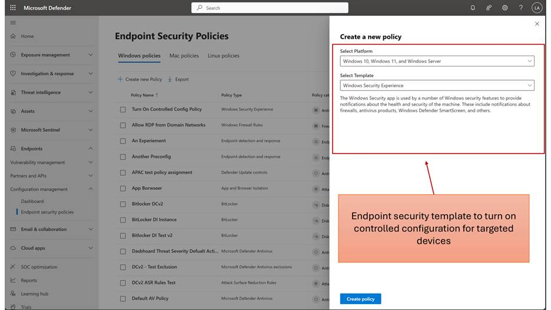
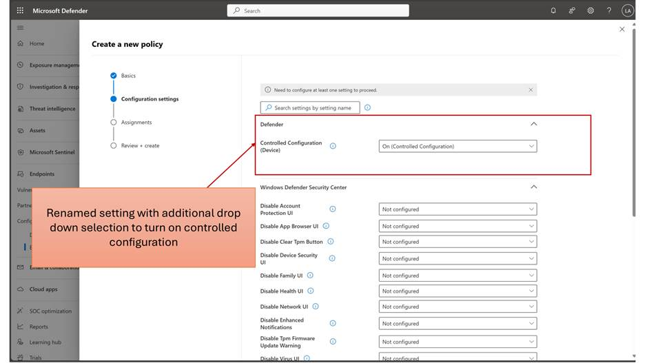
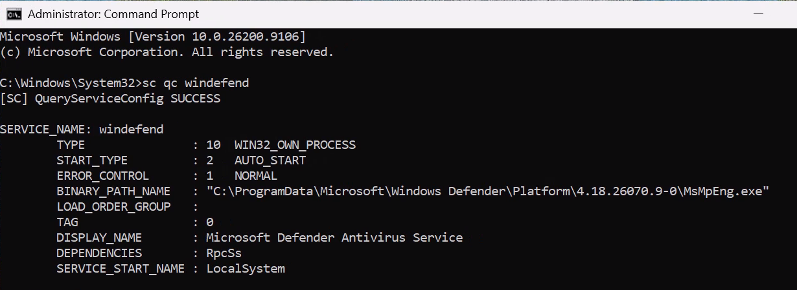
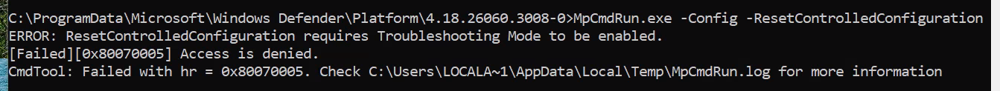
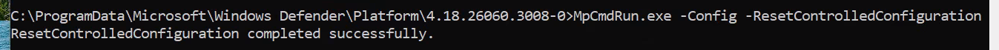
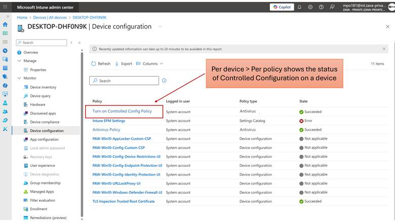
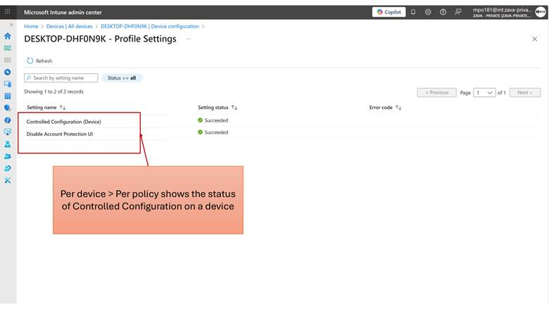
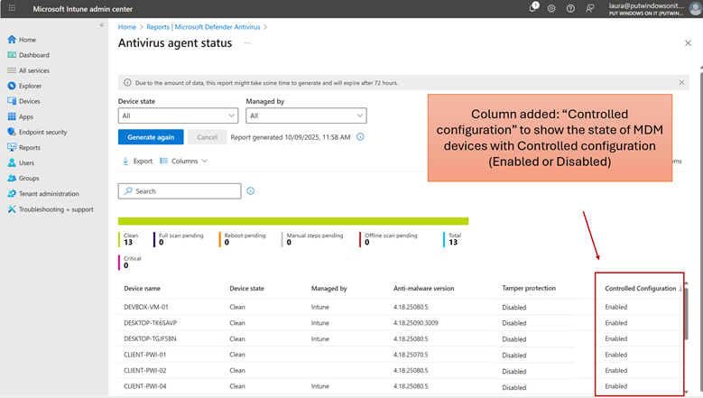

+++
date = '2026-08-13T09:14:29+01:00'
lastmod = '2026-08-14T09:07:29+01:00'
draft = false
title = "Defender for Endpoint Controlled configuration, Tamper protection on steroids:  A deep dive"
slug = 'defedner-for-endpoint-controlled-configuration-tamper-protection-on-steroids-a-deep-dive'
description = "What is controlled Configuration Controlled configuration is a security management capability that enforces a single, authoritative source of truth for Microsoft Defender security settings on a…"
author = 'Thomas Verheyden'
tags = []
categories = []
+++

## What is controlled Configuration

Controlled configuration is a security management capability that enforces **a single, authoritative source of truth** for Microsoft Defender security settings on a device.

Controlled configuration covers both Microsoft Defender Antivirus and Attack Surface Reduction (ASR) settings, enforcing the cloud-managed policy state for these Defender security surfaces.

When controlled configuration is turned on, your device automatically uses Microsoft Defender Antivirus’s default settings **and disables local admin** **merge**. **If you’ve configured security settings through Intune or Microsoft Defender for Endpoint (MDE), those policies will take priority and override the defaults.** Endpoint security settings configured by Group Policy, scripts, SCCM, and local admin actions are not honored when controlled configuration is turned on.

This feature is designed to address long‑standing customer pain around **configuration drift**, **policy conflicts**, and **extended tamper protection coverage to additional endpoint security settings.**

**Key benefits of controlled configuration include:**

- **Authoritative AV Policy Enforcement:** Intune and M365 Defender become the single source for AV configuration. No “shadow” policies from GPO or other tools will apply. This ensures features like real-time protection, scan schedules, signature updates, and exclusion lists configured in cloud policy are always active as intended.
- **Improved Security Posture:** By preventing configuration drift, controlled configuration helps maintain the secure settings your organization requires. It reduces the risk of inadvertent policy gaps (for example, an admin turning off an AV feature via local means).
- **Simplified Troubleshooting:** When only cloud policies are in effect, it’s easier to understand and audit why a device is in a given state. The effective configuration on devices is predictable, eliminating confusion from conflicting sources.
- **Streamlined Future Expansion:** The controlled configuration framework covers Microsoft Defender Antivirus and ASR settings and can be extended to other security policy areas, such as Device Control, to provide the same consistency there. This unified approach lays groundwork for holistic endpoint configuration management.

## Prerequisites

- Windows devices are onboarded to Microsoft Defender for Endpoint and the devices should have a Sense 9D version greater than 10.8804
- Windows devices should have Microsoft Defender Antivirus platform version greater than 4.18.26060.3006. Use **Get-MpComputerStatus** to confirm the installed Defender version.
  - If the device has an older Defender platform version, install version 4.18.26060.3008. Set the Defender platform update ring to Beta before updating Defender: **Set-MpPreference -PlatformUpdatesChannel Beta**. You can also update Defender using the platform update package: <https://definitionupdates.microsoft.com/packages/content/updateplatform.exe?packageType=Platform&packageVersion=4.18.26060.3008&arch=x64>
- Endpoint security settings are managed via Intune or MDE Endpoint Security Setting (MDE Attach)

Supported Devices, Environments and Defender Settings

- Controlled configuration policy will only work on supported device SKUS, i.e. Win 11 or Win 10 or Windows Server 2019 Sever
- GCCH environments are not supported

**The following settings are not covered by controlled configuration:**

- Device Control
- EDR
- Firewall

## Controlled configuration setting overview

The **Windows > Windows Security Experience** security template is the management surface used to enable controlled configuration. The current “Tamper protection” setting will be renamed and another drop-down option will be added for turning on controlled configuration, but controlled configuration enforcement applies to Microsoft Defender Antivirus and Attack Surface Reduction (ASR) settings.

In the table below, there is a mapping of the current windows tamper protection values and how they map to the new value names.

**Old Setting Name:** “Tamper Protection (Device)”

**New Setting Name:** “Controlled configuration (Device)”

**Setting Values:**

| **Current Windows Tamper Protection Value** | **New Value Name** | **Setting Behavior** |
| --- | --- | --- |
| **Not configured** | Not configured |  |
| **Off** | Off | Turns off controlled configuration and tamper protection |
| **On** | Tamper Protection (On) | Turns on Tamper Protection and enforces the [tamper protected settings](https://learn.microsoft.com/en-us/microsoft-365/security/defender-endpoint/prevent-changes-to-security-settings-with-tamper-protection?view=o365-worldwide#what-happens-when-tamper-protection-is-turned-on) to their Secure Defaults. (No change in behavior) |
|  | Controlled configuration (On) | Turns on controlled configuration, enforcing the configuration coming from Intune *exclusively* and any non-configured settings to their secure defaults. |

**Tooltip description:**

“This setting can be used to turn on controlled configuration or tamper protection to help protect important security features from unwanted changes and interference.

If the setting is configured to Tamper Protection (On), this turns on tamper protection to enforce tamper protected settings to their secure defaults. This includes real-time protection, behavior monitoring, and more. Settings are configured with an MDM solution, such as Intune and is available in Windows 10 Enterprise E5 or equivalent subscriptions.

 If the setting is configured to Controlled configuration (On), this turns on controlled configuration, which enforces the configuration coming from Intune exclusively and any non-configured settings to their secure defaults. Controlled configuration is applicable to Microsoft Defender Antivirus and Attack Surface Reduction (ASR) settings.

If the setting is configured to OFF, this turns off controlled configuration and tamper protection.  
  
Clearing tamper protection / controlled configuration state

In some testing or troubleshooting scenarios, you may need to clear the locally cached controlled configuration from a device after tamper protection has been enabled. This can help reset the device configuration state before reapplying policy.

**Important:** This procedure should only be used for troubleshooting, testing, or recovery scenarios. After clearing the controlled configuration state, the device may reapply configuration during the next policy sync.

Controlled configuration works with Microsoft Defender for Endpoint troubleshooting mode. When troubleshooting mode is enabled for a device, administrators can temporarily relax controlled configuration enforcement for troubleshooting and validation; when troubleshooting mode ends, the device returns to the configured controlled configuration policy state.

**Prerequisites**

- Tamper Protection enabled on the device
- Local administrator privileges

1. Open an elevated Command Prompt and verify that the Microsoft Defender Antivirus service (WinDefend) is running.

sc qc windefend

Expected output:

- Navigate to the active Microsoft Defender platform folder. Note: The platform version folder may differ depending on the Defender build installed on the device

Example: cd “C:\ProgramData\Microsoft\Windows Defender\Platform\4.18.26060.3004-0”

- Run the following command to clear the locally applied controlled configuration state:

MpCmdRun.exe -Config -ResetControlledConfiguration

after enabling Troubleshooting Mode:

After the command completes:

If the device is still targeted by Intune or MDE policy, controlled configuration and/or tamper protection settings may automatically reapply during the next policy refresh cycle

The locally cached controlled configuration is cleared

Defender policy state may temporarily revert until the next policy sync

## Controlled configuration defaults

When controlled configuration is turned on, **your device automatically uses Microsoft Defender Antivirus’s recommended default settings** to help keep it protected. These defaults align with the settings protected by tamper protection and are designed to reflect Microsoft security best practices. Microsoft may update these default settings over time to reflect security best practices. If you’ve configured security settings through Intune or Microsoft Defender for Endpoint (MDE), those policies will continue to take priority and override the defaults as expected giving you full control over your configuration.

One exception is local administrator merge, which is automatically disabled when controlled configuration is enabled to ensure consistent and secure enforcement. This prevents locally defined settings, such as locally defined Defender antivirus exclusions, from weakening centrally managed security policies.

When controlled configuration is enabled, settings that are not included in the list above can still be changed by both Defender and a local administrator using the PowerShell cmdlet **set-MpPreference**. For those settings, Defender behavior remains unchanged. However, controlled configuration does not read values from GP or MDM registry paths because those paths are not protected.

The Windows Security Experience template is only the management surface used to enable controlled configuration. Controlled configuration enforcement applies to Microsoft Defender Antivirus and Attack Surface Reduction (ASR) settings. Other Windows Security Experience settings, such as endpoint security settings under the Windows Defender Security Center, are not covered by controlled configuration.

Tamper protection and controlled configuration share the goal of preventing unauthorized changes to Microsoft Defender settings on Windows devices, but they differ significantly in scope, flexibility, and enforcement model. Tamper protection covers a small, fixed set of approximately 10–13 critical security settings—primarily the core protection toggles (real-time protection, behavior monitoring, cloud protection, IOAV scanning, script scanning, on-access protection, network protection, PUA protection) plus cloud block level, cloud extended timeout, and the exclusion merge behavior. It enforces only Microsoft-defined secure defaults and offers no customization: a setting is either locked to its safe value or it’s not protected at all.   
  
Controlled configuration, by contrast, enforces the entire Defender security configuration surface that is cloud-manageable via Intune or MDE Endpoint Security policies. This means controlled configuration covers everything tamper protection covers plus the broader set of antivirus scan settings, scheduling, signature updates, exclusions, and is expanded to include Attack Surface Reduction rules.   
  
The key distinction is that controlled configuration allows organizations to define their own desired state—not just Microsoft’s defaults—and makes cloud policy the single authoritative source, overriding all other configuration channels (GPO, SCCM, local admin, registry, PowerShell). In short, tamper protection locks a few critical switches to safe defaults; controlled configuration enforces the entire Defender configuration as defined by the organization’s cloud policy, making it a superset of tamper protection’s coverage with organizational customization.   
  
Below is the complete list of what tamper protection covers. (The settings marked with \* are also enforced by controlled configuration.)

| **Registry Value** | **Default Value** | **TP Behavior Summary** | **Description** |
| --- | --- | --- | --- |
| DisableAntiVirus | FALSE (0) | Pref: Block changes. Policy: Ignore value (use default=0) and revert on TP enable. | Enable/Disable use of AV signatures during a scan. FALSE means AV is enabled. |
| DisableAntiSpyware | FALSE (0) | Pref: Block changes. Policy: Ignore value (use default=0) and revert on TP enable. | Enable/Disable use of AS signatures during a scan. FALSE means anti-spyware is enabled. |
| PassiveMode | 0 (disabled) | Block changes: prevents forcing Defender into passive mode. | Controls side-by-side passive mode. 0=active (normal), non-zero=passive. Preference-only setting. |
| DisableRoutinelyTakingAction | FALSE (0) | Pref: Block + use default + revert. Policy: Ignore value (use default=0). | When FALSE, detected threats are automatically acted upon after ~10 min delay using the default action. |
| DisableRealtimeMonitoring\* | FALSE (0) | Pref: Block + use default + revert. Policy: Ignore value (use default=0). No Revert in policy (UI-controlled). | Turns off real-time protection prompts for known malware detection. FALSE = RTP enabled. |
| DisableScanOnRealtimeEnable | FALSE (0) | Pref: Block + use default + revert. Policy: Ignore value. | Enables process scanning whenever realtime protection is turned on, to catch malware started while RTP was off. |
| DisableOnAccessProtection\* | FALSE (0) | Pref: Block + use default + revert. Policy: Ignore value. | If TRUE, on-access protection is disabled. FALSE = on-access scanning enabled. |
| DisableBehaviorMonitoring\* | FALSE (0) | Pref: Block + use default + revert. Policy: Ignore value. | If TRUE, behavior monitoring is disabled. FALSE = behavior monitoring enabled. |
| DisableIOAVProtection\* | FALSE (0) | Pref: Block + use default + revert. Policy: Ignore value. | If TRUE, IOAV (downloads/attachments) protection is disabled. FALSE = IOAV enabled. |
| DisableScriptScanning\* | FALSE (0) | Pref: Block + use default + revert. Policy: Ignore value. | If TRUE, AMSI file-less scan and legacy IE protection will be disabled. |
| ~~DisableIntrusionPreventionSystem~~ | FALSE (0) [inferred] | Pref: Block + use default + revert. Policy: Ignore value. | Obsolete If TRUE, network intrusion prevention system (IPS) is disabled. |
| ~~DisableEarlyLaunchAntimalware~~ | FALSE (0) [inferred] | Pref: Block + use default + revert. Policy: Ignore value. | Obsolete If TRUE, Early Launch Antimalware (ELAM) driver protection is disabled. |
| DisableEnhancedNotifications | FALSE (0) | Pref: Block + use default + revert. Policy: Ignore value. | If TRUE, enhanced/detailed threat notifications are suppressed. |
| DisableArchiveScanning\* | FALSE (0) | Pref: Block + use default + revert. Policy: Ignore value. | If TRUE, scanning of archive files (ZIP, CAB, etc.) is disabled. |
| ThreatSeverityDefaultAction\1 | remote\_managed\_default=2 (Clean) | Pref: Block + use default + revert. Policy: Ignore value. | Default action for Low severity threats. Action IDs: 2=Clean, 3=Quarantine, 6=Remove, 8=Allow, 9=UserDefined, 10=Block. |
| ThreatSeverityDefaultAction\2 | remote\_managed\_default=2 (Clean) | Pref: Block + use default + revert. Policy: Ignore value. | Default action for Medium severity threats. |
| ThreatSeverityDefaultAction\4 | remote\_managed\_default=2 (Clean) | Pref: Block + use default + revert. Policy: Ignore value. | Default action for High severity threats. |
| ThreatSeverityDefaultAction\5 | remote\_managed\_default=2 (Clean) | Pref: Block + use default + revert. Policy: Ignore value. | Default action for Severe severity threats. |
| DisablePrivacyMode | FALSE (0) | Pref: Use default + revert (no block). Policy: Ignore value. | Controls privacy protection – whether non-admins can see detection history. |
| Notification\_Suppress | FALSE (0) | Pref: Block + use default + revert. Policy: Ignore value. | Suppresses all pop-up/toast notifications (including enhanced notifications). |
| SuppressRebootNotification | FALSE (0) | Pref: Block + use default + revert. Policy: Ignore value. | Suppresses reboot notification in UI only. |
| SuppressWdoNotification | FALSE (0) | Pref: Block + use default + revert. Policy: Ignore value. | Suppresses Windows Defender Offline (WDO) notification in UI. |
| SpyNetReporting | 2 (Advanced/MAPS full) | Pref: Block + use default (no revert, UI-controlled). Policy: Ignore value. Only active when Sense is running (E5). | Cloud protection reporting level. 0=No participation, 1=Basic, 2=Advanced (send additional info including possible PII). |
| DisableBlockAtFirstSeen | FALSE (0) | Pref: Block + use default (no revert). Policy: Ignore value. Only active when Sense running (E5). | Disables the Block at First Seen (BAFS) cloud feature. FALSE = BAFS enabled. |

Note that this list does not include Tamper Protection specific setting defaults or which settings tamper protection blocks changes, but does not use default.

EnableRemoteManagedDefaults is set to FALSE when controlled configuration is enabled. Generally, controlled configuration supports RemoteManagedDefault for settings that have not been configured yet, but in practice, the CX will not be able to use it.

Controlled configuration covers the Defender Antivirus and Attack Surface Reduction (ASR) settings from the Defender CSP and Defender Policy CSP, excluding device control settings. The default values applied by controlled configuration are listed below.

| **Setting Name (CSP)** | **Default Value (N/A means no default is enforced)** |
| --- | --- |
|  |  |
| ASROnlyPerRuleExclusions | N/A (per-rule exclusion list) |
| AllowArchiveScanning | FALSE |
| AllowBehaviorMonitoring | FALSE |
| AllowCloudProtection | 2 |
| AllowDatagramProcessingOnWinServer | FALSE |
| AllowEmailScanning | TRUE |
| AllowFullScanOnMappedNetworkDrives | TRUE |
| AllowFullScanRemovableDriveScanning | TRUE |
| AllowIOAVProtection | FALSE |
| AllowIntrusionPreventionSystem | 1 (Allowed) [Deprecated] |
| AllowNetworkProtectionDownLevel | FALSE |
| AllowNetworkProtectionOnWinServer | FALSE |
| AllowOnAccessProtection | FALSE |
| AllowRealtimeMonitoring | FALSE |
| AllowScanningNetworkFiles | FALSE |
| AllowScriptScanning | FALSE |
| AllowSwitchToAsyncInspection | TRUE |
| AllowUserUIAccess | FALSE |
| ArchiveMaxDepth | 0 |
| ArchiveMaxSize | 0 |
| AttackSurfaceReductionOnlyExclusions | N/A (exclusion list) |
| AttackSurfaceReductionRules | N/A (list of rule GUIDs + actions) |
| AvgCPULoadFactor | 50 |
| BehavioralNetworkBlocks | N/A (container node) |
| BruteForceProtection | 0 |
| BruteForceProtectionAggressiveness | 0 |
| BruteForceProtectionConfiguredState | 0 |
| BruteForceProtectionExclusions | N/A (exclusion list) |
| BruteForceProtectionLocalNetworkBlocking | FALSE |
| BruteForceProtectionMaxBlockTime | 0 |
| BruteForceProtectionPlugins | N/A (plugin list) |
| BruteForceProtectionSkipLearningPeriod | FALSE |
| CheckForSignaturesBeforeRunningScan | FALSE |
| CloudBlockLevel | 0 (Default) |
| CloudExtendedTimeout | 0 (seconds) |
| ControlledFolderAccessAllowedApplications | N/A (application list) |
| ControlledFolderAccessProtectedFolders | N/A (folder list) |
| DataDuplicationDirectory | \\\\.\\GlobalRoot\\SystemRoot\\Defender Duplication Data |
| DataDuplicationLocalRetentionPeriod | 60 |
| DataDuplicationMaximumQuota | 500 |
| DataDuplicationRemoteLocation | N/A (path string) |
| DaysToRetainCleanedMalware | 0 |
| DaysUntilAggressiveCatchupQuickScan | 30 |
| DefaultEnforcement | 1 |
| DeviceControl | N/A (container node) |
| DeviceControlEnabled | FALSE |
| DisableCacheMaintenance | 0 |
| DisableCatchupFullScan | TRUE |
| DisableCatchupQuickScan | TRUE |
| DisableCoreServiceECSIntegration | FALSE |
| DisableCoreServiceTelemetry | FALSE |
| DisableCpuThrottleOnIdleScans | 1 |
| DisableDatagramProcessing | FALSE |
| DisableDnsOverTcpParsing | FALSE |
| DisableDnsParsing | FALSE |
| DisableFtpParsing | FALSE |
| DisableGradualRelease | FALSE |
| DisableHttpParsing | FALSE |
| DisableInboundConnectionFiltering | FALSE |
| DisableLocalAdminMerge | FALSE |
| DisableNetworkFileAccessTimeRestoration | 0 |
| DisableNetworkProtectionPerfTelemetry | FALSE |
| DisableQuicParsing | TRUE |
| DisableRdpParsing | FALSE |
| DisableSmtpParsing | FALSE |
| DisableSshParsing | FALSE |
| DisableTlsParsing | FALSE |
| EnableControlledFolderAccess | 0 |
| EnableConvertWarnToBlock | FALSE |
| EnableDnsSinkhole | TRUE |
| EnableFileHashComputation | FALSE |
| EnableLowCPUPriority | FALSE |
| EnableNetworkProtection | 0 |
| EnableUdpReceiveOffload | FALSE |
| EnableUdpSegmentationOffload | FALSE |
| EngineUpdatesChannel | 0 |
| ExcludedExtensions | N/A (extension list) |
| ExcludedIpAddresses | N/A (IP list) |
| ExcludedPaths | N/A (path list) |
| ExcludedProcesses | N/A (process list) |
| HideExclusionsFromLocalAdmins | FALSE |
| HideExclusionsFromLocalUsers | TRUE |
| IntelTDTEnabled | 0 (Disabled) |
| MeteredConnectionUpdates | 0 |
| NetworkProtectionReputationMode | 0 |
| OobeEnableRtpAndSigUpdate | 0 |
| PUAProtection | 0 |
| PassiveRemediation | 0 |
| PerformanceModeStatus | 0 |
| PlatformUpdatesChannel | 0 |
| QuickScanIncludeExclusions | 0 |
| RandomizeScheduleTaskTimes | 1 |
| RealTimeScanDirection | 0 |
| RemoteEncryptionProtection | 0 |
| RemoteEncryptionProtectionAggressiveness | 0 |
| RemoteEncryptionProtectionConfiguredState | 0 |
| RemoteEncryptionProtectionExclusions | N/A (exclusion list) |
| RemoteEncryptionProtectionMaxBlockTime | 0 |
| Reporting | N/A (container node) |
| ScanOnlyIfIdleEnabled | TRUE |
| ScanParameter | 1 |
| ScheduleQuickScanTime | 0 |
| ScheduleScanDay | 0 |
| ScheduleScanTime | 0x78 |
| ScheduleSecurityIntelligenceUpdateDay | 8 |
| ScheduleSecurityIntelligenceUpdateTime | 0x69 |
| SchedulerRandomizationTime | 4 |
| SecuredDevicesConfiguration | N/A (configuration string) |
| SecurityIntelligenceLocation | N/A (path string) |
| SecurityIntelligenceLocationUpdateAtSchedu | FALSE |
| SecurityIntelligenceLocationUpdateAtScheduledTimeOnly | FALSE |
| SecurityIntelligenceUpdatesChannel | 0 |
| SignatureUpdateFallbackOrder | MicrosoftUpdateServer|MMPC |
| SignatureUpdateFileSharesSources | N/A (UNC path list) |
| SignatureUpdateInterval | 0 |
| SubmitSamplesConsent | 0 |
| SupportLogLocation | N/A (path string) |
| TamperProtection | 0 |
| ThreatSeverityDefaultAction | 2 |
| ThrottleForScheduledScanOnly | TRUE |

## Intune Policy Conflicts

Controlled configuration uses a deterministic “controlled configuration ON wins” precedence model. It does not use first-write-wins, last-write-wins, or policy-ID priority. When conflicting policies target the same device, the device enforcement state is calculated based on the policy values themselves.

- The controlled configuration ON value takes precedence for device enforcement over controlled configuration OFF.
- The controlled configuration ON value takes precedence for device enforcement when controlled configuration ON and tamper protection ON are both targeted to the same device.
- Matching values report as Success in Intune; mixed values report as Conflict.
- This is value-based precedence only; policy creation time, delivery order, or policy ID does not determine the final device state.

⚠️ Important: Avoid creating overlapping policies with different controlled configuration values. Although device enforcement is deterministic and the controlled configuration ON value takes precedence for device enforcement, Intune will still surface the overlap as a policy conflict.

| **Scenario** | **Device result** | **Intune reporting** |
| --- | --- | --- |
| **Controlled configuration ON + controlled configuration OFF** | Controlled configuration ON | Conflict |
| **Controlled configuration ON + tamper protection ON** | Controlled configuration ON enforced; tamper protection may still appear ON in reporting | Conflict |
| **Controlled configuration ON + controlled configuration ON** | Controlled configuration ON | Success |
| **Controlled configuration OFF + controlled configuration OFF** | Controlled configuration OFF | Success |
| **Multiple policies with mixed ON/OFF values** | Controlled configuration ON | Conflict |

Conflict Scenarios

Understanding how conflicts are reported is critical to managing controlled configuration effectively:

- Scenario: controlled configuration ON + TP ON on the same device
  - If Policy 1 sets TP = ON and Policy 2 sets controlled configuration = ON, the controlled configuration ON value takes precedence for device enforcement.
  - Intune reports the overlap as Conflict.
  - Tamper protection may still appear as ON in reporting even though controlled configuration ON is the enforced device state.
- Scenario: Same value, no conflict
  - If Policy 1 and Policy 2 both set controlled configuration = ON (or both set OFF), the setting reports as Success — no conflict.
- Scenario: Three or more policies
  - When three or more policies with different controlled configuration values target the same device, the controlled configuration ON value takes precedence for device enforcement and Intune reports the conflicting settings as Conflict.

Best Practice: Target each device with a single controlled configuration policy to avoid conflicts and ensure predictable behavior.

## Controlled configuration State

You can verify the controlled configuration state on devices through the following methods:

- Controlled configuration state in the registry on the device
- Effective Settings report in Microsoft Defender for Endpoint
- Setting Policy Report in Intune / MDE
- Controlled configuration state in the Antivirus report in Intun

## Unassignment and Unenrollment behavior

Policy Unassignment (Removing or deleting a policy)

Controlled configuration is not tattooed on the device. When a policy is unassigned or deleted:

- The controlled configuration value from that policy is removed from the device.
- If other policies still target the device, the next applicable policy takes effect.
- If no policies remain, controlled configuration reverts to OFF.

| **Scenario** | **Result** |
| --- | --- |
| Controlled configuration ON policy unassigned; no other policies remain | Controlled configuration = OFF |
| Controlled configuration ON policy unassigned; another controlled configuration ON policy exists | Controlled configuration = ON (next policy applies) |
| Controlled configuration ON policy unassigned; OFF policy remains | Controlled configuration = OFF |

⚠️ “Not Configured” Does Not Equal “Off”:

Unassigning a policy or setting it to “Not Configured” does not remove an existing controlled configuration state by itself. If controlled configuration was applied by another targeted policy, that policy continues to determine the device state; if no controlled configuration policies remain, controlled configuration is removed and the device reverts to OFF.

**Unenrollment from MDE (device unenrolled, not offboarded)**

- If a device is unenrolled from MDE while a controlled configuration ON policy is targeted, controlled configuration remains ON on the device.
- Unenrollment does not clean up the controlled configuration state in Defender Antivirus.
- Intune reports the setting as No longer applicable.

**Offboarding from MDE**

- If a device is offboarded from MDE, the controlled configuration hive is cleaned up and controlled configuration reverts to OFF.
- This is the expected cleanup path for devices leaving the MDE service entirely.

| **Action** | **Controlled configuration state** |
| --- | --- |
| Policy unassigned (no other policies) | Controlled configuration = OFF |
| Device unenrolled from MDE | Controlled configuration = ON (not cleaned up) |
| Device offboarded from MDE | Controlled configuration = OFF (cleaned up) |

## Reporting

### Intune policy reports

Intune will reflect the standard set of policy reports for the Windows Security Experience policy template (contains setting to turn on controlled configuration) and policy templates that are supported by controlled configuration, including Antivirus and Attack Surface Reduction (ASR). This includes the device and user check-in status, per setting status, and device level reports.

**\*Select policy > Per setting status report**

For the Windows Security Experience policy template, the per setting status report will reflect the success status for tamper protection and controlled configuration with the following:

MDM devices:

- “Tamper Protection Blob” –>

MDE attach devices:

- “Tamper Protection Blob” –>
- “Controlled configuration blob” –>
- “Controlled configuration (Device)” –>

will be with the success status, as shown below.

**\*Select device > Device configuration report**

When selecting a given device in Intune or Defender, the list of policies applied to the device will show the related controlled configuration ones. Selecting this policy applied to the device will surface the state of controlled configuration applied to the device if it is Success, Error or Conflict.

### Antivirus reports

Within the Unhealthy endpoints (Endpoint security > Antivirus > Unhealthy endpoints) and Antivirus agent status (Reports > Antivirus > Antivirus agent status) reports in Intune, the “Controlled configuration” column and values will reflect the state of MDM devices with controlled configuration being Enabled or Disabled. Note, MDE attach devices are not in scope of these reports.

Source:  
  
Private Preview – Defender Controlled Configuration Limited Preview  
  
[Controlled configuration in Microsoft Defender for Endpoint – Microsoft Defender for Endpoint | Microsoft Learn](https://learn.microsoft.com/en-us/defender-endpoint/secure-controlled-configuration)
